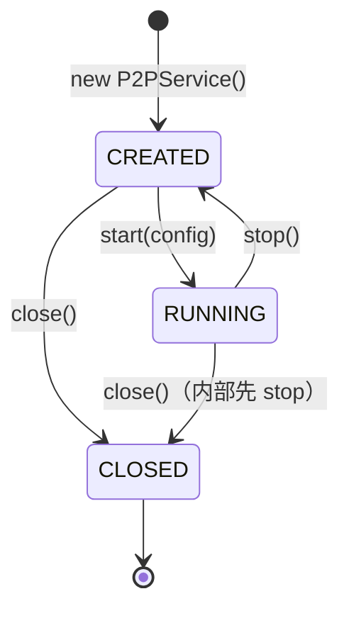

# NetProxy Android Java SDK 方案（v2）

> 状态：代码与本文一致。native 契约未变（无需重编 `.so`）；AAR 构建、仪器测试待 Android SDK 与设备。

## 1. 目标与范围

- 对外交付**本地 AAR 文件**：`com.open.netproxy` 包下的 Java API + 预编译 `libnetproxy.so`。
- 公开命名族统一为 `P2PService`，与 C++ 侧 `netproxy::P2PService` 对应。
- JNI 绑定类包私有，外部代码无法引用；公开面只有 6 个类型。
- 测试策略：**真机仪器测试**（`androidTest`），不做 JVM 假实现。
- 不在范围内：Kotlin 封装、Maven 发布、C++ API 对外。

## 2. 本轮架构调整

| 项 | v1 | v2 | 原因 |
| --- | --- | --- | --- |
| 测试接缝 | `NativeBridge` 接口 + JVM 假实现 | **移除**，`P2PService` 直接持有 `P2PServiceNative` | 17 条纯样板只为在 JVM 里注入；测试改为真机后无收益 |
| 公开类名 | `NetProxy` / `NetProxyConfig` / `NetProxyListener` | `P2PService` / `P2PServiceConfig` / `P2PServiceListener` | 与 C++ 术语一致，命名族自洽 |
| 内部回调 | 拟新增顶层 `NativeCallback` | 不新增，保留 `P2PServiceNative.Listener`（嵌套） | 避免出现两个 `Listener` 顶层类型；业务语义由适配器转换 |

代价（明确接受）：`P2PService` 的状态机、数据解包、参数校验无法再用 JVM 单测覆盖，回归必须上真机；接口层消失后，实现替换只能改类本身。

未采用的备选：让 JNI 直接调用 `P2PServiceListener`（回调参数退化为 `int event`、不再提供 `PeerInfo` 对象），可去掉适配器，但公开 API 变粗糙，且需要改 descriptor。当前方案保留业务语义回调。

## 3. 包与文件

```
sdk/android/src/main/java/com/open/netproxy/
├── package-info.java          公开包说明
├── P2PService.java            公开入口，AutoCloseable
├── P2PServiceConfig.java      公开配置 + Builder
├── P2PServiceListener.java    公开回调（业务语义，default 空实现）
├── PeerInfo.java              公开数据模型
├── StreamInfo.java            公开数据模型
├── StreamEvent.java           公开枚举，序号对齐 C++
├── P2PServiceNative.java      包私有，17 个 native + 嵌套 Listener
├── CallbackAdapter.java       包私有，native 回调 → 公开回调
└── NativeLoader.java          包私有，loadLibrary 幂等
```

| 可见性 | 类型 |
| --- | --- |
| `public` | `P2PService`、`P2PServiceConfig`、`P2PServiceListener`、`PeerInfo`、`StreamInfo`、`StreamEvent` |
| 包私有 | `P2PServiceNative`、`P2PServiceNative$Listener`、`CallbackAdapter`、`NativeLoader` |

## 4. 公开 API

### 4.1 类关系

```mermaid
classDiagram
    direction LR

    class P2PService {
        +P2PService(P2PServiceListener)
        +start(P2PServiceConfig) boolean
        +stop() void
        +isRunning() boolean
        +nodeId() int
        +dataPort() int
        +peers() List~PeerInfo~
        +streams() List~StreamInfo~
        +connect(int) boolean
        +isConnected(int) boolean
        +openStream(int) int
        +closeStream(int) boolean
        +sendData(int, byte[]) boolean
        +isStreamOpen(int) boolean
        +setListener(P2PServiceListener) void
        +close() void
    }

    class P2PServiceNative {
        <<package-private>>
    }
    class CallbackAdapter {
        <<package-private>>
    }
    class P2PServiceListener {
        <<interface>>
    }

    P2PService --> P2PServiceNative : 直接调用
    P2PService --> CallbackAdapter : 安装监听
    CallbackAdapter ..|> P2PServiceListener
    CallbackAdapter ..|> P2PServiceNative$Listener
```

### 4.2 生命周期



| 状态 | 判据 | 允许操作 |
| --- | --- | --- |
| `CREATED` | `handle != 0` 且未 start | `start` / `setListener` / 查询（返回空） / `close` |
| `RUNNING` | `isRunning() == true` | 除 `close` 外全部 |
| `CLOSED` | `handle == 0` | 仅 `close()`（幂等）与 `isRunning()`（返回 false），其余抛 `IllegalStateException` |

### 4.3 方法约定

| 方法 | 线程 | 异常 | 说明 |
| --- | --- | --- | --- |
| `P2PService(P2PServiceListener)` | 任意 | `UnsatisfiedLinkError`、`IllegalStateException` | 构造即加载 `.so` 并创建句柄 |
| `start(P2PServiceConfig)` | 任意 | `NullPointerException`、`IllegalStateException` | 幂等；启动前安装监听器与日志配置 |
| `stop()` | **不可主线程** | `IllegalStateException` | 阻塞等待 native 线程退出，幂等 |
| `close()` | **不可主线程** | 无 | `stop` + 释放句柄，幂等 |
| `isRunning()` | 任意 | 无 | 已关闭返回 `false` |
| `nodeId()` / `dataPort()` | 任意 | `IllegalStateException` | `nodeId` 按无符号 32 位解释 |
| `peers()` / `streams()` | 任意 | `IllegalStateException` | 返回不可变快照 |
| `connect` / `openStream` | 任意 | `IllegalStateException` | `openStream` 返回 0 表示失败 |
| `sendData` | 任意 | `NullPointerException`、`IllegalArgumentException`、`IllegalStateException` | 空数组或超过 `MAX_PAYLOAD_SIZE` 直接拒绝 |
| `setListener` | 任意 | `IllegalStateException` | 传 `null` 取消回调 |
| 回调方法 | native 业务线程 | — | 禁止阻塞、禁止调用 `stop`/`close` |

### 4.4 配置映射

| `P2PServiceConfig.Builder` | 默认值 | 对应 `P2PServiceConfig`（C++） |
| --- | --- | --- |
| `setNodeId(int)` | `0`（随机） | `nodeId` |
| `setDataPort(int)` | `0`（系统分配） | `dataPort` |
| `setBindAddress(String)` | `""`（0.0.0.0） | `dataBindAddress` |
| `setMulticastGroup(String)` | `"239.255.42.99"` | `multicastGroup` |
| `setMulticastPort(int)` | `45454` | `multicastPort` |
| `setLogcatEnabled(boolean)` | `true` | 通过 `nativeSetLogcatEnabled` 影响 `Log` 输出 |

`build()` 校验：数据端口 `0..65535`，组播端口 `1..65535`，组播组非空。其余 C++ 字段暂不开放。

### 4.5 回调与数据

```java
public interface P2PServiceListener {
    default void onPeer(PeerInfo peer) {}
    default void onStreamEvent(int streamId, int peerNodeId, StreamEvent event, int reason) {}
    default void onData(int streamId, int peerNodeId, byte[] data) {}
}
```

- `StreamEvent` 顺序必须与 C++ 一致：`OPENED=0`、`REJECTED=1`、`CLOSED=2`；未知码按 `REJECTED` 兜底并打印告警。
- `onData` 的 `byte[]` 由 native 拷贝，回调返回后可安全持有。
- `PeerInfo.host` 由 32 位 IPv4 值转点分十进制。
- 数据模型使用 JavaBean 访问器：`getNodeId()` / `getHost()` / `getPort()`，`getStreamId()` / `getPeerNodeId()` / `isOpen()`。

## 5. 内部实现

### 5.1 `P2PServiceNative`

- 类私有构造，`static { NativeLoader.load(); }`，17 个 `private static native`。
- 方法签名以 `long handle` 为首参，与 C++ 句柄表一一对应；无效句柄由 C++ 抛 `IllegalStateException`。
- 嵌套 `Listener` 是 JNI 原始回调接口，签名固定为 `(ILjava/lang/String;I)V`、`(IIII)V`、`(II[B)V`。

### 5.2 `CallbackAdapter`

- 实现 `P2PServiceNative.Listener`，持有 `P2PServiceListener`（可空）。
- 事件码 → `StreamEvent`；`onData` 空数组兜底；用户 `RuntimeException` 捕获后 `printStackTrace()`。

### 5.3 句柄与释放

- `P2PService` 持有 `volatile long handle`，`0` 表示已关闭。
- `close()`：`handle = 0` → 清空 native 监听 → `stop()` → `destroy()`（`stop` 抛异常也执行 `destroy`）。
- `close()` 与业务方法并发时，业务方法因句柄失效抛 `IllegalStateException`，不会访问已释放对象。

### 5.4 `NativeLoader`

`static synchronized load()`，`System.loadLibrary("netproxy")` 只执行一次；不捕获 `UnsatisfiedLinkError`，让错误在构造处暴露。

## 6. JNI 契约（本轮未变）

### 6.1 常量单源

```cpp
// jni/JniContract.h
inline constexpr char SERVICE_CLASS_NAME[] = "com/open/netproxy/P2PServiceNative";
inline constexpr char LISTENER_CLASS_NAME[] = "com/open/netproxy/P2PServiceNative$Listener";
inline constexpr char SET_LISTENER_SIGNATURE[] = "(JLcom/open/netproxy/P2PServiceNative$Listener;)V";
```

`nativeSetListener` 的 descriptor 直接引用 `SET_LISTENER_SIGNATURE`，改包名只需改头文件。

### 6.2 descriptor 全表

| native 方法 | Java 声明 | descriptor |
| --- | --- | --- |
| `nativeCreate` | `long nativeCreate()` | `()J` |
| `nativeDestroy` | `void nativeDestroy(long)` | `(J)V` |
| `nativeStart` | `boolean nativeStart(long,int,int,String,String,int)` | `(JIILjava/lang/String;Ljava/lang/String;I)Z` |
| `nativeStop` | `void nativeStop(long)` | `(J)V` |
| `nativeIsRunning` | `boolean nativeIsRunning(long)` | `(J)Z` |
| `nativeNodeId` | `int nativeNodeId(long)` | `(J)I` |
| `nativeDataPort` | `int nativeDataPort(long)` | `(J)I` |
| `nativePeers` | `long[] nativePeers(long)` | `(J)[J` |
| `nativeStreams` | `long[] nativeStreams(long)` | `(J)[J` |
| `nativeConnect` | `boolean nativeConnect(long,int)` | `(JI)Z` |
| `nativeIsConnected` | `boolean nativeIsConnected(long,int)` | `(JI)Z` |
| `nativeOpenStream` | `int nativeOpenStream(long,int)` | `(JI)I` |
| `nativeCloseStream` | `boolean nativeCloseStream(long,int)` | `(JI)Z` |
| `nativeSendData` | `boolean nativeSendData(long,int,byte[])` | `(JI[B)Z` |
| `nativeIsStreamOpen` | `boolean nativeIsStreamOpen(long,int)` | `(JI)Z` |
| `nativeSetListener` | `void nativeSetListener(long, Listener)` | `(JLcom/open/netproxy/P2PServiceNative$Listener;)V` |
| `nativeSetLogcatEnabled` | `void nativeSetLogcatEnabled(long, boolean)` | `(JZ)V` |

### 6.3 失败语义

- `FindClass` 失败或 descriptor 失配 → `JNI_OnLoad` 返回 `JNI_ERR` → `System.loadLibrary` 抛 `UnsatisfiedLinkError`。
- 类名、descriptor、R8 规则必须与 Java 源码同批发布。

## 7. 打包与混淆

```proguard
# consumer-rules.pro，随 AAR 自动生效
-keep class com.open.netproxy.P2PServiceNative { native <methods>; }
-keep interface com.open.netproxy.P2PServiceNative$Listener { *; }
```

- AAR 内 `jni/<abi>/libnetproxy.so` 与 `libc++_shared.so`；`abiFilters` 固定 `arm64-v8a` + `armeabi-v7a`。
- `libnetproxy.so` 已 16 KB 页对齐，满足 Play 对 targetSdk 35+ 的要求。
- 本地交付：`sdk/android/build/outputs/aar/netproxy-android-sdk-release.aar`，不接 Maven。
- module 声明 `INTERNET` 与 `CHANGE_WIFI_MULTICAST_STATE`，组播锁由宿主获取。
- 已验证的构建环境：SDK `/opt/android/sdk`（platform-tools 37.0.1、`platforms;android-35` rev2、build-tools 35.0.0）、Gradle `/opt/gradle/gradle-8.9`（显式版本路径，无软链）、JDK 21。
- **ABI 与 NDK sysroot 目录名不同**：`arm64-v8a` → `aarch64-linux-android`，`armeabi-v7a` → `arm-linux-androideabi`；直接用 ABI 名拼路径会找不到 `libc++_shared.so`。
- 打包前先 `llvm-strip --strip-unneeded`：`libnetproxy.so` 由 5.1 MB / 4.6 MB 降至 323 KB / 206 KB，AAR 由 3.5 MB 降至 **1.1 MB**。
- 实测 AAR 内容：`classes.jar`、`AndroidManifest.xml`（minSdk 21 + 两个权限）、`proguard.txt`、`R.txt`、`jni/arm64-v8a/*`、`jni/armeabi-v7a/*`；`arm64` 库为 ELF64/AArch64、SONAME `libnetproxy.so`、`NEEDED liblog.so`、LOAD 对齐 `0x4000`。
- wrapper 已生成（`gradlew`、`gradlew.bat`、`gradle/wrapper/`）；其 `distributionUrl` 指向 `services.gradle.org`，该域名重定向到 GitHub，本机网络不可达，因此本机用系统 `gradle`，或把 `distributionUrl` 换成镜像。`jniLibs/` 与 `local.properties` 已加入 `.gitignore`。

## 8. 兼容与版本

- `P2PServiceNative` 的类名、方法名、descriptor 视为 ABI，发布后不可改名。
- 新增配置项：新增带完整参数的方法并保留旧方法转调。
- 公开 API 二进制兼容建议用 `japicmp` 在 CI 检查。

## 9. 验证结果与待办

| 项 | 结果 |
| --- | --- |
| Java 编译 | `javac --release 8` 通过（仅 JDK 的 source 8 过时提示） |
| native 签名 | `javap` 与 C++ 注册表 **17/17 一致** |
| 公开面 | 6 个 public 类型；`P2PServiceNative`/`CallbackAdapter`/`NativeLoader` 均无 `public` |
| native 产物 | 未变，无需重编；三个 ABI 的 `.so` 仍为 `com/open/netproxy/P2PServiceNative` |
| AAR 构建 | 通过：`netproxy-android-sdk-release.aar` **1.1 MB** |
| AAR 内容 | `classes.jar`（15 项）、manifest（minSdk 21 + 2 权限）、`proguard.txt`、两个 ABI 的 `.so` |
| `.so` 校验 | ELF64/AArch64、SONAME 正确、`NEEDED liblog.so`、LOAD 对齐 `0x4000` |
| 仪器测试 | 待真机：`loadLibrary`、`start`、`onPeer`/`onData`、`close` 幂等 |
| R8 | 待消费方 App 启用 minify 后检查 `mapping.txt` |

## 10. 实施状态

1. ✅ native 侧包名与常量单源。
2. ✅ Java 骨架（10 个文件）与 Gradle 模块。
3. ✅ 公开类重命名为 `P2PService` 家族，移除 `NativeBridge`。
4. ✅ AAR 组装（`gradle assembleRelease`，1.1 MB）。
5. ⏳ 仪器测试用例（`androidTest`）：覆盖 start/stop 幂等、peers/streams 解包、回调线程、关闭后异常。
6. ⏳ 真机冒烟与 R8 校验。

## 11. 风险

| 风险 | 影响 | 处理 |
| --- | --- | --- |
| 无 JVM 测试接缝 | 状态机与解包逻辑只能靠真机回归 | 仪器测试覆盖关键路径；必要时再引入内部接缝，但不进公开 API |
| 包名/类名再变 | 类名、descriptor、R8 三处联动 | 已收敛为 `JniContract.h` 单源 |
| 包私有类可被反射 | 无法绝对隐藏 | 定位为“不鼓励使用”，非安全边界 |
| 只开放 6 个配置项 | 高级参数不可调 | 后续新增重载方法 |
| `MAX_PAYLOAD_SIZE` 硬编码 1400 | C++ 默认值变化后不一致 | 常量集中，改动时同步 |
| 回调异常被吞 | 用户难定位 | 适配器打印堆栈；后续可加错误回调 |
