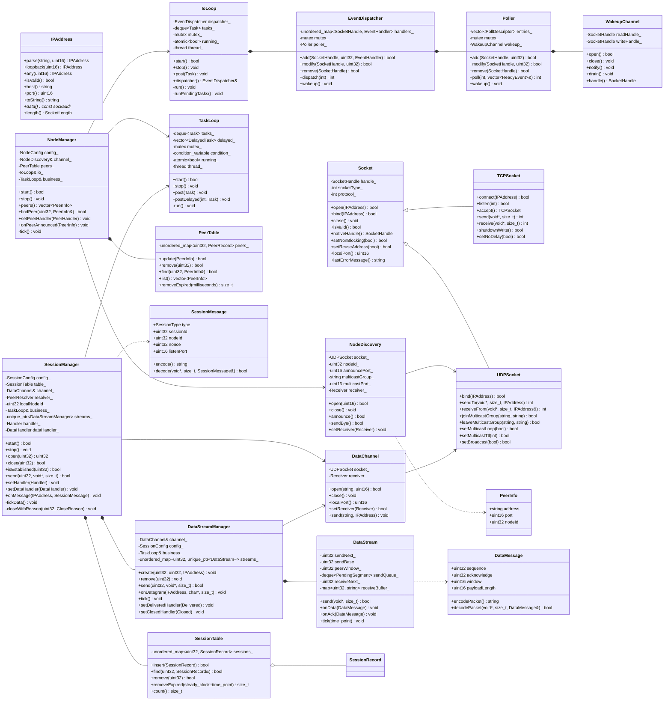

# NetProxy 架构设计

## 1. 目标

- 单进程、双线程：一个 I/O 线程处理所有 socket，一个业务线程处理状态与逻辑。
- 节点通过 UDP 组播发现彼此，发现结果保存在节点表中。
- 会话建立在数据端口上，每对节点之间可有多个会话，用 `sessionId` 区分。
- 线程之间只通过消息投递通信，socket 与业务状态各自单线程独占。

## 2. 线程模型

| 线程 | 职责 | 独占资源 |
| --- | --- | --- |
| I/O 线程 | `poll` 等待、`recvfrom` / `sendto`、`accept`、报文编解码 | 全部 socket、`EventDispatcher`、`Poller`、`WakeupChannel` |
| 业务线程 | 节点表维护、会话状态机、定时任务、应用回调 | `PeerTable`、`SessionTable`、定时器 |

两条规则：

1. **socket 只在 I/O 线程调用**，业务线程通过 `IoLoop::post()` 投递发送任务。
2. **业务状态只在业务线程读写**，I/O 线程解析出结构体后投递，不直接触碰。

## 3. 类图



## 4. 类接口

标注：**[已实现]** 与当前代码一致；**[设计]** 为本次方案新增。

### 4.1 net 模块 [已实现]

#### IPAddress

```cpp
class IPAddress final {
public:
    static IPAddress parse(const std::string& host, std::uint16_t port);
    static IPAddress loopback(std::uint16_t port);
    static IPAddress any(std::uint16_t port);
    static IPAddress fromSockaddr(const sockaddr* address, SocketLength length);

    bool isValid() const;
    int family() const;                 // AF_INET / AF_INET6 / AF_UNSPEC
    std::uint16_t port() const;
    std::string host() const;           // 127.0.0.1
    std::string toString() const;       // 127.0.0.1:80 或 [::1]:80
    const sockaddr* data() const;
    SocketLength length() const;
};
```

#### Socket

```cpp
class Socket {
public:
    Socket(Socket&& other) noexcept;
    Socket& operator=(Socket&& other) noexcept;
    virtual ~Socket();

    bool isValid() const;
    SocketHandle nativeHandle() const;
    void close();

    int lastErrorCode() const;
    std::string lastErrorMessage() const;
    std::uint16_t localPort() const;

    bool setReuseAddress(bool enabled);
    bool setNonBlocking(bool enabled);

    bool open(const IPAddress& address);      // 创建但不绑定
    bool bind(const IPAddress& address);      // 未创建时按构造类型创建

protected:
    Socket(int socketType, int protocol);
    Socket(SocketHandle handle, int socketType, int protocol);
    int addressFamily() const;
};
```

#### TCPSocket

```cpp
class TCPSocket final : public Socket {
public:
    TCPSocket();
    bool connect(const IPAddress& address);
    bool listen(int backlog = 16);
    TCPSocket accept();

    int send(const void* data, std::size_t size);
    int send(const std::string& data);
    int receive(void* buffer, std::size_t size);
    std::string receive(std::size_t maxSize);
    bool shutdownWrite();
    bool setNoDelay(bool enabled);
};
```

#### UDPSocket

```cpp
class UDPSocket final : public Socket {
public:
    UDPSocket();
    bool bind(const IPAddress& address);
    bool setBroadcast(bool enabled);

    bool joinMulticastGroup(const std::string& group, const std::string& interfaceAddress = {});
    bool leaveMulticastGroup(const std::string& group, const std::string& interfaceAddress = {});
    bool setMulticastLoop(bool enabled);
    bool setMulticastTtl(int ttl);

    int sendTo(const void* data, std::size_t size, const IPAddress& address);
    int sendTo(const std::string& data, const IPAddress& address);
    int receiveFrom(void* buffer, std::size_t size, IPAddress& from);
};
```

#### Poller

```cpp
class Poller final {
public:
    enum Event : std::uint32_t { Read = 1, Write = 2, Error = 4 };

    struct ReadyEvent {
        SocketHandle handle;
        std::uint32_t events;
    };

    Poller();
    ~Poller();

    bool add(SocketHandle handle, std::uint32_t events);
    bool modify(SocketHandle handle, std::uint32_t events);
    bool remove(SocketHandle handle);
    bool contains(SocketHandle handle) const;
    std::size_t size() const;
    bool empty() const;
    void clear();
    void wakeup();

    int poll(int timeoutMs, std::vector<ReadyEvent>& readyEvents);
};
```

#### EventDispatcher

```cpp
class EventDispatcher final {
public:
    using EventHandler = std::function<void(SocketHandle, std::uint32_t)>;

    EventDispatcher();
    ~EventDispatcher();

    bool add(SocketHandle handle, std::uint32_t events, EventHandler handler);
    bool modify(SocketHandle handle, std::uint32_t events);
    bool remove(SocketHandle handle);
    bool contains(SocketHandle handle) const;
    std::size_t size() const;
    void clear();

    int dispatch(int timeoutMs);   // 触发回调数；0 超时/唤醒；-1 失败
    void wakeup();
};
```

#### WakeupChannel

```cpp
class WakeupChannel final {
public:
    bool open();
    void close();
    bool isOpen() const;
    SocketHandle handle() const;
    void notify();
    void drain();
};
```

### 4.2 core 模块 [设计]

#### IoLoop

I/O 线程的主循环，所有 socket 操作都发生在这个线程。

```cpp
class IoLoop final {
public:
    using Task = std::function<void()>;

    IoLoop();
    ~IoLoop();

    IoLoop(const IoLoop&) = delete;
    IoLoop& operator=(const IoLoop&) = delete;

    // 启动 I/O 线程，重复启动返回 false
    bool start();

    // 停止线程并 join；会关闭唤醒通道
    void stop();

    // 线程安全：入队任务并唤醒 poll
    void post(Task task);

    // 供 I/O 线程回调内注册 / 注销事件
    net::EventDispatcher& dispatcher();

    bool isRunning() const;

private:
    void run();
    void runPendingTasks();

    net::EventDispatcher dispatcher_;
    std::mutex mutex_;
    std::deque<Task> tasks_;
    std::atomic<bool> running_{false};
    std::thread thread_;
};
```

使用约束：

- `post()` 可在任意线程调用。
- 除 `post()` 与 `isRunning()` 外的方法只能在 I/O 线程或启动前调用。
- 循环体为 `dispatch(100)` + `runPendingTasks()`，`wakeup()` 让任务及时执行。

#### TaskLoop

业务线程的主循环，负责任务与定时器。

```cpp
class TaskLoop final {
public:
    using Task = std::function<void()>;

    TaskLoop();
    ~TaskLoop();

    TaskLoop(const TaskLoop&) = delete;
    TaskLoop& operator=(const TaskLoop&) = delete;

    bool start();
    void stop();

    // 线程安全：立即执行
    void post(Task task);

    // 线程安全：延迟执行，delayMs <= 0 视为立即
    void postDelayed(int delayMs, Task task);

    bool isRunning() const;

private:
    struct DelayedTask {
        std::chrono::steady_clock::time_point deadline;
        std::uint64_t sequence;
        Task task;
    };

    void run();
    void runPendingTasks(std::unique_lock<std::mutex>& lock);

    std::mutex mutex_;
    std::condition_variable condition_;
    std::deque<Task> tasks_;
    std::vector<DelayedTask> delayed_;
    std::atomic<bool> running_{false};
    std::thread thread_;
};
```

### 4.3 node 模块

node 模块分为三层：`NodeProtocol` / `NodeDiscovery` 负责协议与组播传输，`NodeManager` 只做节点表与定时，数据通道不属于本模块。

#### PeerInfo [已实现]

```cpp
struct PeerInfo {
    std::string address;      // 对端 IPv4 文本
    std::uint16_t port = 0;   // 对端数据端口
    std::uint32_t nodeId = 0;
};
```

#### NodeMessage [已实现]

编解码放在 `NodeProtocol.h/.cpp`，`NodeDiscovery` 只负责 socket 与回调，不包含报文格式。

```cpp
enum class NodeMessageType : std::uint8_t {
    Announce = 1,
    Bye = 2
};

class NodeMessage final {
public:
    static constexpr std::size_t SIZE = 16;   // 固定 16 字节，携带地址

    NodeMessageType type = NodeMessageType::Announce;
    net::IPAddress address;                   // 发送方可连接地址
    std::uint32_t nodeId = 0;
    std::uint16_t port = 0;

    std::string encode() const;
    static bool decode(const void* data, std::size_t size, NodeMessage& message);
};
```

#### NodeDiscovery [已实现]

报文格式、校验规则与示例见 [discovery-protocol.md](discovery-protocol.md)。

```cpp
class NodeDiscovery final {
public:
    // 收到公告后的回调，运行在 I/O 线程
    using Receiver = std::function<void(const PeerInfo& peer)>;

    static constexpr const char* DEFAULT_MULTICAST_GROUP = "239.255.42.99";
    static constexpr std::uint16_t DEFAULT_MULTICAST_PORT = 45454;

    NodeDiscovery(std::uint32_t nodeId, const std::string& group, std::uint16_t port);
    ~NodeDiscovery();

    // 绑定组播端口、加入组播组并注册读事件，需在 IoLoop 启动前调用
    bool open(std::uint16_t announcePort);
    void close();
    bool isOpen() const;

    // 任意线程调用，发送经 I/O 线程执行
    bool announce();
    bool sendBye();

    // 设置解析后的公告回调
    void setReceiver(Receiver receiver);
};
```

`NodeDiscovery` 是组播公告通道，只处理本网段的 Announce / Bye，不用于点对点通信。

#### PeerTable [已实现，改造为业务线程独占]

```cpp
class PeerTable final {
public:
    bool update(const PeerInfo& peer);       // 新节点返回 true
    bool remove(std::uint32_t nodeId);
    bool contains(std::uint32_t nodeId) const;
    bool find(std::uint32_t nodeId, PeerInfo& peer) const;

    std::vector<PeerInfo> list() const;
    std::size_t removeExpired(std::chrono::milliseconds timeout);
    std::size_t size() const;
    void clear();
};
```

新架构下移除内部 `mutex_`，改由业务线程独占访问。

#### NodeConfig [设计]

```cpp
struct NodeConfig {
    std::uint32_t nodeId = 0;

    // 发现通道
    std::string multicastGroup = "239.255.42.99";
    std::uint16_t multicastPort = 45454;
    int announceIntervalMs = 3000;
    int peerTimeoutMs = 10000;
};
```

数据通道配置（`dataBindAddress`、`dataPort`）归 `P2PServiceConfig`，不再由节点管理器持有。

#### NodeManager [已实现]

只跑在业务线程；socket 的创建与注册通过 `IoLoop` 完成。

```cpp
class NodeManager final {
public:
    // 发现新节点时的回调，运行在业务线程
    using PeerHandler = std::function<void(const PeerInfo& peer)>;

    // channel 生命周期由调用方保证；nodeId 用于过滤自身公告
    NodeManager(NodeDiscovery& channel, std::uint32_t nodeId, const NodeConfig& config,
                IoLoop& io, TaskLoop& business);
    ~NodeManager();

    NodeManager(const NodeManager&) = delete;
    NodeManager& operator=(const NodeManager&) = delete;

    // 设置发现通道回调并安排定时任务，须在 IoLoop / TaskLoop 启动前调用
    bool start();
    void stop();

    std::uint32_t nodeId() const;

    // 业务线程查询
    std::vector<PeerInfo> peers() const;
    bool findPeer(std::uint32_t nodeId, PeerInfo& peer) const;

    // 新节点回调
    void setPeerHandler(PeerHandler handler);

    // I/O 线程收到公告后投递到业务线程调用
    void onPeerAnnounced(const PeerInfo& peer);

private:
    void tick();                             // 公告与淘汰，业务线程

    NodeConfig config_;
    NodeDiscovery& channel_;
    PeerTable peers_;
    IoLoop& io_;
    TaskLoop& business_;
    bool started_ = false;
};
```

`NodeManager` 不再创建或持有任何 socket：收到公告由 `NodeDiscovery` 回调推入，发送公告通过 `IoLoop::post` 调用 `channel_.announce()`。

### 4.4 session 模块 [设计]

#### DataChannel

`DataChannel` 定义在 `src/session/DataChannel.h`，负责数据 UDP socket 的生命周期、读事件注册与发送投递，不解析报文。

```cpp
class DataChannel final {
public:
    using Receiver = std::function<void(const net::IPAddress& from, const char* data, std::size_t size)>;

    explicit DataChannel(IoLoop& io);
    ~DataChannel();

    bool open(const std::string& bindAddress, std::uint16_t port);
    void close();
    bool isOpen() const;

    std::uint16_t localPort() const;

    bool setReceiver(Receiver receiver);   // 注册读事件，需在 IoLoop 启动前调用
    void send(const std::string& packet, const net::IPAddress& target);

private:
    void handleReadable();

    IoLoop& io_;
    net::UDPSocket socket_;
    Receiver receiver_;
    bool registered_ = false;
};
```

#### SessionMessage

报文逐字段说明、校验规则与示例见 [session-protocol.md](session-protocol.md)。

```cpp
enum class SessionType : std::uint8_t {
    Open = 1,
    Accept = 2,
    Reject = 3,
    Close = 4,
    Ping = 5,
    Data = 6,
    Ack = 7
};

struct SessionMessage {
    static constexpr std::size_t HEADER_SIZE = 16;

    SessionType type = SessionType::Open;
    std::uint16_t flags = 0;       // Ping 用 SESSION_FLAG_RESPONSE 区分请求与响应
    std::uint32_t nodeId = 0;      // 发送方节点标识，每条报文都带
    std::uint32_t sessionId = 0;
    std::uint32_t nonce = 0;
    std::uint16_t listenPort = 0;
    std::uint8_t reason = 0;

    std::string encode() const;
    static bool decode(const void* data, std::size_t size, SessionMessage& message);
};

// 数据报文在通用头之后扩展序号与确认字段，不与信令共用结构体
struct SessionDataMessage {
    static constexpr std::size_t HEADER_SIZE = 28;

    SessionType type = SessionType::Data;   // Data / Ack
    std::uint32_t nodeId = 0;
    std::uint32_t sessionId = 0;
    std::uint32_t sequence = 0;
    std::uint32_t acknowledge = 0;
    std::uint16_t window = 0;
    std::uint16_t payloadLength = 0;

    std::string encode() const;
    static bool decode(const void* data, std::size_t size, SessionDataMessage& message);
};
```

报文布局：

| 偏移 | 长度 | 字段 | 说明 |
| --- | --- | --- | --- |
| 0 | 4 | magic `NPSN` | |
| 4 | 1 | version | 当前为 1 |
| 5 | 1 | type | 1~7 |
| 6 | 2 | flags | 保留 |
| 8 | 4 | nodeId | 发送方节点标识，每条报文都带 |
| 12 | 4 | sessionId | 会话标识 |
| 16 | — | 类型负载 | 见下 |

类型负载：

| 类型 | 偏移 16 起 |
| --- | --- |
| Open | `listenPort(2) + reserved(2) + nonce(4)`，共 24 字节 |
| Accept | `nonce(4)`，共 20 字节 |
| Reject / Close | `reason(1) + reserved(3)`，共 20 字节 |
| Ping | 无，共 16 字节 |
| Data / Ack | 见 [session-protocol.md](session-protocol.md) |

#### SessionState / SessionRecord

```cpp
enum class SessionState : std::uint8_t {
    Opening = 1,
    Established = 2,
    Closing = 3,
    Closed = 4
};

struct SessionRecord {
    std::uint32_t sessionId = 0;
    std::uint32_t peerNodeId = 0;
    net::IPAddress peerAddress;
    SessionState state = SessionState::Opening;
    std::uint32_t nonce = 0;
    int retryCount = 0;
    std::chrono::steady_clock::time_point deadline;
};
```

#### SessionConfig

```cpp
struct SessionConfig {
    std::size_t maxSessions = 64;
    std::size_t maxSessionsPerPeer = 8;
    int openRetryIntervalMs = 1000;
    int openRetryCount = 5;
    int closeTimeoutMs = 2000;

    // 保活：空闲到达 interval 后发 Ping，每次等 timeout，连续失败 retryCount 次判定断链
    int keepaliveIntervalMs = 30000;
    int keepaliveTimeoutMs = 10000;
    int keepaliveRetryCount = 3;
    int keepaliveTickMs = 1000;
};
```

#### SessionTable

```cpp
class SessionTable final {
public:
    bool insert(const SessionRecord& record);
    bool find(std::uint32_t sessionId, SessionRecord& record) const;
    bool remove(std::uint32_t sessionId);
    std::size_t count() const;
    std::size_t countForPeer(std::uint32_t peerNodeId) const;
    std::size_t removeExpired(std::chrono::steady_clock::time_point now);
};
```

业务线程独占，不加锁。

#### SessionManager

```cpp
class SessionManager final {
public:
    enum class Event {
        Opened,
        Rejected,
        Closed
    };

    using Handler = std::function<void(std::uint32_t sessionId, std::uint32_t peerNodeId, Event event)>;

    // 查询对端地址，返回 false 表示节点未知
    using PeerResolver = std::function<bool(std::uint32_t nodeId, PeerInfo& peer)>;

    SessionManager(DataChannel& channel, PeerResolver resolver, std::uint32_t localNodeId,
                   const SessionConfig& config, TaskLoop& business);
    ~SessionManager();

    SessionManager(const SessionManager&) = delete;
    SessionManager& operator=(const SessionManager&) = delete;

    // 设置数据通道回调；需在 IoLoop 启动前调用
    bool start();
    void stop();

    // 任意线程调用：立即分配并返回会话标识，握手在业务线程异步进行
    // 返回 0 只表示模块未启动或参数非法；对端未知、超限、拒绝都走 Rejected 回调
    std::uint32_t open(std::uint32_t peerNodeId);

    bool close(std::uint32_t sessionId);
    bool isEstablished(std::uint32_t sessionId) const;

    // 提交一条数据，长度不超过 maxPayloadSize；只投递到对应 DataStream
    bool send(std::uint32_t sessionId, const void* data, std::size_t size);

    void setHandler(Handler handler);

    // 设置数据交付回调，运行在业务线程
    void setDataHandler(DataHandler handler);

    // I/O 线程读到数据报文后投递；信令报文走 onMessage
    void onDatagram(const net::IPAddress& from, const char* data, std::size_t size);
    void onMessage(const net::IPAddress& from, const SessionMessage& message);

private:
    void handleIncoming();                   // I/O 线程回调，读取并投递
    void sendMessage(const SessionMessage& message, const net::IPAddress& target);
    void scheduleRetry(std::uint32_t sessionId);
    void handleOpen(const net::IPAddress& from, const SessionMessage& message);
    void handleAccept(const net::IPAddress& from, const SessionMessage& message);
    void handleReject(const SessionMessage& message);
    void handleClose(const SessionMessage& message);
    void tickData();                         // 重传检查，业务线程
    void closeWithReason(std::uint32_t sessionId, CloseReason reason);

    SessionConfig config_;
    SessionTable table_;
    DataChannel& channel_;
    PeerResolver resolver_;
    std::uint32_t localNodeId_ = 0;
    TaskLoop& business_;
    std::unique_ptr<transport::DataStreamManager> streams_;
    Handler handler_;
    DataHandler dataHandler_;
};
```

`SessionManager` 持有 `DataChannel`（信令与数据共用），只通过 `PeerResolver` 查询对端地址；数据报文交给 `DataStreamManager`，自身不处理序号、窗口与重传。

### 4.5 transport 模块 [设计]

负责数据报文与可靠传输，不持有 socket，不依赖 session。报文格式、类接口与可靠性流程见 [transport-protocol.md](transport-protocol.md)。

| 类 | 职责 | 关键接口 |
| --- | --- | --- |
| `DataMessage` | Data / Ack 编解码 | `encodePacket()` / `decodePacket()` |
| `DataStream` | 单会话序号、窗口、重传、按序交付 | `send` / `onData` / `onAck` / `tick` |
| `DataStreamManager` | 按 `sessionId` 管理 `DataStream` | `create` / `remove` / `send` / `onDatagram` / `tick` |

`DataStreamManager` 由 `SessionManager` 持有：会话 `Established` 时 `create`，`Closed` 时 `remove`；`DataStream` 重传耗尽时通过 `Closed` 回调触发 `SessionManager::closeWithReason`。

### 4.6 应用层组装

对外只暴露 `P2PService`，内部按依赖顺序组装：

```cpp
class P2PService {
    struct Impl {
        IoLoop io;
        TaskLoop business;

        std::unique_ptr<DataChannel> channel;
        std::unique_ptr<NodeDiscovery> discovery;
        std::unique_ptr<NodeManager> node;
        std::unique_ptr<SessionManager> sessions;
    };
};
```

`NodeManager` 的 `PeerResolver` 由 `P2PService` 提供，内部转调 `node->findPeer()`。

## 5. 线程间数据流

### 5.1 节点发现

```
I/O 线程                                     业务线程
NodeDiscovery 收到公告并解析
  receiver(peer)
  io → business.post(peer)
                                   ─────>  node.onPeerAnnounced(peer)
                                            peers.update(peer) / 日志 / 回调
                                            │
                                    公告定时器到期
                                            │
  channel.announce()               <──────  io.post(announce)
```

### 5.2 会话建立

```
业务线程                                      I/O 线程
sessions.open(nodeId)
  ├─ resolver 查询对端地址
  ├─ 生成 sessionId / nonce
  ├─ table.insert(Opening)
  ├─ channel.send(Open)          ─────>  dataSocket.sendTo(Open)
  └─ business.postDelayed(重传)
数据 socket 可读  <──────────────────────────
  channel receiver 解析后投递  ─────>  业务线程 onMessage
  ├─ 校验 nonce
  ├─ Opening → Established
  └─ handler(sessionId, Opened)
```

### 5.3 会话关闭

```
业务线程：close(sessionId)
  ├─ 状态置 Closing
  ├─ io.post(send Close)
  └─ business.postDelayed(closeTimeout)
对端收到 Close → 删除会话 → handler(Closed)
本端超时 → 删除会话 → handler(Closed)
```

### 5.4 数据传输

```
业务线程                                      I/O 线程
sendData(sessionId, data)
  ├─ 查 streams_ 得到 DataStream
  ├─ 校验长度、窗口，分配 sequence
  ├─ 入 sendQueue，构造 Data 报文
  └─ channel.send ─────────────────────>  dataSocket.sendTo(Data)

数据 socket 可读  <──────────────────────────
  SessionManager 只读 type（6 / 7）
  business.post(packet)  ─────>  DataStreamManager.onDatagram
                                  ├─ 按序交付 DataHandler
                                  └─ 回 Ack
```

- 数据报文与信令共用数据 socket，靠 `type` 分流
- 可靠性状态（序号、窗口、重传）全部在 `DataStream` 内，业务线程独占
- 发送走 `DataChannel::send`，内部 `io.post` 回到 I/O 线程

## 6. 启动与停止顺序

启动：

```
1. IoLoop 构造（唤醒通道就绪）
2. DataChannel 构造并 open()，绑定数据端口并回填真实端口
3. NodeDiscovery 构造并 open(dataPort)，绑定组播、注册读事件
4. NodeManager 构造（注入 NodeDiscovery），start() 设置 receiver 与定时
5. SessionManager 构造（注入 DataChannel + PeerResolver），start()
6. io.start()
7. business.start()
```

停止：

```
1. business.stop()       // 停止业务线程，等待队列排空
2. io.stop()             // 停止 I/O 线程
3. sessions.stop()       // 注销数据通道回调，清空会话表
4. node.stop()           // 取消定时任务
5. 关闭 DataChannel / NodeDiscovery
```

先停业务线程，避免它继续 post 发送任务；socket 的关闭放在两个线程退出之后，保证没有并发使用者。

## 7. 错误处理

| 场景 | 处理 |
| --- | --- |
| 数据 socket 绑定失败 | `P2PService::start()` 返回 false，不公告 |
| 组播加入失败 | 回滚数据通道，`start()` 返回 false |
| 会话数超限 | 返回 0，向对端发 Reject（reason=1） |
| 对端无响应 | 重传耗尽，`handler(Rejected)` |
| 收到未知 sessionId 的 Accept | 丢弃并记录 Warning |
| I/O 线程 poll 失败 | 记录 Error，退出循环，由应用决定是否重启 |

所有失败路径使用 `Log::warning` / `Log::error`，关键正常路径使用 `Log::debug`。

## 8. 后续扩展

| 方向 | 说明 |
| --- | --- |
| 多 Reactor | `IoLoop` 内部支持多个 `EventDispatcher`，按 fd 取模分片 |
| 工作线程池 | 业务线程拆成多个，按 `nodeId` 或 `sessionId` 分片，避免状态锁 |
| 会话数据通道 | 在 `SessionMessage` 增加 `Data` 类型与序号，补可靠传输 |
| TCP 业务连接 | 复用 `TCPSocket`，在 I/O 线程 accept 后投递业务线程建立对象 |
| 加密认证 | 在 `Open` 中增加 token 字段，握手阶段校验 |
