# NetProxy 架构设计

## 1. 目标

- 单进程、双线程：一个 I/O 线程处理所有 socket，一个业务线程处理状态与逻辑。
- 节点通过 UDP 组播发现彼此，发现结果保存在节点表中。
- 连接建立在数据端口上，每对节点一条连接；连接上可开多条流，用 `streamId` 区分。
- 线程之间只通过消息投递通信，socket 与业务状态各自单线程独占。

### 1.1 术语

| 术语 | 定义 | 适用范围 |
| --- | --- | --- |
| Node | 网络中的实体，**包括本机** | 协议字段、发现、`nodeId` |
| Peer | 从本机视角看的**对端**节点（`nodeId != localNodeId`） | 连接、会话、流、对端表、回调 |
| Local | 本机 | `localNodeId`、`localPort` |

口诀：**带「标识 / 报文 / 发现」的用 Node，带「连接 / 会话 / 流 / 表 / 回调」的用 Peer。**

参数命名：

| 名字 | 含义 | 用在哪 |
| --- | --- | --- |
| `nodeId` | 任意节点的标识，可能是自己 | 协议字段、`PeerInfo::nodeId`、表键 |
| `localNodeId` | 本机标识 | 帧头、公告 |
| `peerNodeId` | 明确指向对端 | `connect` / `openStream` / 会话与流 API |

规则：同一函数签名内不得用 `nodeId` 与 `peerNodeId` 表示同一个值；不新增 `peerId`、`remoteNodeId`。

## 2. 线程模型

| 线程 | 职责 | 独占资源 |
| --- | --- | --- |
| I/O 线程 | `poll` 等待、`recvfrom` / `sendto`、`accept`、报文编解码 | 全部 socket、`EventDispatcher`、`Poller`、`WakeupChannel` |
| 业务线程 | 节点表维护、连接与流状态机、定时任务、应用回调 | `PeerTable`、连接表、定时器 |

两条规则：

1. **socket 只在 I/O 线程调用**，业务线程通过 `IoLoop::post()` 投递发送任务。
2. **业务状态只在业务线程读写**，I/O 线程解析出结构体后投递，不直接触碰。

## 3. 类图

```mermaid
classDiagram
    direction LR

    class IoLoop {
        -EventDispatcher dispatcher_
        -deque~Task~ tasks_
        -mutex mutex_
        -atomic~bool~ running_
        -thread thread_
        +start() bool
        +stop() void
        +post(Task) void
        +dispatcher() EventDispatcher&
        -run() void
        -runPendingTasks() void
    }

    class TaskLoop {
        -deque~Task~ tasks_
        -vector~DelayedTask~ delayed_
        -mutex mutex_
        -condition_variable condition_
        -atomic~bool~ running_
        -thread thread_
        +start() bool
        +stop() void
        +post(Task) void
        +postDelayed(int, Task) void
        -run() void
    }

    class EventDispatcher {
        -unordered_map~SocketHandle, EventHandler~ handlers_
        -mutex mutex_
        -Poller poller_
        +add(SocketHandle, uint32, EventHandler) bool
        +modify(SocketHandle, uint32) bool
        +remove(SocketHandle) bool
        +dispatch(int) int
        +wakeup() void
    }

    class Poller {
        -vector~PollDescriptor~ entries_
        -mutex mutex_
        -WakeupChannel wakeup_
        +add(SocketHandle, uint32) bool
        +modify(SocketHandle, uint32) bool
        +remove(SocketHandle) bool
        +poll(int, vector~ReadyEvent~&) int
        +wakeup() void
    }

    class WakeupChannel {
        -SocketHandle readHandle_
        -SocketHandle writeHandle_
        +open() bool
        +close() void
        +notify() void
        +drain() void
        +handle() SocketHandle
    }

    class Socket {
        -SocketHandle handle_
        -int socketType_
        -int protocol_
        +open(IPAddress) bool
        +bind(IPAddress) bool
        +close() void
        +isValid() bool
        +nativeHandle() SocketHandle
        +setNonBlocking(bool) bool
        +setReuseAddress(bool) bool
        +localPort() uint16
        +lastErrorMessage() string
    }

    class TCPSocket {
        +connect(IPAddress) bool
        +listen(int) bool
        +accept() TCPSocket
        +send(void*, size_t) int
        +receive(void*, size_t) int
        +shutdownWrite() bool
        +setNoDelay(bool) bool
    }

    class UDPSocket {
        +bind(IPAddress) bool
        +sendTo(void*, size_t, IPAddress) int
        +receiveFrom(void*, size_t, IPAddress&) int
        +joinMulticastGroup(string, string) bool
        +leaveMulticastGroup(string, string) bool
        +setMulticastLoop(bool) bool
        +setMulticastTtl(int) bool
        +setBroadcast(bool) bool
    }

    class IPAddress {
        +parse(string, uint16) IPAddress
        +loopback(uint16) IPAddress
        +any(uint16) IPAddress
        +isValid() bool
        +host() string
        +port() uint16
        +toString() string
        +data() const sockaddr*
        +length() SocketLength
    }

    class PeerInfo {
        +string address
        +uint16 port
        +uint32 nodeId
    }

    class NodeDiscovery {
        -UDPSocket socket_
        -uint32 nodeId_
        -uint16 announcePort_
        -string multicastGroup_
        -uint16 multicastPort_
        -Receiver receiver_
        +open(uint16) bool
        +close() void
        +announce() bool
        +sendBye() bool
        +setReceiver(Receiver) void
    }

    class DataChannel {
        -UDPSocket socket_
        -Receiver receiver_
        +open(string, uint16) bool
        +close() void
        +localPort() uint16
        +setReceiver(Receiver) bool
        +send(string, IPAddress) void
    }

    class PeerTable {
        -unordered_map~uint32, PeerRecord~ peers_
        +update(PeerInfo) bool
        +remove(uint32) bool
        +find(uint32, PeerInfo&) bool
        +list() vector~PeerInfo~
        +removeExpired(milliseconds) size_t
    }

    class PeerDirectory {
        -DiscoveryConfig config_
        -NodeDiscovery& channel_
        -PeerTable peers_
        -IoLoop& io_
        -TaskLoop& business_
        +start() bool
        +stop() void
        +peers() vector~PeerInfo~
        +findPeer(uint32, PeerInfo&) bool
        +setPeerHandler(PeerHandler) void
        +onPeerAnnounced(PeerInfo) void
        -tick() void
    }

    class PeerSessionManager {
        -DataChannel& channel_
        -uint32 localNodeId_
        -PeerConfig peerConfig_
        -StreamConfig streamConfig_
        -TaskLoop& business_
        -unordered_map~uint32, shared_ptr~PeerSession~~ sessions_
        -StreamHandler streamHandler_
        -DataHandler dataHandler_
        +start() bool
        +stop() void
        +connect(uint32, IPAddress) bool
        +openStream(uint32, IPAddress) uint32
        +closeStream(uint32) bool
        +sendData(uint32, void*, size_t) bool
        +isConnected(uint32) bool
        +isStreamOpen(uint32) bool
        +streams() vector~StreamRecord~
        +setStreamHandler(StreamHandler) void
        +setDataHandler(DataHandler) void
        -onDatagram(IPAddress, char*, size_t) void
        -tick() void
        -sessionForStream(uint32) shared_ptr~PeerSession~
    }

    class PeerSession {
        -PeerConnection connection_
        -StreamMux streams_
        -atomic~bool~ connected_
        +connect() bool
        +acceptHandshake() void
        +onFrame(PeerFrame) void
        +tick(time_point) void
        +openStream(uint32) bool
        +sendData(uint32, void*, size_t) bool
        +closeStream(uint32) bool
        +ownsStream(uint32) bool
        +isStreamOpen(uint32) bool
        +isConnected() bool
    }

    class PeerConnection {
        -uint32 peerNodeId_
        -uint32 localNodeId_
        -IPAddress peer_
        -PeerConfig config_
        -Sender sender_
        -HasStreams hasStreams_
        -ConnectionState state_
        -uint32 helloNonce_
        -int helloRetries_
        -uint32 sendNext_
        -uint32 sendBase_
        -uint32 peerWindow_
        -deque~PendingFrame~ sendQueue_
        -uint32 receiveNext_
        -map~uint32, PeerFrame~ receiveBuffer_
        -int pingMisses_
        +open() bool
        +close(uint8) void
        +send(PeerFrame) bool
        +onFrame(PeerFrame) void
        +onHelloAck(PeerFrame) void
        +tick(time_point) void
        +setFrameHandler(FrameHandler) void
        +setCloseHandler(CloseHandler) void
        +isConnected() bool
    }

    class StreamMux {
        -uint32 peerNodeId_
        -StreamConfig config_
        -FrameSender sender_
        -bool connected_
        -mutex mutex_
        -unordered_map~uint32, Stream~ streams_
        -deque~uint32~ pending_
        +onFrame(PeerFrame) void
        +onConnectionUp() void
        +onConnectionClosed(uint8) void
        +openStream(uint32) bool
        +sendData(uint32, void*, size_t) bool
        +closeStream(uint32) bool
        +hasStreams() bool
        +isStreamOpen(uint32) bool
        +ownsStream(uint32) bool
        +streams() vector~StreamRecord~
    }

    class Stream {
        -uint32 streamId_
        -uint32 peerNodeId_
        -bool locallyInitiated_
        -StreamState state_
        +markOpen() bool
        +deliverData(char*, size_t) void
        +close(uint8, uint8) void
    }

    class PeerProtocol {
        +encodeHello(HelloMessage) string
        +decodeHello(void*, size_t, HelloMessage&) bool
        +encodeFrame(PeerFrame) string
        +decodeFrame(void*, size_t, PeerFrame&) bool
    }

    IoLoop *-- EventDispatcher
    EventDispatcher *-- Poller
    Poller *-- WakeupChannel
    Socket <|-- TCPSocket
    Socket <|-- UDPSocket
    PeerDirectory *-- PeerTable
    PeerDirectory --> NodeDiscovery
    PeerDirectory --> IoLoop
    PeerDirectory --> TaskLoop
    NodeDiscovery --> UDPSocket
    NodeDiscovery ..> PeerInfo
    DataChannel --> UDPSocket
    PeerSessionManager *-- PeerSession
    PeerSessionManager --> DataChannel
    PeerSessionManager --> TaskLoop
    PeerSession *-- PeerConnection
    PeerSession *-- StreamMux
    StreamMux *-- Stream
    PeerSession ..> PeerProtocol
    PeerConnection ..> PeerProtocol
```



## 4. 类接口

标注：**[已实现]** 与当前代码一致；**[设计]** 为本次方案新增。

### 4.1 net 模块 [已实现]

#### IPAddress

```cpp
class IPAddress final {
public:
    static IPAddress parse(const std::string& host, std::uint16_t port);
    static IPAddress loopback(std::uint16_t port);
    static IPAddress any(std::uint16_t port);
    static IPAddress fromSockaddr(const sockaddr* address, SocketLength length);

    bool isValid() const;
    int family() const;                 // AF_INET / AF_INET6 / AF_UNSPEC
    std::uint16_t port() const;
    std::string host() const;           // 127.0.0.1
    std::string toString() const;       // 127.0.0.1:80 或 [::1]:80
    const sockaddr* data() const;
    SocketLength length() const;
};
```

#### Socket

```cpp
class Socket {
public:
    Socket(Socket&& other) noexcept;
    Socket& operator=(Socket&& other) noexcept;
    virtual ~Socket();

    bool isValid() const;
    SocketHandle nativeHandle() const;
    void close();

    int lastErrorCode() const;
    std::string lastErrorMessage() const;
    std::uint16_t localPort() const;

    bool setReuseAddress(bool enabled);
    bool setNonBlocking(bool enabled);

    bool open(const IPAddress& address);      // 创建但不绑定
    bool bind(const IPAddress& address);      // 未创建时按构造类型创建

protected:
    Socket(int socketType, int protocol);
    Socket(SocketHandle handle, int socketType, int protocol);
    int addressFamily() const;
};
```

#### TCPSocket

```cpp
class TCPSocket final : public Socket {
public:
    TCPSocket();
    bool connect(const IPAddress& address);
    bool listen(int backlog = 16);
    TCPSocket accept();

    int send(const void* data, std::size_t size);
    int send(const std::string& data);
    int receive(void* buffer, std::size_t size);
    std::string receive(std::size_t maxSize);
    bool shutdownWrite();
    bool setNoDelay(bool enabled);
};
```

#### UDPSocket

```cpp
class UDPSocket final : public Socket {
public:
    UDPSocket();
    bool bind(const IPAddress& address);
    bool setBroadcast(bool enabled);

    bool joinMulticastGroup(const std::string& group, const std::string& interfaceAddress = {});
    bool leaveMulticastGroup(const std::string& group, const std::string& interfaceAddress = {});
    bool setMulticastLoop(bool enabled);
    bool setMulticastTtl(int ttl);

    int sendTo(const void* data, std::size_t size, const IPAddress& address);
    int sendTo(const std::string& data, const IPAddress& address);
    int receiveFrom(void* buffer, std::size_t size, IPAddress& from);
};
```

#### Poller

```cpp
class Poller final {
public:
    enum Event : std::uint32_t { Read = 1, Write = 2, Error = 4 };

    struct ReadyEvent {
        SocketHandle handle;
        std::uint32_t events;
    };

    Poller();
    ~Poller();

    bool add(SocketHandle handle, std::uint32_t events);
    bool modify(SocketHandle handle, std::uint32_t events);
    bool remove(SocketHandle handle);
    bool contains(SocketHandle handle) const;
    std::size_t size() const;
    bool empty() const;
    void clear();
    void wakeup();

    int poll(int timeoutMs, std::vector<ReadyEvent>& readyEvents);
};
```

#### EventDispatcher

```cpp
class EventDispatcher final {
public:
    using EventHandler = std::function<void(SocketHandle, std::uint32_t)>;

    EventDispatcher();
    ~EventDispatcher();

    bool add(SocketHandle handle, std::uint32_t events, EventHandler handler);
    bool modify(SocketHandle handle, std::uint32_t events);
    bool remove(SocketHandle handle);
    bool contains(SocketHandle handle) const;
    std::size_t size() const;
    void clear();

    int dispatch(int timeoutMs);   // 触发回调数；0 超时/唤醒；-1 失败
    void wakeup();
};
```

#### WakeupChannel

```cpp
class WakeupChannel final {
public:
    bool open();
    void close();
    bool isOpen() const;
    SocketHandle handle() const;
    void notify();
    void drain();
};
```

### 4.2 core 模块 [设计]

#### IoLoop

I/O 线程的主循环，所有 socket 操作都发生在这个线程。

```cpp
class IoLoop final {
public:
    using Task = std::function<void()>;

    IoLoop();
    ~IoLoop();

    IoLoop(const IoLoop&) = delete;
    IoLoop& operator=(const IoLoop&) = delete;

    // 启动 I/O 线程，重复启动返回 false
    bool start();

    // 停止线程并 join；会关闭唤醒通道
    void stop();

    // 线程安全：入队任务并唤醒 poll
    void post(Task task);

    // 供 I/O 线程回调内注册 / 注销事件
    net::EventDispatcher& dispatcher();

    bool isRunning() const;

private:
    void run();
    void runPendingTasks();

    net::EventDispatcher dispatcher_;
    std::mutex mutex_;
    std::deque<Task> tasks_;
    std::atomic<bool> running_{false};
    std::thread thread_;
};
```

使用约束：

- `post()` 可在任意线程调用。
- 除 `post()` 与 `isRunning()` 外的方法只能在 I/O 线程或启动前调用。
- 循环体为 `dispatch(100)` + `runPendingTasks()`，`wakeup()` 让任务及时执行。

#### TaskLoop

业务线程的主循环，负责任务与定时器。

```cpp
class TaskLoop final {
public:
    using Task = std::function<void()>;

    TaskLoop();
    ~TaskLoop();

    TaskLoop(const TaskLoop&) = delete;
    TaskLoop& operator=(const TaskLoop&) = delete;

    bool start();
    void stop();

    // 线程安全：立即执行
    void post(Task task);

    // 线程安全：延迟执行，delayMs <= 0 视为立即
    void postDelayed(int delayMs, Task task);

    bool isRunning() const;

private:
    struct DelayedTask {
        std::chrono::steady_clock::time_point deadline;
        std::uint64_t sequence;
        Task task;
    };

    void run();
    void runPendingTasks(std::unique_lock<std::mutex>& lock);

    std::mutex mutex_;
    std::condition_variable condition_;
    std::deque<Task> tasks_;
    std::vector<DelayedTask> delayed_;
    std::atomic<bool> running_{false};
    std::thread thread_;
};
```

### 4.3 node 模块

node 模块分为三层：`DiscoveryProtocol` / `NodeDiscovery` 负责协议与组播传输，`PeerDirectory` 只做节点表与定时，数据通道不属于本模块。

#### PeerInfo [已实现]

```cpp
struct PeerInfo {
    std::string address;      // 对端 IPv4 文本
    std::uint16_t port = 0;   // 对端数据端口
    std::uint32_t nodeId = 0;
};
```

#### AnnounceMessage [已实现]

编解码放在 `DiscoveryProtocol.h/.cpp`，`NodeDiscovery` 只负责 socket 与回调，不包含报文格式。

```cpp
enum class AnnounceType : std::uint8_t {
    Announce = 1,
    Bye = 2
};

class AnnounceMessage final {
public:
    static constexpr std::size_t SIZE = 16;   // 固定 16 字节，携带地址

    AnnounceType type = AnnounceType::Announce;
    net::IPAddress address;                   // 发送方可连接地址
    std::uint32_t nodeId = 0;
    std::uint16_t port = 0;

    std::string encode() const;
    static bool decode(const void* data, std::size_t size, AnnounceMessage& message);
};
```

#### NodeDiscovery [已实现]

报文格式、校验规则与示例见 [discovery-protocol.md](discovery-protocol.md)。

```cpp
class NodeDiscovery final {
public:
    // 收到公告后的回调，运行在 I/O 线程
    using Receiver = std::function<void(const PeerInfo& peer)>;

    static constexpr const char* DEFAULT_MULTICAST_GROUP = "239.255.42.99";
    static constexpr std::uint16_t DEFAULT_MULTICAST_PORT = 45454;

    NodeDiscovery(std::uint32_t nodeId, const std::string& group, std::uint16_t port);
    ~NodeDiscovery();

    // 绑定组播端口、加入组播组并注册读事件，需在 IoLoop 启动前调用
    bool open(std::uint16_t announcePort);
    void close();
    bool isOpen() const;

    // 任意线程调用，发送经 I/O 线程执行
    bool announce();
    bool sendBye();

    // 设置解析后的公告回调
    void setReceiver(Receiver receiver);
};
```

`NodeDiscovery` 是组播公告通道，只处理本网段的 Announce / Bye，不用于点对点通信。

#### PeerTable [已实现，改造为业务线程独占]

```cpp
class PeerTable final {
public:
    bool update(const PeerInfo& peer);       // 新节点返回 true
    bool remove(std::uint32_t nodeId);
    bool contains(std::uint32_t nodeId) const;
    bool find(std::uint32_t nodeId, PeerInfo& peer) const;

    std::vector<PeerInfo> list() const;
    std::size_t removeExpired(std::chrono::milliseconds timeout);
    std::size_t size() const;
    void clear();
};
```

新架构下移除内部 `mutex_`，改由业务线程独占访问。

#### DiscoveryConfig [已实现]

```cpp
struct DiscoveryConfig {
    std::uint32_t nodeId = 0;

    // 发现通道
    std::string multicastGroup = "239.255.42.99";
    std::uint16_t multicastPort = 45454;
    int announceIntervalMs = 3000;
    int peerTimeoutMs = 10000;
};
```

数据通道配置（`dataBindAddress`、`dataPort`）归 `P2PServiceConfig`，不再由节点管理器持有。

#### PeerDirectory [已实现]

只跑在业务线程；socket 的创建与注册通过 `IoLoop` 完成。

```cpp
class PeerDirectory final {
public:
    // 发现新节点时的回调，运行在业务线程
    using PeerHandler = std::function<void(const PeerInfo& peer)>;

    // channel 生命周期由调用方保证；nodeId 用于过滤自身公告
    PeerDirectory(NodeDiscovery& channel, std::uint32_t nodeId, const DiscoveryConfig& config,
                IoLoop& io, TaskLoop& business);
    ~PeerDirectory();

    PeerDirectory(const PeerDirectory&) = delete;
    PeerDirectory& operator=(const PeerDirectory&) = delete;

    // 设置发现通道回调并安排定时任务，须在 IoLoop / TaskLoop 启动前调用
    bool start();
    void stop();

    std::uint32_t nodeId() const;

    // 业务线程查询
    std::vector<PeerInfo> peers() const;
    bool findPeer(std::uint32_t nodeId, PeerInfo& peer) const;

    // 新节点回调
    void setPeerHandler(PeerHandler handler);

    // I/O 线程收到公告后投递到业务线程调用
    void onPeerAnnounced(const PeerInfo& peer);

private:
    void tick();                             // 公告与淘汰，业务线程

    DiscoveryConfig config_;
    NodeDiscovery& channel_;
    PeerTable peers_;
    IoLoop& io_;
    TaskLoop& business_;
    bool started_ = false;
};
```

`PeerDirectory` 不再创建或持有任何 socket：收到公告由 `NodeDiscovery` 回调推入，发送公告通过 `IoLoop::post` 调用 `channel_.announce()`。

### 4.4 transport 模块 [已实现]

负责连接与流：握手、连接级可靠传输、多路复用、心跳。不依赖业务层。协议与类细节见 [peer-protocol.md](peer-protocol.md)，分层依据见 [transport-layer-split.md](transport-layer-split.md)。

内部按两层拆开，`transport/` 根只做组装：

| 模块 | 类 | 职责 | 关键接口 |
| --- | --- | --- | --- |
| `transport/connection/` | `PeerProtocol` | 握手报文与连接帧编解码 | `encodeHello` / `decodeHello` / `encodeFrame` / `decodeFrame` |
| `transport/connection/` | `PeerConnection` | 单连接：握手、序号、窗口、重传、心跳、有序交付 | `open` / `send` / `onFrame` / `tick` |
| `transport/stream/` | `Stream` | 单条流的状态与回调 | `markOpen` / `deliverData` / `close` |
| `transport/stream/` | `StreamMux` | 唯一流表、流信令、数据分发、并发上限 | `openStream` / `sendData` / `onFrame` / `onConnectionUp` |
| `transport/`（根） | `PeerSession` | 每对端组装：连接 + 流，状态同步 | `connect` / `openStream` / `sendData` / `tick` |
| `transport/`（根） | `PeerSessionManager` | 报文路由、会话表、对外 API | `connect` / `openStream` / `isStreamOpen` / `streams` |
| `transport/`（根） | `DataChannel` | 数据 UDP socket | `open` / `setReceiver` / `send` |

边界约定：

- **可靠性只在连接层**：序号、ACK、窗口、重传、有序交付都由 `PeerConnection` 负责，流层不感知序号。
- **连接层保证有序交付**：对端先发 `StreamOpen` 再发 `Data`，本地一定先交付 `StreamOpen`，`StreamMux` 可以依赖这一点。
- **流层不持有连接**：发帧通过注入的 `FrameSender`，收帧通过 `onFrame`，关闭通过 `onConnectionClosed` 通知。
- **不保存状态镜像**：流表只在 `StreamMux`，连接状态只在 `PeerSession`（对外是 `atomic<bool>`），manager 不再维护 `streamToPeer_` / `streamOpen_` 之类的副本。

`P2PService` 通过 `PeerSessionManager` 开流与发数据，组装层通过 `StreamHandler` / `DataHandler` 把事件与数据推回业务层。


边界：

- **transport 不承载业务会话**。`PeerSession` 只是「一条连接 + 其上的流」，生命周期与连接绑定；跨连接可恢复的业务上下文（登录态、断点续传、消息序号）由应用层持有，并按业务命名（如 [file-transfer.md](file-transfer.md) 的 `FileTransfer` / `PeerTransfer` / `FileSession`），不要挂进 `PeerSession`。
- **业务对象不进 transport**：`FileSession` 这类对象只依赖 `P2PService` 的流回调，可以脱离网络单独测试。

### 4.5 应用层组装

对外只暴露 `P2PService`，内部按依赖顺序组装：

```cpp
class P2PService {
    struct Impl {
        IoLoop io;
        TaskLoop business;

        std::unique_ptr<DataChannel> channel;
        std::unique_ptr<NodeDiscovery> discovery;
        std::unique_ptr<PeerDirectory> node;
        std::unique_ptr<PeerSessionManager> connections;
    };
};
```

`P2PService` 用 `node->findPeer()` 拿到对端地址后调用 `connections->openStream()`；连接层不感知会话语义，流即通道。

### 4.6 应用与 Demo 组织

`apps/` 只做汇总，每个子目录产出一个可执行文件；新增 Demo 只需加目录和一行 CMake。

```
apps/
├── CMakeLists.txt      # 汇总：遍历 NETPROXY_APP_DIRS
└── demo/
    ├── CMakeLists.txt  # 可执行文件定义
    └── Main.cpp        # 交互式 CLI
```

`apps/CMakeLists.txt`：

```cmake
set(NETPROXY_APP_DIRS
    demo
)

foreach(app_dir IN LISTS NETPROXY_APP_DIRS)
    add_subdirectory(${app_dir})
endforeach()
```

`apps/demo/CMakeLists.txt` 链接 `NetProxy::netproxy` 与 `Threads::Threads`，并把 VS 多配置的输出目录统一到 `bin`：

```cmake
set_target_properties(netproxy_demo PROPERTIES
    RUNTIME_OUTPUT_DIRECTORY ${CMAKE_BINARY_DIR}/bin
    RUNTIME_OUTPUT_DIRECTORY_DEBUG ${CMAKE_BINARY_DIR}/bin
    RUNTIME_OUTPUT_DIRECTORY_RELEASE ${CMAKE_BINARY_DIR}/bin
)
```

产物路径统一为：

```
build/<preset>/bin/netproxy_demo          # Linux
build/windows-msvc/bin/netproxy_demo.exe  # Windows
```

平台差异：

| 项 | Linux | Windows |
| --- | --- | --- |
| 生成器 | Ninja + Clang | Visual Studio 17 2022 |
| 信号 | `std::signal(SIGINT/SIGTERM)` | 同样可用 |
| Socket 初始化 | 无 | `WSAStartup` 由 `net/Socket.cpp` 负责 |
| UNC 路径 | 无 | 项目在 WSL 文件系统时需复制到本地盘 |
| 防火墙 | 无 | 首次运行需允许「专用网络」 |

新增 Demo 时在列表里加一行：

```cmake
set(NETPROXY_APP_DIRS
    demo
    chat
)
```

平台专属 Demo 用 `if(WIN32)` / `if(UNIX)` 追加目录，不影响通用列表。

## 5. 线程间数据流

### 5.1 节点发现

```
I/O 线程                                     业务线程
NodeDiscovery 收到公告并解析
  receiver(peer)
  io → business.post(peer)
                                   ─────>  node.onPeerAnnounced(peer)
                                            peers.update(peer) / 日志 / 回调
                                            │
                                    公告定时器到期
                                            │
  channel.announce()               <──────  io.post(announce)
```

### 5.2 连接与开流

```
业务线程                                      I/O 线程
openStream(peerNodeId)
  ├─ 查节点表得到地址
  ├─ 未连接 → connections.connect()，发 Hello ──> dataSocket.sendTo(Hello)
  ├─ 连接 Connecting → 流进入等待队列
  └─ 连接 Connected → 发 StreamOpen ────────────> dataSocket.sendTo(StreamOpen)

数据 socket 可读  <──────────────────────────────
  PeerSessionManager.onDatagram
  ├─ Hello → 复用或创建连接，回 HelloAck
  ├─ HelloAck → 连接 Connected，补发排队流
  └─ 连接帧 → PeerConnection.onFrame
       ├─ StreamOpen → 回 StreamAccept → streamHandler(Opened)
       └─ StreamAccept → 流 Open → streamHandler(Opened)
```

### 5.3 关流与关连接

```
业务线程：closeStream(streamId)
  ├─ 找到所属连接
  └─ PeerConnection 发 StreamClose（可靠队列，自动重传）
对端收到 StreamClose → 删除流 → 回调 Closed
本端流删除 → 回调 Closed

无流且空闲超时 / 心跳失败
  └─ 连接发 Close → 关闭所有流 → 逐个回调 Closed
```

`StreamClose` 与数据帧同等可靠，不再依赖超时收敛。

### 5.4 数据传输

```
业务线程                                      I/O 线程
sendData(streamId, data)
  ├─ 找到所属连接与流
  ├─ PeerConnection 分配 connectionSeq、入 sendQueue
  └─ channel.send(Data) ──────────────────────> dataSocket.sendTo(Data)

数据 socket 可读  <──────────────────────────────
  PeerSessionManager.onDatagram
  └─ PeerConnection.onFrame
       ├─ 按连接序号去重与排序
       └─ dataHandler(streamId, peerNodeId, payload)
```

- 数据与握手共用数据 socket，靠 `type` 区分：1~3 握手，10~16 连接帧
- 可靠性状态（序号、窗口、重传）全部在 `PeerConnection` 内，业务线程独占
- 发送走 `DataChannel::send`，内部 `io.post` 回到 I/O 线程

## 6. 启动与停止顺序

启动：

```
1. IoLoop 构造（唤醒通道就绪）
2. DataChannel 构造并 open()，绑定数据端口并回填真实端口
3. NodeDiscovery 构造并 open(dataPort)，绑定组播、注册读事件
4. PeerDirectory 构造（注入 NodeDiscovery），start() 设置 receiver 与定时
5. PeerSessionManager 构造（注入 DataChannel），start() 接管数据 socket
6. io.start()
7. business.start()
```

停止：

```
1. business.stop()         // 停止业务线程，等待队列排空
2. io.stop()               // 停止 I/O 线程
3. connections.stop()      // 关闭全部连接与流，回调 Closed
4. node.stop()             // 取消定时任务
5. 关闭 DataChannel / NodeDiscovery
```

先停业务线程，避免它继续 post 发送任务；socket 的关闭放在两个线程退出之后，保证没有并发使用者。

## 7. 错误处理

| 场景 | 处理 |
| --- | --- |
| 数据 socket 绑定失败 | `P2PService::start()` 返回 false，不公告 |
| 组播加入失败 | 回滚数据通道，`start()` 返回 false |
| 会话数超限 | 返回 0，向对端发 Reject（reason=1） |
| 对端无响应 | 重传耗尽，`handler(Rejected)` |
| 收到未知 streamId 的 StreamAccept | 丢弃并记录 Warning |
| I/O 线程 poll 失败 | 记录 Error，退出循环，由应用决定是否重启 |

所有失败路径使用 `Log::warning` / `Log::error`，关键正常路径使用 `Log::debug`。

## 8. 后续扩展

| 方向 | 说明 |
| --- | --- |
| 多 Reactor | `IoLoop` 内部支持多个 `EventDispatcher`，按 fd 取模分片 |
| 工作线程池 | 业务线程拆成多个，按 `nodeId` 或 `streamId` 分片，避免状态锁 |
| 连接迁移 | 握手与帧头引入 `connectionId`，支持地址变化与中继切换 |
| 互联网打洞 | 发现扩展为 rendezvous，握手交换候选地址与密钥 |
| TCP 业务连接 | 复用 `TCPSocket`，在 I/O 线程 accept 后投递业务线程建立对象 |
| 加密认证 | 握手阶段交换 token 或做密钥协商，逐帧认证 |
