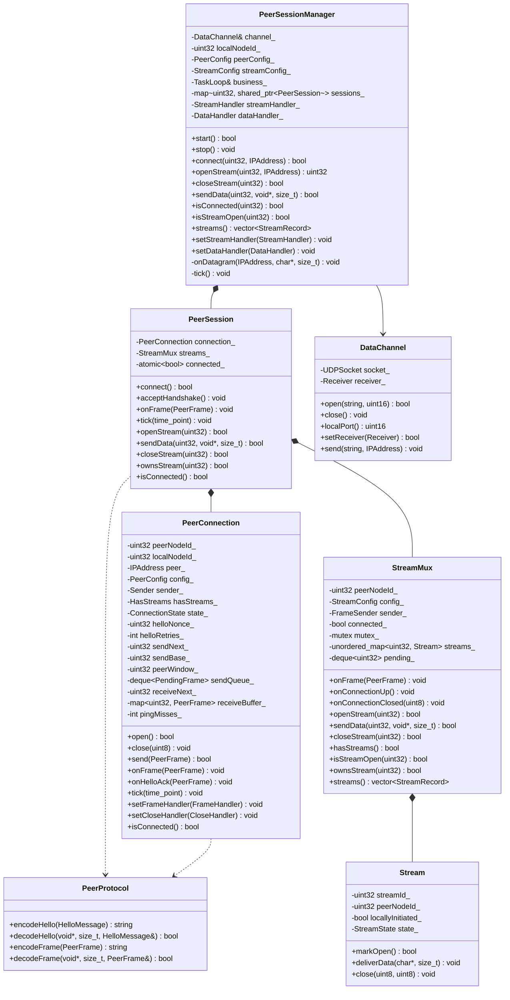
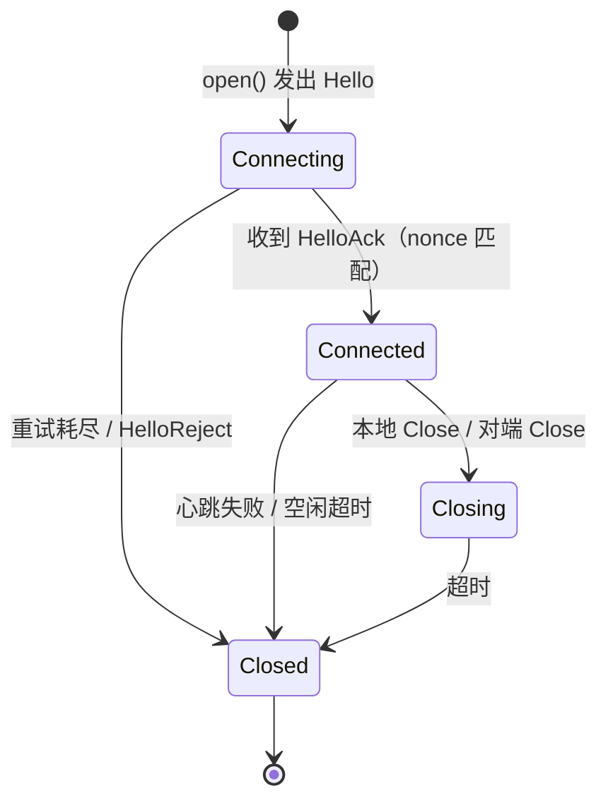
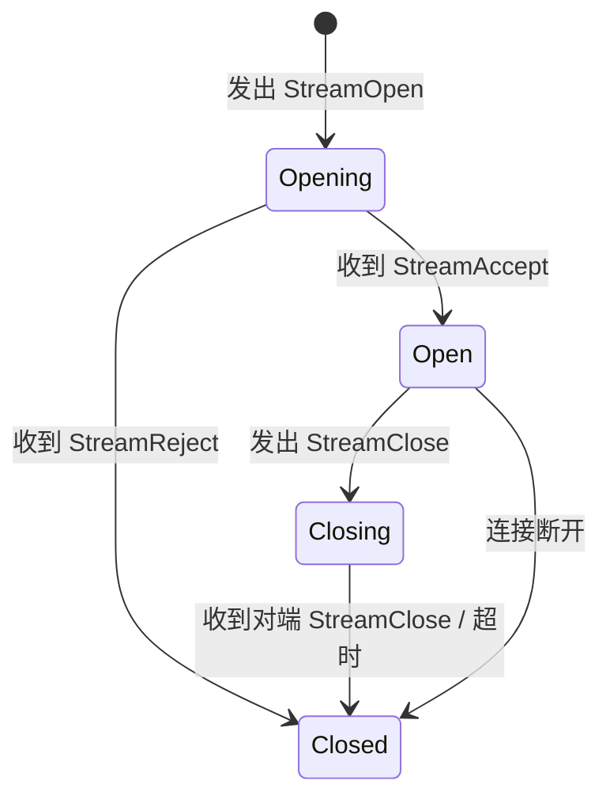

# 连接与流协议

本文描述节点对之间的连接建立、流多路复用与可靠传输。项目不设独立的会话层：会话即连接上的一条流。

架构总览见 [architecture.md](architecture.md)，节点发现协议见 [discovery-protocol.md](discovery-protocol.md)。

## 1. 目标与模型

```
UDP 数据端口
├── 握手（裸 UDP，可重发）
│     Hello / HelloAck / HelloReject
└── 连接（每个 peerNodeId 一条，可靠）
      ├── 连接级序号、累计 ACK、窗口、重传、心跳
      └── 流（streamId）：StreamOpen / StreamAccept / StreamReject / StreamClose / Data
```

| 概念 | 层级 | 标识 | 说明 |
| --- | --- | --- | --- |
| 连接 | 传输层 | `peerNodeId` | 两个节点之间唯一，握手成功后建立 |
| 流 | 传输层 | `streamId` | 连接上的多路复用通道，`0` 保留给控制 |

关键设计：

- 可靠层按「节点对」建立，不是按「会话」
- 所有帧（含 `StreamAccept`、`StreamClose`）都走可靠层，控制消息不裸奔
- 握手仍然不可靠，只负责交换 `nodeId` 与 `nonce`
- 上层业务若要「会话」语义，直接在流上封装；传输层不感知

## 2. 模块结构

```
src/protocol/
├── Protocol.h                 # magic、version、类型常量
└── Frame.h                    # PeerFrame（连接层与流层共用）

src/transport/
├── connection/                # —— 连接层 ——
│   ├── PeerConnection.h/.cpp  # 单连接：握手、序号、窗口、重传、心跳、有序交付
│   ├── PeerProtocol.h/.cpp    # 握手报文与连接帧编解码
│   ├── PeerConfig.h           # 连接参数
│   └── TransportTypes.h       # PacketSender
│
├── stream/                    # —— 流层 ——
│   ├── Stream.h/.cpp          # 单条流的状态与回调
│   ├── StreamMux.h/.cpp       # 流表、流信令、数据分发、并发上限
│   ├── StreamConfig.h         # 流参数（maxStreams）
│   └── StreamTypes.h          # StreamState、StreamRecord
│
├── DataChannel.h/.cpp         # 数据 UDP socket（组装层）
├── PeerSession.h/.cpp         # 每对端会话：连接 + 流（组装层）
└── PeerSessionManager.h/.cpp  # 报文路由与会话表（组装层）

src/node/                      # 组播发现与节点表（不变）
src/core/                      # IoLoop、TaskLoop（不变）
src/net/                       # Socket、Poller、EventDispatcher（不变）

src/P2PService.cpp             # 组装
```

依赖方向：

```
P2PService ──> transport ──> protocol
           ──> node       ──> protocol
```

`transport` 不依赖 `node`，`node` 不依赖 `transport`。

`transport` 内部再分两层，边界由 CMake 的 OBJECT 目标强制（见 [transport-layer-split.md](transport-layer-split.md)）：

```
PeerSession ──> PeerConnection ──> protocol（Frame.h / Protocol.h）
            └─> StreamMux
```

流层**不链接也不 include** 连接层：发帧通过注入的 `FrameSender`，收帧通过 `onFrame`，关闭通过 `onConnectionClosed` 通知。

## 3. 类图



## 4. 类说明

### 4.1 `transport::PeerProtocol`

**作用**：纯函数，负责握手报文与连接帧的编解码，不含状态、不碰 socket。

**成员**：无。

| 常量 | 值 |
| --- | --- |
| `MAGIC` | `0x4E50534E`（`NPSN`） |
| `VERSION` | `2` |
| `HELLO_HEADER_SIZE` | `16` |
| `FRAME_HEADER_SIZE` | `28` |

```cpp
struct HelloMessage {
    std::uint8_t type = 1;      // 1=Hello，2=HelloAck，3=HelloReject
    std::uint32_t nodeId = 0;
    std::uint32_t nonce = 0;
    std::uint8_t reason = 0;    // HelloReject 使用
};

struct PeerFrame {
    std::uint8_t type = 10;     // 10~16
    std::uint32_t nodeId = 0;
    std::uint32_t connectionSeq = 0;
    std::uint32_t acknowledge = 0;
    std::uint16_t window = 0;
    std::uint16_t payloadLength = 0;
    std::uint32_t streamId = 0;
    std::string payload;
};

std::string encodeHello(const HelloMessage& message);
bool decodeHello(const void* data, std::size_t size, HelloMessage& message);
std::string encodeFrame(const PeerFrame& frame);
bool decodeFrame(const void* data, std::size_t size, PeerFrame& frame);
```

### 4.2 `transport::PeerConnection`

**作用**：一条节点对连接的可靠有序帧通道，负责握手、序号、窗口、重传、心跳与有序交付。流表与流信令不在本类，见 4.3。

**成员**：

| 成员 | 类型 | 作用 |
| --- | --- | --- |
| `peerNodeId_` | `uint32` | 对端节点标识，连接唯一键 |
| `localNodeId_` | `uint32` | 本节点标识，写入报文头 |
| `peer_` | `IPAddress` | 对端地址与端口 |
| `config_` | `PeerConfig` | 重试、窗口、心跳参数 |
| `sender_` | `Sender` | 发送帧，由管理器注入 |
| `state_` | `ConnectionState` | `Connecting / Connected / Closing / Closed` |
| `helloNonce_` | `uint32` | 握手随机数 |
| `helloRetries_` | `int` | Hello 已重发次数 |
| `sendNext_` | `uint32` | 下一个待分配序号 |
| `sendBase_` | `uint32` | 最老的未确认序号 |
| `peerWindow_` | `uint32` | 对端通告窗口 |
| `sendQueue_` | `deque<PendingFrame>` | 已发送未确认帧 |
| `duplicateAcks_` | `int` | 连续重复 ACK 次数 |
| `receiveNext_` | `uint32` | 期望收到的下一个序号 |
| `receiveBuffer_` | `map<uint32, PeerFrame>` | 乱序缓存 |
| `hasStreams_` | `HasStreams` | 活跃流判定，由 `PeerSession` 注入 |
| `pingMisses_` | `int` | 连续心跳失败次数 |
| `lastActive_` | `time_point` | 最近收发时间 |
| `frameHandler_` | `FrameHandler` | 有序交付回调 |
| `closeHandler_` | `CloseHandler` | 连接进入 Closed 的回调 |

**接口**：

```cpp
using Sender = std::function<void(const std::string& packet, const net::IPAddress& target)>;
using FrameHandler = std::function<void(const PeerFrame&)>;    // 有序交付
using CloseHandler = std::function<void(Reason reason)>;       // 进入 Closed 时触发一次
using HasStreams = std::function<bool()>;                // 空闲关闭判定

PeerConnection(std::uint32_t peerNodeId, std::uint32_t localNodeId, const net::IPAddress& peer,
               const PeerConfig& config, Sender sender, HasStreams hasStreams = {});

bool open();                                   // 发出 Hello，进入 Connecting
void onHelloAck(const HelloMessage& message);  // 校验 nonce，进入 Connected
void onFrame(const PeerFrame& frame);          // 连接帧入口
void tick(std::chrono::steady_clock::time_point now);  // 重传、心跳、超时

bool send(PeerFrame frame);                    // 可靠有序发送；未连接或超长返回 false

bool isConnected() const;
ConnectionState state() const;
std::uint32_t peerNodeId() const;
void close(Reason reason);
```

**内部方法**：

| 方法 | 作用 |
| --- | --- |
| `sendFrame(const PeerFrame&)` | 分配序号、入队、发送 |
| `flushWindow()` | 窗口可用时发送排队帧 |
| `receiveFrame(const PeerFrame&)` | 按 `connectionSeq` 去重、缓存、按序交付 |
| `deliverOrdered(const PeerFrame&)` | 把帧交给 `FrameHandler` |
| `sendControl(FrameType, payload)` | 发送 `Ping` / `Close` 控制帧 |
| `enterClosed(Reason)` | 唯一的关闭出口：置状态并触发 `CloseHandler` |
| `sendAck()` | 回纯 ACK |

**不做的事**：不读 socket、不建 socket、不判断节点是否在 `PeerTable`、不维护流表。

### 4.3 `transport::StreamMux` / `transport::Stream`

**作用**：流层的唯一流表与流信令入口。`Stream` 只保存单条流的状态与回调，`StreamMux` 负责收发改帧、并发上限与排队。

**`StreamMux` 接口**：

```cpp
using StreamHandler = std::function<void(std::uint32_t streamId, std::uint32_t peerNodeId,
                                         StreamEvent event, Reason reason)>;
using DataHandler = std::function<void(std::uint32_t streamId, std::uint32_t peerNodeId,
                                       const char* data, std::size_t size)>;
using FrameSender = std::function<bool(PeerFrame frame)>;   // 注入连接层可靠发送

StreamMux(std::uint32_t peerNodeId, const StreamConfig& config, FrameSender sender);

void onFrame(const PeerFrame& frame);                 // 只处理 Data / Stream*
void onConnectionUp();                                // 补发排队开流
void onConnectionClosed(Reason reason);               // 已开流 Closed、排队流 Rejected(Timeout)

bool openStream(std::uint32_t streamId);              // 流号由调用线程生成
bool sendData(std::uint32_t streamId, const void* data, std::size_t size);
bool closeStream(std::uint32_t streamId);

bool hasStreams() const;
bool isStreamOpen(std::uint32_t streamId) const;
bool ownsStream(std::uint32_t streamId) const;
std::vector<StreamRecord> streams() const;
```

**内部逻辑**：

| 场景 | 行为 |
| --- | --- |
| `openStream` 且连接已就绪 | 建 `Stream(Opening)` 并发 `StreamOpen` |
| `openStream` 且连接未就绪 | 建 `Stream(Opening)`，流号入 `pending_`，`onConnectionUp` 时补发 |
| 收到 `StreamOpen`（新流） | 建 `Stream(Open)`、回 `StreamAccept`、回调 `Opened` |
| 收到 `StreamOpen`（已存在） | 只重发 `StreamAccept`，不重复回调 |
| 收到 `StreamOpen`（超 `maxStreams`） | 回 `StreamReject(Error)`，不建流 |
| 收到 `StreamAccept` / `StreamReject` / `StreamClose` | 推进或删除流，回调对应事件 |
| 收到 `Data` | 按 `streamId` 分发；找不到则丢弃并计数 |

**锁边界**：`mutex_` 只保护流表与 `pending_`，所有回调（`StreamHandler` / `DataHandler` / `FrameSender`）都在解锁后触发，保证应用在数据回调里重入 `sendData` 不会自锁。

### 4.4 `transport::PeerSession`

**作用**：每对端一个会话，把一条连接与其上的流组合起来，只做转调与状态同步。

```cpp
PeerSession(std::uint32_t localNodeId, std::uint32_t peerNodeId, const net::IPAddress& peer,
            const PeerConfig& peerConfig, const StreamConfig& streamConfig, PacketSender sender);

bool connect();
void acceptHandshake();   // 内部：状态变为 Connected 后调 streams_.onConnectionUp()
void onHelloAck(const HelloMessage& message);
void onFrame(const PeerFrame& frame);
void tick(std::chrono::steady_clock::time_point now);
void close(Reason reason);

bool openStream(std::uint32_t streamId);
bool sendData(std::uint32_t streamId, const void* data, std::size_t size);
bool closeStream(std::uint32_t streamId);
bool ownsStream(std::uint32_t streamId) const;
bool isStreamOpen(std::uint32_t streamId) const;
std::vector<StreamRecord> streams() const;
```

`connected_` 是 `std::atomic<bool>`，只供应用线程查询；流表不设镜像，全部在 `StreamMux`。

### 4.5 `transport::PeerSessionManager`

**作用**：数据 socket 的唯一入口，按 `peerNodeId` 管理会话与报文路由。

**成员**：

| 成员 | 类型 | 作用 |
| --- | --- | --- |
| `channel_` | `DataChannel&` | 数据 socket |
| `localNodeId_` | `uint32` | 本节点标识 |
| `peerConfig_` / `streamConfig_` | `PeerConfig` / `StreamConfig` | 连接与流参数 |
| `business_` | `TaskLoop&` | 业务线程 |
| `sessions_` | `map<uint32, shared_ptr<PeerSession>>` | 会话表（唯一按对端的状态） |
| `streamHandler_` | `StreamHandler` | 对外流事件 |
| `dataHandler_` | `DataHandler` | 对外数据 |

**接口**：

```cpp
using StreamHandler = std::function<void(std::uint32_t streamId, std::uint32_t peerNodeId,
                                         StreamEvent event, Reason reason)>;
using DataHandler = std::function<void(std::uint32_t streamId, std::uint32_t peerNodeId,
                                       const char* data, std::size_t size)>;

PeerSessionManager(DataChannel& channel, std::uint32_t localNodeId,
                      const PeerConfig& peerConfig, const StreamConfig& streamConfig,
                      core::TaskLoop& business);

bool start();     // 设置 channel 回调，安排 tick
void stop();

bool connect(std::uint32_t peerNodeId, const net::IPAddress& peer);
std::uint32_t openStream(std::uint32_t peerNodeId, const net::IPAddress& peer);
bool closeStream(std::uint32_t streamId);
bool sendData(std::uint32_t streamId, const void* data, std::size_t size);
bool isConnected(std::uint32_t peerNodeId) const;
bool isStreamOpen(std::uint32_t streamId) const;
std::vector<StreamRecord> streams() const;

void setStreamHandler(StreamHandler handler);
void setDataHandler(DataHandler handler);
```

**内部逻辑**：

| 场景 | 行为 |
| --- | --- |
| `openStream` | 调用线程生成流号并返回，业务线程建会话、建流、必要时发起握手 |
| 收到 `Hello` | 建会话、`acceptHandshake`、回 `HelloAck` |
| 收到 `HelloAck` / `HelloReject` | 转发给会话；拒绝时删除会话 |
| 收到连接帧 | 按 `nodeId` 找会话，找不到丢弃 |
| `sendData` / `closeStream` | 线性扫描 `sessions_` 找 `ownsStream` 的会话 |
| `tick` | 遍历会话调用 `tick`，清理 `Closed` 的会话 |

不维护 `streamToPeer_` / `streamOpen_` / `connectedCache_` / `pendingStreams_` 中的任何一份镜像。

### 4.6 `transport::DataChannel`

**作用**：数据 UDP socket 的封装，绑定端口、注册读事件、线程安全发送。

```cpp
class DataChannel final {
public:
    using Receiver = std::function<void(const net::IPAddress& from, const char* data, std::size_t size)>;

    explicit DataChannel(core::IoLoop& io);
    ~DataChannel();

    bool open(const std::string& bindAddress, std::uint16_t port);
    void close();
    bool isOpen() const;
    std::uint16_t localPort() const;

    bool setReceiver(Receiver receiver);   // 注册读事件，需在 IoLoop 启动前调用
    void send(const std::string& packet, const net::IPAddress& target);

private:
    void handleReadable();

    core::IoLoop& io_;
    net::UDPSocket socket_;
    Receiver receiver_;
    bool registered_ = false;
};
```

### 4.7 `P2PService`

**作用**：对外唯一入口，组装发现与连接，管理两个线程。

**成员**（`Impl`）：

| 成员 | 类型 |
| --- | --- |
| `io` | `core::IoLoop` |
| `business` | `core::TaskLoop` |
| `channel` | `unique_ptr<transport::DataChannel>` |
| `discovery` | `unique_ptr<node::NodeDiscovery>` |
| `node` | `unique_ptr<node::NodeManager>` |
| `connections` | `unique_ptr<transport::PeerSessionManager>` |
| `handler` | `PeerHandler` |
| `streamHandler` | `StreamHandler` |
| `dataHandler` | `DataHandler` |

**接口**：

```cpp
struct P2PServiceConfig {
    // 节点与发现
    std::uint32_t nodeId = 0;
    std::uint16_t dataPort = 0;
    std::string dataBindAddress;
    std::string multicastGroup = "239.255.42.99";
    std::uint16_t multicastPort = 45454;
    int announceIntervalMs = 3000;
    int peerTimeoutMs = 10000;

    // 连接与流
    std::size_t maxStreams = 64;            // 总流上限
    std::size_t maxStreamsPerPeer = 8;      // 单对节点流上限
    int helloRetryIntervalMs = 1000;
    int helloRetryCount = 5;
    std::size_t sendWindow = 16;
    std::size_t receiveWindow = 64;
    int retransmitTimeoutMs = 200;
    int maxRetransmitCount = 5;
    int pingIntervalMs = 30000;
    int pingTimeoutMs = 10000;
    int pingRetryCount = 3;
    std::size_t maxPayloadSize = 1400;
};

enum class StreamEvent { Opened, Rejected, Closed };

class P2PService final {
public:
    using PeerHandler = std::function<void(const PeerInfo& peer)>;
    using StreamHandler = std::function<void(std::uint32_t streamId, std::uint32_t peerNodeId,
                                             StreamEvent event, std::uint8_t reason)>;
    using DataHandler = std::function<void(std::uint32_t streamId, std::uint32_t peerNodeId,
                                           const char* data, std::size_t size)>;

    P2PService();
    ~P2PService();

    bool start(const P2PServiceConfig& config);
    void stop();
    bool isRunning() const;

    std::uint32_t nodeId() const;
    std::uint16_t dataPort() const;

    std::vector<PeerInfo> peers() const;
    bool findPeer(std::uint32_t nodeId, PeerInfo& peer) const;

    bool connect(std::uint32_t peerNodeId);
    bool isConnected(std::uint32_t peerNodeId) const;

    std::uint32_t openStream(std::uint32_t peerNodeId);   // 0 表示失败
    bool closeStream(std::uint32_t streamId);
    bool sendData(std::uint32_t streamId, const void* data, std::size_t size);
    bool isStreamOpen(std::uint32_t streamId) const;

    void setPeerHandler(PeerHandler handler);
    void setStreamHandler(StreamHandler handler);
    void setDataHandler(DataHandler handler);
};
```

## 5. 协议

### 5.1 约定

- 全部网络字节序
- 版本 `2`，与旧版不兼容，长度或 `version` 不符直接丢弃
- 握手报文与连接帧用 `type` 区分：`1~3` 为握手，`10~16` 为连接帧

### 5.2 握手头（16 字节）

| 偏移 | 长度 | 字段 | 说明 |
| --- | --- | --- | --- |
| 0 | 4 | `magic` | `NPSN` |
| 4 | 1 | `version` | 2 |
| 5 | 1 | `type` | 1=Hello，2=HelloAck，3=HelloReject |
| 6 | 2 | `flags` | 保留，填 0 |
| 8 | 4 | `nodeId` | 发送方节点标识，非 0 |
| 12 | 4 | `nonce` | 握手随机数，非 0 |

`HelloReject` 时偏移 12 为 `reason(1)`，其后 3 字节保留。

| reason | 含义 |
| --- | --- |
| 1 | 连接数超限 |
| 2 | 节点未知 |
| 3 | 版本不匹配 |
| 4 | 被策略拒绝 |

### 5.3 连接帧头（28 字节）

| 偏移 | 长度 | 字段 | 说明 |
| --- | --- | --- | --- |
| 0 | 4 | `magic` | `NPSN` |
| 4 | 1 | `version` | 2 |
| 5 | 1 | `type` | 10~16 |
| 6 | 2 | `flags` | 保留 |
| 8 | 4 | `nodeId` | 发送方 |
| 12 | 4 | `connectionSeq` | 连接级序号，从 0 递增 |
| 16 | 4 | `acknowledge` | 累计确认，期望的下一个序号 |
| 20 | 2 | `window` | 接收方剩余缓存（报文数） |
| 22 | 2 | `payloadLength` | 负载长度 |
| 24 | 4 | `streamId` | 0=连接控制 |
| 28 | ... | `payload` | 帧负载 |

### 5.4 帧类型

| type | 名称 | streamId | payload |
| --- | --- | --- | --- |
| 10 | `Data` | 流 | 业务数据，1~1400 字节 |
| 11 | `StreamOpen` | 流 | 空 |
| 12 | `StreamAccept` | 流 | 空 |
| 13 | `StreamReject` | 流 | `reason(1)` |
| 14 | `StreamClose` | 流 | `reason(1)` |
| 15 | `Ping` | 0 | 空 |
| 16 | `Close` | 0 | `reason(1)` |

`StreamReject` / `StreamClose` 的 reason：

| reason | 含义 |
| --- | --- |
| 1 | 本地主动关闭 |
| 2 | 收到对端关闭 |
| 3 | 超时 |
| 4 | 错误 |

`Ping` 与 `Close` 是连接控制帧：`streamId = 0`，`connectionSeq` 填 0，不占用交付序号，也不进入重传队列。这样纯 ACK 丢失不会阻塞后续数据的按序交付。

### 5.5 校验顺序

握手与帧分别校验，任一步失败直接丢弃，不回错误。

**握手**

1. 长度 ≥ 16
2. `magic` 正确
3. `version == 2`
4. `type` 为 1~3
5. `nodeId != 0`
6. Hello/HelloAck 的 `nonce != 0`

**连接帧**

1. 长度 ≥ 28
2. `magic` 正确
3. `version == 2`
4. `type` 为 10~16
5. `nodeId != 0`
6. `payloadLength` 与剩余长度一致
7. `Data` 帧 `streamId != 0` 且 `payloadLength > 0`，且 ≤ 1400
8. `Ping` / `Close` 帧 `streamId == 0`
9. 流帧（11~14）`streamId != 0`

## 6. 状态机

### 6.1 连接



| 状态 | 可发送 | 可接收 |
| --- | --- | --- |
| `Connecting` | Hello | HelloAck、HelloReject |
| `Connected` | 全部帧 | 全部帧 |
| `Closing` | Close | Close |
| `Closed` | 无 | 无 |

### 6.2 流



连接断开时，所有流直接进入 `Closed`，逐个回调。

## 7. 流程

### 7.1 连接建立

```
A                                       B
| 发现 B（组播，得到 address:port）      |
|--- Hello(nonce=N) ------------------->|
|                                        | 校验 nodeId、地址；创建连接
|<-- HelloAck(nonce=N) -----------------|
| 校验 nonce，Connected                  | Connected
| 双方序号从 0 开始                       |
```

- Hello 每 `helloRetryIntervalMs` 重发，最多 `helloRetryCount` 次
- 接收方收到 Hello 后回 HelloAck，并直接进入 `Connected`（`acceptHandshake`）
- 已连接时收到重复 Hello，直接回 HelloAck，不重建连接
- 连接数超限回 `HelloReject(1)`

### 7.2 开流

```
A                                       B
|--- StreamOpen(S) -------------------->|
|                                        | 检查流上限、创建流（Open）
|<-- StreamAccept(S) --------------------|
| 流 Open，回调 Opened                   |
```

- `StreamOpen`、`StreamAccept` 都是连接帧，参与序号与重传
- 重复 `StreamOpen` 幂等：已 Open 则再回一次 `StreamAccept`
- 超限回 `StreamReject(S, 1)`
- 未连接时调用 `openStream`，由管理器排队，连接就绪后自动发出

### 7.3 数据传输

```
A --- Data(S, "payload") -------------> B
A --- Data(S, "payload") -------------> B
B --- ACK(2) -------------------------> A
```

- 序号是连接级，不同流共享序号空间
- 接收方按 `connectionSeq` 去重与排序，按 `streamId` 分发
- 单帧负载上限 1400，避免 IP 分片

### 7.4 关流

```
A --- StreamClose(S, 1) ---------------> B
B 删除流，回调 Closed
A 删除流，回调 Closed
```

`StreamClose` 走可靠层，不会丢；连接保留，其它流不受影响。

### 7.5 关连接

```
A --- Close(0, 1) ---------------------> B
B 关闭所有流 → 回调 Closed → 删除连接
A 进入 Closing，等待 Close 或超时 → 删除
```

- 无流且空闲超过 `idleTimeoutMs` 自动发 `Close`
- 心跳连续失败直接 `Closed`

### 7.6 心跳

- 连接空闲 `pingIntervalMs`（默认 30 秒）发 `Ping`
- `pingTimeoutMs`（默认 10 秒）内未收到任意帧，计一次失败
- 连续 `pingRetryCount`（默认 3）次失败 → 连接 `Closed`，所有流回调

## 8. 可靠层

| 机制 | 规则 |
| --- | --- |
| 序号 | 连接级 `connectionSeq`，从 0 递增，uint32 |
| 确认 | 累计确认，`acknowledge` 表示该序号之前的帧都已收到 |
| 发送窗口 | `sendNext - sendBase < min(sendWindow, peerWindow)` |
| 超时重传 | 队首帧超过 `retransmitTimeoutMs`（默认 200ms）重发 |
| 快速重传 | 连续 3 个相同 `acknowledge` 立即重发队首 |
| 重传上限 | 单帧重传 `maxRetransmitCount`（默认 5）次后判定连接错误 |
| 乱序缓存 | 接收方按序号缓存，按序交付 |
| 流控 | `window` 通告剩余接收缓存，`0` 时对方暂停 |
| 序号范围 | `Data` 与 `Stream*` 参与序号与重传；`Ping`、`Close` 为连接控制，不占序号 |

## 9. 配置

```cpp
struct PeerConfig {
    int helloRetryIntervalMs = 1000;    // Hello 重发间隔
    int helloRetryCount = 5;            // Hello 最多重发次数
    std::size_t maxStreams = 16;        // 单连接流上限
    std::size_t sendWindow = 16;        // 发送窗口（帧数）
    std::size_t receiveWindow = 64;     // 接收缓存（帧数）
    int retransmitTimeoutMs = 200;      // 重传超时
    int maxRetransmitCount = 5;         // 单帧重传上限
    int pingIntervalMs = 30000;         // 心跳间隔
    int pingTimeoutMs = 10000;          // 心跳等待时间
    int pingRetryCount = 3;             // 连续失败上限
    int idleTimeoutMs = 60000;          // 无流空闲关闭连接
    int tickMs = 50;                    // 重传与心跳检查粒度
};
```

流上限的全局配额由 `P2PService` 汇总检查，`PeerConfig::maxStreams` 是单连接技术上限。

## 10. 线程模型

| 操作 | 线程 |
| --- | --- |
| `DataChannel` 收包 | I/O 线程，原样投递到业务线程 |
| 握手与帧处理 | 业务线程（`business.post`） |
| `connect` / `openStream` / `closeStream` / `sendData` | 任意线程，投递到业务线程执行 |
| `tick`（重传、心跳） | 业务线程，`tickMs` 定时 |
| `DataChannel::send` | 内部 `io.post`，落到 I/O 线程 |

`PeerConnection` 的状态只在业务线程访问，不需要锁。需要跨线程读取的部分各有单一来源：

| 对象 | 写路径 | 读路径 | 同步手段 |
| --- | --- | --- | --- |
| `StreamMux` 的流表 | 业务线程 | 任意线程（`isStreamOpen` / `ownsStream` / `streams` / `hasStreams`） | `StreamMux::mutex_` |
| `PeerSession::connected_` | 业务线程 | 任意线程 | `std::atomic<bool>` |
| `PeerSessionManager::sessions_` | 业务线程 | 任意线程（`isConnected` / `isStreamOpen` / `streams`） | `sessionsMutex_` |

两条规则：`StreamMux` 持锁期间不得调用任何外部回调；`PeerSessionManager` 取快照后释放锁再调用会话方法。

## 11. 与现有代码的映射

| 现有 | 处理 |
| --- | --- |
| `session/SessionManager.*` | 删除，职责并入连接层与 `P2PService` |
| `session/SessionTable.*` | 删除，流表在 `PeerConnection` |
| `session/SessionProtocol.*` | 删除，握手由 `PeerProtocol` 承担 |
| `session/DataChannel.*` | 迁到 `transport/` |
| `transport/DataProtocol.*` | 删除，帧格式并入 `PeerProtocol` |
| `transport/DataStream.*` | 删除，可靠层并入 `PeerConnection` |
| `transport/DataStreamManager.*` | 删除，改为 `PeerSessionManager` |
| `node/*` | 不变 |
| `P2PService.cpp` | 组装改为 `DataChannel → PeerSessionManager` |

协议版本从 `1` 提到 `2`，新旧不兼容。

## 12. 分阶段实施

| 阶段 | 内容 | 验证 |
| --- | --- | --- |
| 1 | `protocol/Protocol.h` + `transport/PeerProtocol` | 单测字段往返、非法报文 |
| 2 | `transport/PeerConnection`：序号、ACK、窗口、重传 | 假 Sender 注入丢包，验证重传与交付 |
| 3 | 握手：Hello/HelloAck/Reject + 连接状态机 | 两节点建连、超时、重复 Hello |
| 4 | 流：StreamOpen/Accept/Reject/Close + 分发 | 多流并发、关闭时延 |
| 5 | `PeerSessionManager`：排队开流、事件转发 | 未连接时 `openStream` 能自动补发 |
| 6 | `P2PService` 组装，删除 `src/session/` | 端到端建立、传输、关闭 |
| 7 | app 与测试改名，文档收尾 | 干净重建全绿 |

## 13. 测试计划

| 用例 | 覆盖 |
| --- | --- |
| 握手往返 | Hello/HelloAck 字段与 nonce 匹配 |
| 握手超时 | 无响应 → 重试耗尽 → Closed |
| 帧编解码 | Data / StreamOpen / StreamClose 字段与长度 |
| 非法帧 | 长度不足、magic/version 错、streamId 越界 |
| 丢包重传 | 假 Sender 丢弃首帧，200ms 后重发并交付 |
| 多流并发 | 同一连接 3 条流，数据不串流 |
| 排队开流 | 未连接时 `openStream`，连接后自动发出 |
| 关闭时延 | `StreamClose` 到达即关闭 |
| 心跳断链 | 对端停止响应，3 次后连接与所有流 Closed |
| 端到端 | 两节点发现 → 连接 → 开流 → 传数据 → 关闭 |

## 14. 边界与约束

- 单帧负载 ≤ 1400，不做应用层分片
- 连接级单序号，一个慢流会拖慢同连接其它流（局域网可接受）
- 无加密与认证，`nonce` 只做握手关联
- 不做打洞与中继；将来若做，连接需引入 `connectionId` 与路径验证，握手再扩展
- 不设独立会话层：业务上的「会话」直接映射为流；需要会话级语义时在 `P2PService` 之上封装
- 连接与节点表解耦：`PeerSessionManager` 不校验节点是否在 `PeerTable`，由 `P2PService::openStream` 先用 `findPeer` 取地址
