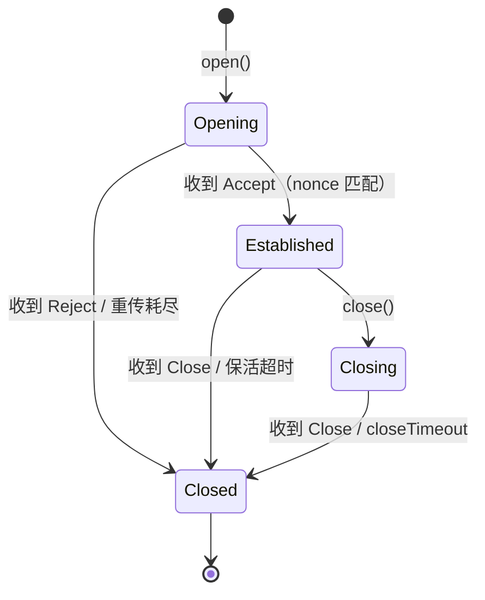

# 会话信令协议

本文描述节点之间建立、维持与关闭会话的 UDP 信令格式。会话报文走节点的数据端口，与组播发现通道（45454）完全分离。

## 1. 约定

- 所有多字节字段使用网络字节序（大端）
- 报文最小 16 字节，最大 24 字节
- `sessionId` 由发起方生成，非 0
- 每条报文都携带发送方 `nodeId`
- 同一对节点之间用 `(对端地址, 对端端口, sessionId)` 唯一标识一条会话

## 2. 通用头部

每条报文都以 16 字节头部开始：

| 偏移 | 长度 | 字段 | 说明 |
| --- | --- | --- | --- |
| 0 | 4 | `magic` | `0x4E50534E`，ASCII `NPSN` |
| 4 | 1 | `version` | 当前为 `1` |
| 5 | 1 | `type` | 1=Open，2=Accept，3=Reject，4=Close，5=Ping |
| 6 | 2 | `flags` | 保留，填 0 |
| 8 | 4 | `nodeId` | 发送方节点标识，非 0 |
| 12 | 4 | `sessionId` | 会话标识，非 0 |

## 3. 消息类型

### 3.1 Open（type = 1，24 字节）

发起方请求建立会话，同时承担打洞作用：从发起方数据 socket 发出，到对端数据端口。

| 偏移 | 长度 | 字段 | 说明 |
| --- | --- | --- | --- |
| 0 | 16 | 头部 | `type = 1` |
| 16 | 2 | `listenPort` | 发起方数据端口，非 0 |
| 18 | 2 | `reserved` | 填 0 |
| 20 | 4 | `nonce` | 随机会话验证码 |

`nonce` 用于让发起方把 `Accept` 与本次请求关联，避免把旧报文当成响应。

### 3.2 Accept（type = 2，20 字节）

接收方同意建立会话。

| 偏移 | 长度 | 字段 | 说明 |
| --- | --- | --- | --- |
| 0 | 16 | 头部 | `type = 2` |
| 16 | 4 | `nonce` | 原样回显 `Open` 中的 `nonce` |

### 3.3 Reject（type = 3，20 字节）

接收方拒绝或发起方放弃。

| 偏移 | 长度 | 字段 | 说明 |
| --- | --- | --- | --- |
| 0 | 16 | 头部 | `type = 3` |
| 16 | 1 | `reason` | 拒绝原因，见下表 |
| 17 | 3 | `reserved` | 填 0 |

| reason | 含义 |
| --- | --- |
| 1 | 会话总数超限 |
| 2 | 单对节点会话数超限 |
| 3 | 协议版本不匹配 |
| 4 | 未知节点（不在节点表中） |
| 5 | 被策略拒绝 |

### 3.4 Close（type = 4，20 字节）

任一方主动关闭会话。

| 偏移 | 长度 | 字段 | 说明 |
| --- | --- | --- | --- |
| 0 | 16 | 头部 | `type = 4` |
| 16 | 1 | `reason` | 关闭原因，见下表 |
| 17 | 3 | `reserved` | 填 0 |

| reason | 含义 |
| --- | --- |
| 1 | 本地主动关闭 |
| 2 | 收到对端关闭 |
| 3 | 超时 |
| 4 | 内部错误 |

### 3.5 Ping（type = 5，16 字节）

保活探测，只有头部，无负载。可选实现。

### 3.6 Data / Ack（type = 6 / 7）

会话建立后的数据传输报文，头部在通用头基础上扩展序号与确认字段，格式见第 4 章。

## 4. 数据传输

会话进入 `Established` 后，双方在同一个数据 socket 上收发数据报文，靠 `type` 与会话信令区分。

### 4.1 Data（type = 6）

| 偏移 | 长度 | 字段 | 说明 |
| --- | --- | --- | --- |
| 0 | 16 | 头部 | `type = 6` |
| 16 | 4 | `sequence` | 本会话内递增，从 0 开始 |
| 20 | 4 | `acknowledge` | 累计确认，期望收到的下一个序号 |
| 24 | 2 | `window` | 接收方还能接收的报文数 |
| 26 | 2 | `payloadLength` | 负载长度 |
| 28 | ... | `payload` | 业务数据 |

单包负载上限 1400 字节（MTU 1500 - IP 20 - UDP 8 - 头 28 - 余量）。

### 4.2 Ack（type = 7）

| 偏移 | 长度 | 字段 | 说明 |
| --- | --- | --- | --- |
| 0 | 16 | 头部 | `type = 7` |
| 16 | 4 | `acknowledge` | 累计确认 |
| 20 | 2 | `window` | 接收窗口 |
| 22 | 2 | `reserved` | 填 0 |

### 4.3 可靠性

- 发送方维护 `sendNext` / `sendBase`，窗口默认 16 个报文
- 接收方按序号缓存、按序交付，`acknowledge` 表示「该序号之前已全部收到」
- 收到 `acknowledge` 后滑动窗口；窗口内最早报文超时（默认 200ms）重传
- 连续 3 个重复 ACK 触发快速重传
- 重传超过 5 次判定会话异常，主动发 `Close(reason=4)`
- `window` 为 0 时发送方暂停，收到 `Ack` 或携带 `acknowledge` 的 `Data` 后恢复

### 4.4 分片

第一阶段限制单条消息不超过 1400 字节，超长由调用方拆分。

第二阶段在 `Data` 头部增加 `messageId(4) + fragmentIndex(2) + fragmentCount(2)`，头部变为 32 字节；接收方按 `messageId` 重组，以 `fragmentCount` 判断完整性。

### 4.5 保活

`Ping` 用头部 `flags` 的最低位区分请求与响应：

| `flags` | 含义 |
| --- | --- |
| `0x0000` | 请求，要求对端确认存活 |
| `0x0001` | 响应，对端已收到请求 |

流程：

```
A                                    B
| 空闲达到 keepaliveIntervalMs       |
|--- Ping(flags=0) ---------------->|
|<-- Ping(flags=1) -----------------|   B 回响应，A 刷新活动时间
```

- 收到任何会话报文（Open / Accept / Reject / Close / Ping）都刷新活动时间并清零连续未响应计数
- 响应不再回复，避免两端互相回包形成循环

参数：

| 参数 | 默认值 | 说明 |
| --- | --- | --- |
| `keepaliveIntervalMs` | 30000 | 空闲达到该时间后发送请求 Ping |
| `keepaliveTimeoutMs` | 10000 | 每次 Ping 的等待时间 |
| `keepaliveRetryCount` | 3 | 连续未响应次数上限 |
| `keepaliveTickMs` | 1000 | 定时检查粒度 |

默认时间线：

| 时刻 | 动作 |
| --- | --- |
| 30s 空闲 | 发第 1 个 Ping，未响应计数 1 |
| 40s | 发第 2 个，计数 2 |
| 50s | 发第 3 个，计数 3 |
| 60s | 计数达到上限，发送 `Close(reason=3)`，删除会话，回调 `Closed` |

任意时刻收到对端报文都会重置计数，因此正常通信的会话不会被误判。

### 4.6 示例

Data：`nodeId = 0x0000000A`，`sessionId = 0x12345678`，`sequence = 0`，`acknowledge = 0`，`window = 16`，负载 `"hello"`

```
4E 50 53 4E  01  06  00 00  00 00 00 0A  12 34 56 78
00 00 00 00  00 00 00 00  00 10  00 05
68 65 6C 6C 6F
```

Ack：确认已经收到 1 个报文

```
4E 50 53 4E  01  07  00 00  00 00 00 0A  12 34 56 78
00 00 00 01  00 10  00 00
```

## 5. 校验规则

接收方按下列顺序校验，任一步失败直接丢弃报文，不回错误——避免被伪造报文放大：

1. 长度 ≥ 16
2. `magic` 正确
3. `version` 为 1
4. `type` 在 1~5 之间
5. 长度满足该类型的固定长度（Open ≥ 24，Accept ≥ 20，Reject/Close ≥ 20，Ping ≥ 16，Data ≥ 28，Ack ≥ 24）
6. `nodeId != 0`
7. `sessionId != 0`
8. Open 中 `listenPort != 0`
9. Open 的来源地址与节点表中该 `nodeId` 的地址一致

`sessionId` 未命中会话表时的处理：

| 报文 | 处理 |
| --- | --- |
| Open | 新会话，走建立流程 |
| Accept / Reject / Close / Ping / Data / Ack | 丢弃并记录 Warning |

## 6. 建立流程

```
A                                          B
| 生成 sessionId=S，nonce=N                 |
| 记录 Opening，启动重传定时器               |
|--- Open(S, A, Pa, N) ------------------>|
|                                          | 校验、检查上限、建立会话
|<-- Accept(S, B, N) ---------------------|
| 校验 nonce，Opening -> Established        |
| 回调 Opened(S)                           |
```

### 重传与超时

| 参数 | 默认值 | 行为 |
| --- | --- | --- |
| `openRetryIntervalMs` | 1000 | 未收到响应时的重发间隔 |
| `openRetryCount` | 5 | 最多重发次数 |
| 总握手超时 | 约 5s | 重发耗尽后会话置 Closed，回调 `Rejected` |

接收方对重复到达的 `Open` 幂等处理：

- 会话已存在且 `Established`：直接再回一次 `Accept`
- 会话已存在但 `Closing`：回 `Reject(reason=2)`

## 7. 关闭流程

```
A                                          B
|--- Close(S, reason=1) ----------------->|
| 状态 Closing，等待 closeTimeoutMs        | 删除会话，回调 Closed
| 超时或收到对端关闭 -> 删除会话            |
```

`Close` 不要求应答；发送方只短暂保留状态，超时后清理。

## 8. 会话状态

### 8.1 状态迁移



### 8.2 各状态行为

| 状态 | 可发送 | 可接收 | 定时器 |
| --- | --- | --- | --- |
| `Opening` | Open | Accept、Reject | 重传间隔 1000ms，最多 5 次 |
| `Established` | Data、Ack、Ping、Close | Data、Ack、Ping、Close | 保活 30s |
| `Closing` | Close | Close | closeTimeout 2000ms |
| `Closed` | 无 | 无 | 等待从会话表移除 |

### 8.3 会话记录

| 字段 | 说明 |
| --- | --- |
| `sessionId` | 会话标识 |
| `peerNodeId` | 对端节点标识 |
| `peerAddress` | 对端地址与端口 |
| `state` | 当前状态 |
| `nonce` | 发起方生成的验证码 |
| `sendNext` | 下一个待发送序号 |
| `sendBase` | 最老的未确认序号 |
| `receiveNext` | 期望收到的下一个序号 |
| `retryCount` | 当前重传次数 |
| `deadline` | 下一次超时检查时间点 |

### 8.4 事件回调

| 事件 | 触发时机 |
| --- | --- |
| `Opened` | 握手完成，进入 `Established` |
| `Rejected` | 对端未知、超出上限、收到 `Reject` 或握手重传耗尽 |
| `Closed` | 收到 `Close`、本地关闭完成或保活失败 |

回调参数为 `(sessionId, peerNodeId, event)`。

`open()` 是非阻塞的：调用线程立即拿到 `sessionId`，握手在业务线程进行，结果只通过回调通知。`open()` 返回非 0 不代表对端可达；回调可能在 `open()` 返回前触发，调用方应提前准备好状态收集。

约定：

- 同一 `sessionId` 只回调一次终态事件
- `Closed` 回调后立即从会话表移除，后续报文按未知会话丢弃
- 会话记录字段在状态迁移时同步更新，`sendBase` / `receiveNext` 只对 `Established` 有意义

## 9. 多会话与多路复用

- 同一对节点可以建立多条会话，各自持有独立 `sessionId`
- 单对节点上限 `maxSessionsPerPeer`（默认 8），超限时对端回 `Reject(reason=2)`
- 全局上限 `maxSessions`（默认 64），超限时回 `Reject(reason=1)`
- 不同节点使用相同 `sessionId` 不会冲突，会话表以来源地址 + `sessionId` 定位

## 10. 报文示例

### Open

字段值：

| 字段 | 值 |
| --- | --- |
| `sessionId` | `0x12345678` |
| `nodeId` | `0x0000000A` |
| `listenPort` | `7001`（`0x1B59`） |
| `nonce` | `0xDEADBEEF` |

字节序列：

```
4E 50 53 4E  01  01  00 00  00 00 00 0A  12 34 56 78
1B 59  00 00  DE AD BE EF
```

### Accept

`nodeId = 0x0000000B`，`nonce` 回显 `0xDEADBEEF`：

```
4E 50 53 4E  01  02  00 00  00 00 00 0B  12 34 56 78
DE AD BE EF
```

### Close

`reason = 1`：

```
4E 50 53 4E  01  04  00 00  00 00 00 0A  12 34 56 78
01  00 00 00
```

## 11. 与发现协议的区别

| 项 | 发现协议 | 会话协议 |
| --- | --- | --- |
| magic | `NPRO` | `NPSN` |
| 传输 | UDP 组播 `239.255.42.99:45454` | UDP 单播，节点数据端口 |
| 长度 | 固定 16 字节 | 16 ~ 24 字节 |
| 主要字段 | `nodeId`、`port` | `nodeId`、`sessionId`、`nonce` |
| 方向 | 一对多广播 | 点对点 |

两个协议用不同 magic 与不同端口，互不干扰；数据 socket 上收到 `NPRO` 报文视为异常并丢弃。

## 12. 安全边界

- 无认证与加密，局域网内任何主机都可以伪造 `nodeId` 与 `sessionId`
- `nonce` 只用于请求/响应关联，不提供防重放能力
- 后续可在 `Open` 中增加 `token` 字段（8 字节）做预共享密钥校验，需提升 `version`
