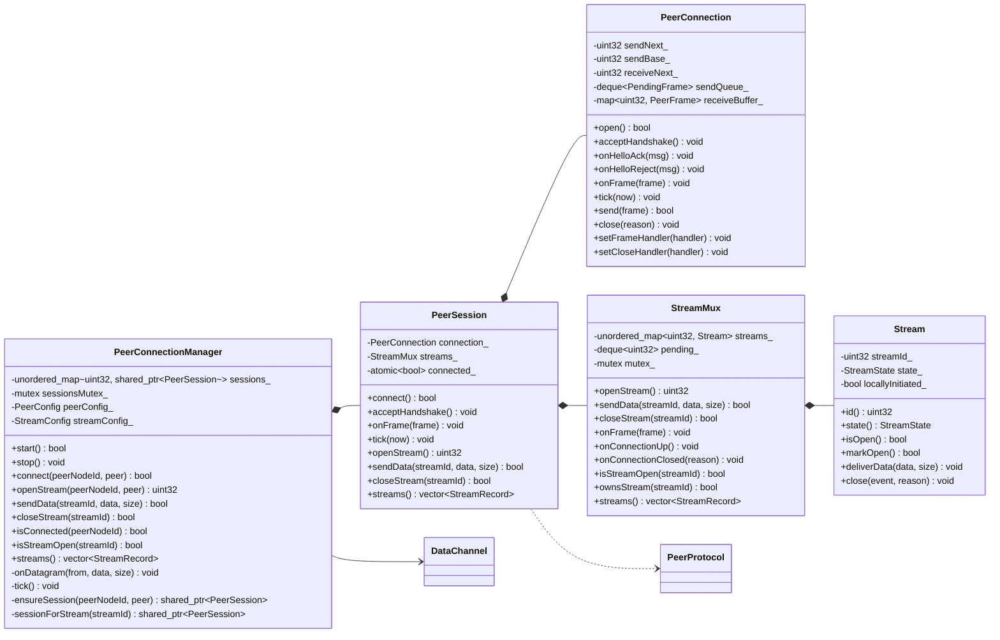
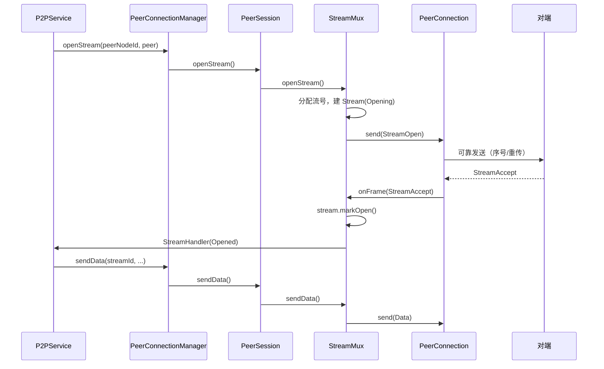
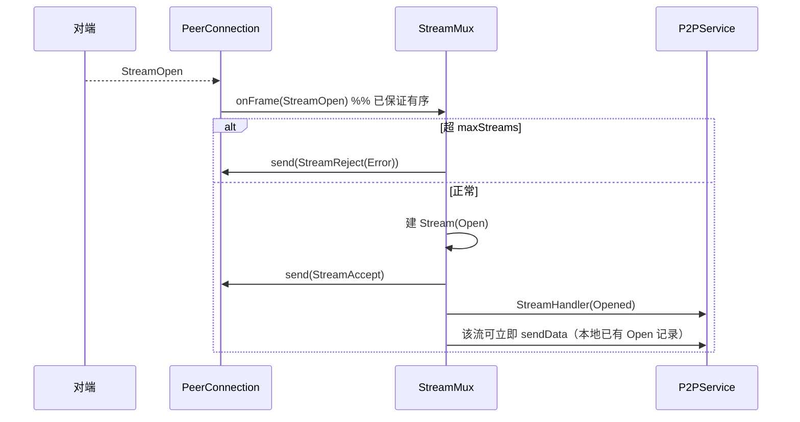

# 传输层分层设计：连接层与流层拆分

本文给出「把 `PeerConnection` 拆成连接层与流层」的目标结构：目录、文件、类、函数、线程模型、迁移步骤与验收标准。拆分不修改线上协议（帧格式与信令不变），属于内部结构重构。

## 1. 拆分依据

现状（见 [architecture.md](architecture.md)）中 `PeerConnection`（502 行）同时承担五件事：

1. 连接状态机与握手（Hello / HelloAck / HelloReject）
2. 可靠传输（序号、ACK、窗口、重传、快速重传、去重、乱序缓存、有序交付）
3. 流表与流信令（StreamOpen / StreamAccept / StreamReject / StreamClose）
4. 数据交付与流事件回调
5. 心跳、空闲关闭、连接关闭

拆成两层，边界按「谁负责重传、谁负责语义」划分：

| 关注点 | 归属 |
| --- | --- |
| Hello 握手、nonce 校验、握手重试 | 连接层 |
| `connectionSeq`、`acknowledge`、窗口、RTO 重传、重复 ACK 快重传、去重、乱序缓存、**有序交付** | 连接层（唯一的重传点） |
| Ping 心跳、Close 连接、空闲关闭 | 连接层 |
| 流表、`StreamOpen/Accept/Reject/Close` 信令、并发上限 | 流层 |
| 单流状态、单流回调、流级错误 | 流层（`Stream`） |
| 帧编解码、帧类型枚举 | `protocol`（两层共用，不变） |

两条不可越界的契约：

- **可靠性只属于连接层**。流层不得自行重传、不得感知序号与窗口。
- **连接层保证有序交付**：对端先发 `StreamOpen` 再发该流的 `Data`，本地一定先交付 `StreamOpen`。流层可以依赖这一点。

## 2. 模块划分（方案 A）

### 2.1 两个模块 + 一个组装层

| 模块 | 目录 | 职责 | 对外头文件 | CMake 目标 |
| --- | --- | --- | --- | --- |
| 连接层 | `transport/connection/` | 握手、可靠有序帧通道、心跳、关闭 | `PeerConnection.h` | `netproxy_connection` |
| 流层 | `transport/stream/` | 流表、流信令、数据分发、并发上限 | `StreamMux.h`、`Stream.h` | `netproxy_stream` |
| 组装层 | `transport/`（根） | 把两者接成每对端一个会话；报文路由 | `PeerSession.h`、`PeerConnectionManager.h` | 并入 `netproxy` |

「组装层」不是第三个模块：它没有自己的状态模型，只负责构造、转调与生命周期，编译上属于 `netproxy` 主目标。

### 2.2 目录结构

```
src/
├── protocol/
│   ├── Protocol.h              # 不变：FrameType / StreamEvent / Reason
│   └── Frame.h                 # 新增：PeerFrame（从 transport/PeerProtocol.h 移入）
│
├── transport/
│   ├── connection/             # ── 模块 A：连接层 ──
│   │   ├── PeerConnection.h/.cpp   # 改造：剥离全部流逻辑
│   │   ├── PeerProtocol.h/.cpp     # 不变：帧编解码
│   │   ├── PeerConfig.h            # 新增：从 PeerConnection.h 拆出（去掉 maxStreams）
│   │   └── TransportTypes.h        # 移动：PacketSender
│   │
│   ├── stream/                 # ── 模块 B：流层 ──
│   │   ├── Stream.h/.cpp           # 新增：单条流
│   │   ├── StreamMux.h/.cpp        # 新增：流表 + 流信令
│   │   ├── StreamConfig.h          # 新增：maxStreams、acceptTimeoutMs
│   │   └── StreamTypes.h           # 新增：StreamState、StreamRecord
│   │
│   ├── DataChannel.h/.cpp          # 不变：UDP 收发（组装层使用）
│   ├── PeerSession.h/.cpp          # 新增：每对端门面，组合 A + B
│   └── PeerConnectionManager.h/.cpp# 瘦身：只做路由与生命周期
│
tests/transport/
├── connection/
│   ├── PeerProtocolTest.cpp        # 移动：只链 netproxy_connection
│   └── PeerConnectionTest.cpp      # 改造：握手 / ARQ / 有序交付 / 心跳
├── stream/
│   └── StreamMuxTest.cpp           # 新增：流信令与流表，只链 netproxy_stream
└── （原有 P2PServiceTest 覆盖组装层与端到端行为，位置不变）
```

约定：**子目录 = 两个模块，`transport/` 根 = 组装与适配**。目录表达层次，CMake 目标表达依赖边界。

### 2.3 为什么流层不提到 `src/` 顶层

| 判据 | 现状 | 结论 |
| --- | --- | --- |
| 依赖方向 | 流层直接消费 `PeerFrame`，并依赖"连接层保证有序可靠交付"这一契约 | 属于 transport 内部概念 |
| 复用诉求 | 没有"流跑在其它可靠通道上"的需求；`file-transfer.md` 是**在流之上**按 `fileId` 复用，属上层应用 | 无独立诉求 |
| 发布与版本 | 两者始终同版本、同库发布 | 无独立发布诉求 |

业界对照：QUIC（RFC 9000）把 streams 定义在传输规范内部；SCTP 的 streams 属于 association；WebRTC 的 SCTP streams 与 DCEP 也在 transport 侧。因此 `transport/{connection,stream}` 的层次与主流实现一致。

若将来真要把流层复用到其它可靠通道，再把它移动到 `src/stream/` 并抽象帧类型即可——那是**纯移动文件**，成本很低。

### 2.4 依赖方向与 include 规则

```
                 protocol/Protocol.h + protocol/Frame.h
                  （FrameType / StreamEvent / Reason / PeerFrame）
                        ▲                          ▲
                        │                          │
        ┌───────────────┘                          └───────────────┐
        │                                                          │
  connection 模块                                            stream 模块
  PeerConnection / PeerProtocol                              Stream / StreamMux
  PeerConfig / TransportTypes                                StreamConfig / StreamTypes
        ▲                                                          ▲
        └───────────────────┬──────────────────────────────────────┘
                            │
                    PeerSession（组装层，transport/ 根）
                            ▲
              PeerConnectionManager（路由，transport/ 根）
                            ▲
                       P2PService
```

| 目标 | 允许 include | 禁止 include |
| --- | --- | --- |
| `netproxy_connection` | `protocol/`、`net/`（`IPAddress`）、标准库 | `stream/`、`transport/PeerSession.h`、`transport/PeerConnectionManager.h` |
| `netproxy_stream` | `protocol/`、标准库 | `connection/`、`net/`、`core/`、组装层头文件 |
| `netproxy`（组装层） | 全部 | — |

`stream` 模块**不依赖 `PeerConnection` 类本身**：发帧通过 `FrameSender = std::function<bool(PeerFrame)>` 注入，收帧通过 `onFrame(const PeerFrame&)` 被调用，关闭通过 `onConnectionClosed(reason)` 通知。这是两个模块能真正解耦的关键。

### 2.5 为支撑边界需要移动的类型

| 类型 | 现在位置 | 目标位置 | 原因 |
| --- | --- | --- | --- |
| `PeerFrame` | `transport/PeerProtocol.h` | `protocol/Frame.h` | 流层需要帧结构，但不应 include 连接层头文件 |
| `PacketSender` | `transport/TransportTypes.h` | `transport/connection/TransportTypes.h` | 只有连接层发原始报文 |
| `StreamRecord`、`StreamState`、流回调签名 | `transport/PeerConnectionManager.h` | `transport/stream/StreamTypes.h` | 归流层 |
| `PeerConfig` | `transport/PeerConnection.h` | `transport/connection/PeerConfig.h` | 连接参数 |
| `StreamConfig` | 不存在（`PeerConfig::maxStreams`） | `transport/stream/StreamConfig.h` | 从连接配置中拆出流相关参数 |

`PeerProtocol`（编解码）留在连接层：只有连接层接触原始报文。

### 2.6 CMake 目标

```cmake
# 模块 A：连接层
add_library(netproxy_connection STATIC
    transport/connection/PeerConnection.cpp
    transport/connection/PeerProtocol.cpp)
target_include_directories(netproxy_connection PUBLIC transport/connection)
target_include_directories(netproxy_connection PRIVATE . )
target_link_libraries(netproxy_connection PUBLIC netproxy_protocol)
if(WIN32)
    target_link_libraries(netproxy_connection PUBLIC ws2_32)
endif()

# 模块 B：流层（注意：不链接 connection）
add_library(netproxy_stream STATIC
    transport/stream/Stream.cpp
    transport/stream/StreamMux.cpp)
target_include_directories(netproxy_stream PUBLIC transport/stream)
target_include_directories(netproxy_stream PRIVATE . )
target_link_libraries(netproxy_stream PUBLIC netproxy_protocol)

# 主库：聚合模块 + 组装层
add_library(netproxy STATIC
    ... 现有源文件 ...
    transport/PeerSession.cpp
    transport/PeerConnectionManager.cpp
    transport/DataChannel.cpp)
target_include_directories(netproxy PRIVATE ${CMAKE_CURRENT_SOURCE_DIR})
target_link_libraries(netproxy PRIVATE netproxy_connection netproxy_stream)
```

边界由构建系统强制：`netproxy_stream` 既不链接 `netproxy_connection`，也不把 `transport/connection` 加入 include 目录，任何反向 `#include` 都会在编译期失败。

测试目标同理，用来证明边界：

```cmake
add_executable(netproxy_tests ... transport/connection/PeerConnectionTest.cpp ...)
target_link_libraries(netproxy_tests PRIVATE netproxy_connection)   # 只链连接层

add_executable(netproxy_stream_tests transport/stream/StreamMuxTest.cpp)
target_link_libraries(netproxy_stream_tests PRIVATE netproxy_stream) # 只链流层
```

### 2.7 文件清单与行数预估

| 文件 | 模块 | 动作 | 现状 | 预估 |
| --- | --- | --- | --- | --- |
| `protocol/Frame.h` | protocol | 新增（移动 `PeerFrame`） | 10 行 | ~20 行 |
| `connection/PeerConfig.h` | connection | 新增（从 `PeerConnection.h` 拆出） | — | ~30 行 |
| `connection/TransportTypes.h` | connection | 移动 | 17 行 | ~20 行 |
| `connection/PeerProtocol.h/.cpp` | connection | 移动 | 298 行 | 不变 |
| `connection/PeerConnection.h` | connection | 改造 | 360 行 | ~230 行 |
| `connection/PeerConnection.cpp` | connection | 改造 | 502 行 | ~260 行 |
| `stream/StreamTypes.h` | stream | 新增 | — | ~40 行 |
| `stream/StreamConfig.h` | stream | 新增 | — | ~15 行 |
| `stream/Stream.h/.cpp` | stream | 新增 | — | ~120 行 |
| `stream/StreamMux.h/.cpp` | stream | 新增 | — | ~380 行 |
| `PeerSession.h/.cpp` | 组装层 | 新增 | — | ~160 行 |
| `PeerConnectionManager.h` | 组装层 | 瘦身 | 178 行 | ~110 行 |
| `PeerConnectionManager.cpp` | 组装层 | 瘦身 | 419 行 | ~250 行 |
| `DataChannel.h/.cpp` | 组装层 | 不变 | 213 行 | 不变 |

### 2.8 模块级落地步骤（阶段 1：纯搬运，行为零变化）

1. 新建 `src/transport/connection/`、`src/transport/stream/`、`tests/transport/connection/`、`tests/transport/stream/`。
2. 用 `git mv` 移动 `PeerConnection.*`、`PeerProtocol.*`、`TransportTypes.h` 与 `PeerProtocolTest.cpp`，保留历史。
3. 把 `PeerFrame` 提到 `src/protocol/Frame.h`，`PeerProtocol.h` 改为 include 它。
4. 修正 include：同目录用短名（`"PeerConnection.h"`），跨模块统一用 `"connection/..."`、`"stream/..."`、`"protocol/..."`、`"net/..."`（依赖 `netproxy` 的 `PRIVATE src` 与各模块的 include 目录）。
5. 按 2.6 拆 `src/CMakeLists.txt`，主目标继续聚合，`P2PService` 可见符号不变。
6. 验收：`cmake --preset windows-vs2026 && cmake --build --preset windows-vs2026 && ctest --preset windows-vs2026` 全绿；`netproxy_stream` 单独编译通过即证明没有反向依赖。
7. 此阶段只搬文件与拆目标，**不修改任何逻辑**；职责拆分放在第 13 节后续步骤。

## 3. 类图



## 4. 类型与配置

### 4.1 `transport/connection/TransportTypes.h`（移动）

```cpp
namespace netproxy::transport {

// 把一段已编码的报文发送到指定地址，由 DataChannel 提供实现。
// 仅连接层使用；流层通过 FrameSender 注入，不接触原始报文与目标地址。
using PacketSender = std::function<void(const std::string& packet, const net::IPAddress& target)>;

} // namespace netproxy::transport
```

> `StreamRecord` 不在这里，已移到流层的 `stream/StreamTypes.h`（见 4.4）。

### 4.2 `transport/connection/PeerConfig.h`（新增，从 `PeerConnection.h` 拆出）

从现有 `PeerConfig` 中移出 `maxStreams`（归流层），其余保持不变：

```cpp
struct PeerConfig {
    int helloRetryIntervalMs = 1000;
    int helloRetryCount = 5;
    std::size_t maxPayloadSize = 1400;
    std::size_t sendWindow = 16;
    std::size_t receiveWindow = 64;
    int retransmitTimeoutMs = 200;
    int maxRetransmitCount = 5;
    int pingIntervalMs = 30000;
    int pingTimeoutMs = 10000;
    int pingRetryCount = 3;
    int idleTimeoutMs = 60000;
    int closeTimeoutMs = 2000;
    int tickMs = 50;
};
```

### 4.3 `transport/stream/StreamConfig.h`（新增）

```cpp
struct StreamConfig {
    std::size_t maxStreams = 16; // 单连接流上限，超限回 StreamReject
    int acceptTimeoutMs = 0;     // 预留：等待 StreamAccept 的超时，0 表示不检查
};
```

> `P2PServiceConfig` 对外字段不变，内部把 `maxStreamsPerPeer` 映射到 `StreamConfig::maxStreams`。

### 4.4 `transport/stream/StreamTypes.h`（新增）

```cpp
namespace netproxy::transport {

// 流状态。
enum class StreamState : std::uint8_t {
    Opening = 1, // 本地已发 StreamOpen，等待对端 StreamAccept
    Open = 2,    // 双向可传数据
    Closing = 3, // 预留：已发 StreamClose，等待清理
    Closed = 4   // 已关闭，不再出现在流表中
};

// 流快照，供上层查询（原定义在 PeerConnectionManager.h）。
struct StreamRecord {
    std::uint32_t streamId = 0;
    std::uint32_t peerNodeId = 0;
    bool open = false;
    bool locallyInitiated = false;
};

} // namespace netproxy::transport
```

回调签名随使用它的类定义：`Stream` 用自己的 `EventCallback` / `DataCallback`，`StreamMux` 用注入的 `FrameSender` / `StreamIdAllocator`（见第 6、7 节），不集中放在本文件，避免两处维护。

## 5. 连接层：`PeerConnection`（`transport/connection/`）

职责：握手、可靠有序帧通道、心跳、关闭。**不解析 `Stream*` 帧语义**，只保留「`Ping`/`Close` 是控制帧、不进序号」这一条连接级知识。

```cpp
namespace netproxy::transport {

enum class ConnectionState : std::uint8_t {
    Connecting = 1,
    Connected = 2,
    Closing = 3,
    Closed = 4
};

class PeerConnection final {
public:
    using Sender = PacketSender;
    using FrameHandler = std::function<void(const PeerFrame&)>;          // 有序交付
    using CloseHandler = std::function<void(protocol::Reason)>;          // 连接进入 Closed

    PeerConnection(std::uint32_t peerNodeId, std::uint32_t localNodeId, const net::IPAddress& peer,
                   const PeerConfig& config, Sender sender);
    ~PeerConnection();

    PeerConnection(const PeerConnection&) = delete;
    PeerConnection& operator=(const PeerConnection&) = delete;

    // 握手
    bool open();
    void acceptHandshake();
    void onHelloAck(const HelloMessage& message);
    void onHelloReject(const HelloMessage& message);

    // 帧通道
    void onFrame(const PeerFrame& frame);
    bool send(PeerFrame frame);   // 可靠、有序；窗口不足时内部排队
    void tick(std::chrono::steady_clock::time_point now);
    void close(protocol::Reason reason);

    // 回调
    void setFrameHandler(FrameHandler handler);
    void setCloseHandler(CloseHandler handler);

    // 查询（业务线程内使用）
    bool isConnected() const;
    ConnectionState state() const;
    std::uint32_t peerNodeId() const;
    const net::IPAddress& peer() const;
    std::size_t maxPayloadSize() const;

private:
    struct PendingFrame {
        PeerFrame frame;
        std::chrono::steady_clock::time_point sentAt{};
        int retransmitCount = 0;
    };

    void sendHello();
    void sendFrame(PeerFrame frame);
    void flushWindow();
    void handleAck(std::uint32_t acknowledge, std::uint16_t window);
    void receiveFrame(const PeerFrame& frame);
    void deliverOrdered(const PeerFrame& frame);   // 交给 FrameHandler
    void sendAck();
    void sendControl(protocol::FrameType type, const std::string& payload);
    std::uint16_t windowRemaining() const;
    void enterClosed(protocol::Reason reason);     // 状态置 Closed + CloseHandler

    // 成员：peerNodeId_、localNodeId_、peer_、config_、sender_、state_、handshakeStarted_、
    //       helloNonce_、helloRetries_、helloSentAt_、sendNext_、sendBase_、peerWindow_、
    //       receiveNext_、receiveBuffer_、sendQueue_、pendingFrames_、duplicateAcks_、
    //       lastActive_、pingSentAt_、pingMisses_、frameHandler_、closeHandler_
};

} // namespace netproxy::transport
```

与现有实现的差异：

| 现有成员/方法 | 处理 |
| --- | --- |
| `streams_`、`StreamState` | 移出到 `StreamMux` / `Stream` |
| `openStream` / `closeStream` / `sendData` | 移出到 `StreamMux` |
| `handleStreamFrame` / `deliverFrame` 的流分支 | 移出到 `StreamMux::onFrame` |
| `closeAllStreams` | 由 `CloseHandler` 通知流层后由 `StreamMux::onConnectionClosed` 完成 |
| `emitStreamEvent` / `setStreamHandler` / `setDataHandler` | 移出到 `StreamMux` |
| `queueFrame` | 改名为对外 `send(PeerFrame)` |
| `deliverFrame` 的 `Ping` / `Close` 分支 | 保留在连接层 |
| 其余（握手、ACK、窗口、重传、心跳） | 原样保留 |

## 6. 单流：`Stream`（`transport/stream/`）

职责：只维护一条流的状态与回调，不持有连接，不做收发调度。

```cpp
namespace netproxy::transport {

enum class StreamState : std::uint8_t {
    Opening = 1, // 本地已发 StreamOpen，等待对端 StreamAccept
    Open = 2,    // 双向可传数据
    Closing = 3, // 预留：已发 StreamClose，等待清理
    Closed = 4   // 已关闭，不再出现在流表中
};

class Stream final {
public:
    using EventCallback = std::function<void(std::uint32_t streamId, protocol::StreamEvent event,
                                             protocol::Reason reason)>;
    using DataCallback = std::function<void(std::uint32_t streamId, const char* data, std::size_t size)>;

    Stream(std::uint32_t streamId, std::uint32_t peerNodeId, bool locallyInitiated);

    std::uint32_t id() const;
    std::uint32_t peerNodeId() const;
    StreamState state() const;
    bool isOpen() const;
    bool locallyInitiated() const;

    void setEventCallback(EventCallback handler);
    void setDataCallback(DataCallback handler);

    bool markOpen();                                  // Opening -> Open；返回状态是否变化
    void deliverData(const char* data, std::size_t size);
    void close(protocol::StreamEvent event, protocol::Reason reason); // -> Closed 并回调

private:
    std::uint32_t streamId_ = 0;
    std::uint32_t peerNodeId_ = 0;
    bool locallyInitiated_ = false;
    StreamState state_ = StreamState::Opening;
    EventCallback eventHandler_;
    DataCallback dataHandler_;
};

} // namespace netproxy::transport
```

说明：

- `Stream` 不持有 `PeerConnection`，无法自行发帧——发送统一走 `StreamMux`，保证所有帧进入同一条可靠队列。
- `Closing` 状态沿用现状的预留语义（当前实现直接删表），暂不启用。

## 7. 流层：`StreamMux`（`transport/stream/`）

职责：唯一的流表、流信令的收发与状态推进、数据分发、并发上限控制、连接未就绪时的开流排队。

```cpp
namespace netproxy::transport {

class StreamMux final {
public:
    using StreamHandler = std::function<void(std::uint32_t streamId, std::uint32_t peerNodeId,
                                             protocol::StreamEvent event, protocol::Reason reason)>;
    using DataHandler = std::function<void(std::uint32_t streamId, std::uint32_t peerNodeId,
                                           const char* data, std::size_t size)>;
    using FrameSender = std::function<bool(PeerFrame)>;              // 注入连接层可靠发送
    using StreamIdAllocator = std::function<std::uint32_t()>;        // 注入流号生成

    StreamMux(std::uint32_t localNodeId, std::uint32_t peerNodeId, const StreamConfig& config,
              FrameSender sender, StreamIdAllocator allocator);

    // 连接层驱动的入口（业务线程）
    void onFrame(const PeerFrame& frame);                 // 只处理 Data / Stream*
    void onConnectionUp();                                // 握手完成：补发排队开流
    void onConnectionClosed(protocol::Reason reason);     // 全部流回调 Closed

    // 上层 API（业务线程）
    std::uint32_t openStream();                           // 分配流号；未连上则排队
    bool sendData(std::uint32_t streamId, const void* data, std::size_t size);
    bool closeStream(std::uint32_t streamId);

    // 任意线程查询（内部加锁）
    bool isStreamOpen(std::uint32_t streamId) const;
    bool ownsStream(std::uint32_t streamId) const;
    std::vector<StreamRecord> streams() const;

    void setStreamHandler(StreamHandler handler);
    void setDataHandler(DataHandler handler);

private:
    void handleStreamOpen(const PeerFrame& frame);
    void handleStreamAccept(const PeerFrame& frame);
    void handleStreamReject(const PeerFrame& frame);
    void handleStreamClose(const PeerFrame& frame);
    void handleData(const PeerFrame& frame);

    void sendStreamOpen(std::uint32_t streamId);
    void flushPending();
    void removeStream(std::uint32_t streamId);
    void emitEvent(const Stream& stream, protocol::StreamEvent event, protocol::Reason reason);

    std::uint32_t localNodeId_ = 0;
    std::uint32_t peerNodeId_ = 0;
    StreamConfig config_;
    FrameSender sender_;
    StreamIdAllocator allocateId_;
    bool connected_ = false;   // 由 onConnectionUp / onConnectionClosed 维护

    mutable std::mutex mutex_;
    std::unordered_map<std::uint32_t, Stream> streams_;   // 唯一流表
    std::deque<std::uint32_t> pending_;                   // 连接未就绪时排队的流

    StreamHandler streamHandler_;
    DataHandler dataHandler_;
};

} // namespace netproxy::transport
```

信令处理规则（与现状一致）：

| 收到 | 行为 |
| --- | --- |
| `StreamOpen`（流已存在） | 重发 `StreamAccept`（幂等），不重复回调 `Opened` |
| `StreamOpen`（超 `maxStreams`） | 回 `StreamReject(Error)`，不建流 |
| `StreamOpen`（正常） | 建流并置 `Open` → 回 `StreamAccept` → 回调 `Opened` |
| `StreamAccept` | 仅当本地流为 `Opening` 时置 `Open` → 回调 `Opened` |
| `StreamReject` | 删流 → 回调 `Rejected(Error)` |
| `StreamClose` | 删流 → 回调 `Closed(Remote)` |
| `Data` | 按 `streamId` 找到流后 `deliverData`；未找到则丢弃并计数 |

开流路径：

- 连接已就绪：分配流号 → 建 `Stream(Opening)` → 发 `StreamOpen`。
- 连接未就绪：流号与 `Stream(Opening)` 立即建（对外先返回流号，与现状 `openStream` 行为一致），`streamId` 入 `pending_`，等 `onConnectionUp()` 再发 `StreamOpen`。

## 8. 每对端门面：`PeerSession`

职责：把「一条连接 + 其上的流」组合成每对端一个对象，承担原先散落在 `PeerConnectionManager` 的每对端状态。

```cpp
namespace netproxy::transport {

class PeerSession final {
public:
    PeerSession(std::uint32_t localNodeId, std::uint32_t peerNodeId, const net::IPAddress& peer,
                const PeerConfig& peerConfig, const StreamConfig& streamConfig, PacketSender sender);

    // 连接层转发
    bool connect();
    void acceptHandshake();
    void onHelloAck(const HelloMessage& message);
    void onHelloReject(const HelloMessage& message);
    void onFrame(const PeerFrame& frame);
    void tick(std::chrono::steady_clock::time_point now);
    void close(protocol::Reason reason);

    // 流层转发
    std::uint32_t openStream();
    bool sendData(std::uint32_t streamId, const void* data, std::size_t size);
    bool closeStream(std::uint32_t streamId);
    bool isStreamOpen(std::uint32_t streamId) const;
    std::vector<StreamRecord> streams() const;

    void setStreamHandler(StreamMux::StreamHandler handler);
    void setDataHandler(StreamMux::DataHandler handler);

    // 查询（跨线程安全）
    std::uint32_t peerNodeId() const;
    const net::IPAddress& peer() const;
    bool isConnected() const;           // 读 atomic
    ConnectionState state() const;      // 仅业务线程

private:
    void onConnectionClosed(protocol::Reason reason);

    PeerConnection connection_;
    StreamMux streams_;
    std::atomic<bool> connected_{false}; // 供应用线程查询，连接层状态只在业务线程可读
};

} // namespace netproxy::transport
```

`PeerSession` 是本次拆分消除「状态镜像」的关键：`connected_` 只是一个 `atomic<bool>`，取代原先 manager 里的 `unordered_map<uint32_t,bool> connectedCache_`；流表则完全交给 `StreamMux`，不再有 `streamToPeer_` / `streamOpen_`。

## 9. 路由层：`PeerConnectionManager`

职责：报文入口、握手报文的路由（未知节点建会话）、`nodeId → PeerSession` 表、统一 tick、对外 API 转发。

```cpp
namespace netproxy::transport {

class PeerConnectionManager final {
public:
    PeerConnectionManager(DataChannel& channel, std::uint32_t localNodeId, const PeerConfig& peerConfig,
                          const StreamConfig& streamConfig, core::TaskLoop& business);
    ~PeerConnectionManager();

    PeerConnectionManager(const PeerConnectionManager&) = delete;
    PeerConnectionManager& operator=(const PeerConnectionManager&) = delete;

    bool start();
    void stop();

    bool connect(std::uint32_t peerNodeId, const net::IPAddress& peer);
    std::uint32_t openStream(std::uint32_t peerNodeId, const net::IPAddress& peer);
    bool sendData(std::uint32_t streamId, const void* data, std::size_t size);
    bool closeStream(std::uint32_t streamId);
    bool isConnected(std::uint32_t peerNodeId) const;
    bool isStreamOpen(std::uint32_t streamId) const;
    std::vector<StreamRecord> streams() const;

    void setStreamHandler(StreamMux::StreamHandler handler);
    void setDataHandler(StreamMux::DataHandler handler);

private:
    void onDatagram(const net::IPAddress& from, const char* data, std::size_t size);
    void tick();
    void scheduleTick();

    std::shared_ptr<PeerSession> ensureSession(std::uint32_t peerNodeId, const net::IPAddress& peer);
    std::shared_ptr<PeerSession> sessionForStream(std::uint32_t streamId) const; // 线性扫描，见下
    void forgetSession(std::uint32_t peerNodeId);

    DataChannel& channel_;
    std::uint32_t localNodeId_ = 0;
    PeerConfig peerConfig_;
    StreamConfig streamConfig_;
    core::TaskLoop& business_;
    PacketSender sender_;

    mutable std::mutex sessionsMutex_;
    std::unordered_map<std::uint32_t, std::shared_ptr<PeerSession>> sessions_;
    std::atomic<bool> running_{false};
};

} // namespace netproxy::transport
```

关于 `streamId → 会话` 的查找：**不再维护反向索引**。局域网 P2P 的对端数量是个位数，`sessionForStream()` 线性扫描 `sessions_` 并调用 `PeerSession::ownsStream()` 足够快，同时避免再引入一份需要同步的映射表（那正是上一轮 `streams` 看不到对端流的根因）。若将来对端数量上百，再考虑由 `StreamMux` 的 `Opened/Closed` 回调驱动一个索引，并在同一处维护。

## 10. 关键时序

### 10.1 本地开流（连接已就绪）



### 10.2 对端开流（本地被动接受）



### 10.3 连接断开

```
PeerConnection 进入 Closed
   → CloseHandler(reason)
      → PeerSession::onConnectionClosed(reason)
         → StreamMux::onConnectionClosed(reason)
            → 每个流 close(Closed, reason) 并清表
   → PeerConnectionManager::tick 发现 state()==Closed
      → 清 connected 缓存、删除会话
```

## 11. 现有代码 → 新位置映射

| 现有实现 | 新归属 |
| --- | --- |
| `PeerConnection::open` / `onHelloAck` / `acceptHandshake` / `onHelloReject` / `sendHello` | `PeerConnection`（不变） |
| `queueFrame` | `PeerConnection::send`（对外可见） |
| `sendFrame` / `flushWindow` / `handleAck` / `receiveFrame` / `sendAck` / `sendControl` / `windowRemaining` | `PeerConnection`（不变） |
| `tick` 的 Connecting / 重传 / 心跳 / Closing 分支 | `PeerConnection::tick` |
| `deliverFrame` 的 `Ping` / `Close` 分支 | `PeerConnection` |
| `deliverFrame` 的 `Data` / `Stream*` 分支、`handleStreamFrame` | `StreamMux::onFrame` 及其 `handleStream*` |
| `openStream` / `closeStream` / `sendData` | `StreamMux` |
| `streams_`、`emitStreamEvent`、`closeAllStreams`、`maxStreams` 判断 | `StreamMux` / `Stream` |
| `setStreamHandler` / `setDataHandler` | `StreamMux`（`PeerSession` 与 manager 逐层转发） |
| `PeerConnectionManager::connections_` + `streamToPeer_` + `streamOpen_` + `pendingStreams_` + `connectedCache_` | 前四项删除；`pendingStreams_` → `StreamMux::pending_`；`connectedCache_` → `PeerSession::connected_` |
| `PeerConnectionManager::peerForStream` / `removeStream` / `emitStreamEvent` / `emitData` / `flushPending` | 删除（职责已下沉） |
| `PeerConnectionManager::ensureConnection` | `ensureSession`（构造 `PeerSession` 并接好回调） |
| `PeerConnectionManager::tick` | 保留，改为遍历 `sessions_` 调用 `PeerSession::tick` |

## 12. 线程模型

| 对象 | 写路径 | 读路径 | 同步手段 |
| --- | --- | --- | --- |
| `PeerConnection` | 业务线程 | 业务线程 | 无锁（保持现状） |
| `Stream` / `StreamMux::streams_` | 业务线程 | 任意线程（`isStreamOpen` / `ownsStream` / `streams`） | `StreamMux::mutex_` |
| `PeerSession::connected_` | 业务线程 | 任意线程 | `std::atomic<bool>` |
| `PeerConnectionManager::sessions_` | 业务线程 | 任意线程（`sendData` / `streams` / `isConnected`） | `sessionsMutex_` |

I/O 线程与业务线程之间仍只通过 `IoLoop::post()` 与 `DataChannel` 回调交互，不新增跨线程直接调用。

## 13. 迁移步骤（每步可编译、可测试）

0. **模块化目录（阶段 1，纯搬运）**：按 2.8 建目录、`git mv` 文件、移动 `PeerFrame`、修正 include、拆出 `netproxy_connection` / `netproxy_stream` 两个目标。行为零变化，验收标准是 `ctest` 全绿且 `netproxy_stream` 可独立编译。
1. **抽 `Stream`**：`PeerConnection::streams_` 由 `unordered_map<id, StreamState>` 改为 `unordered_map<id, Stream>`，外部行为不变。目标：验证状态机未被搬坏，`PeerConnectionTest` 全绿。
2. **抽 `StreamMux`**：把流信令、流表、数据分发、`maxStreams` 迁到 `StreamMux`；`PeerConnection` 露出 `send()` 与 `setFrameHandler()`。`PeerConnectionManager` 暂时保留原有对外 API，内部改调 `StreamMux`。
3. **抽 `PeerSession`，去镜像**：manager 的 `streamToPeer_` / `streamOpen_` / `pendingStreams_` / `connectedCache_` 全部删除，改为 `sessions_` + 转发。此步同时修复「对端发起的流不出现在 `streams()`、也无法回发」的缺陷。
4. **文档与测试收尾**：更新 `architecture.md` 的类图与类职责表、`peer-protocol.md` 的目录树；补 `StreamMuxTest`。

## 14. 验收标准

- `ctest` 全绿，含新增用例。
- 行为等价性：开流 / 双向数据 / 拒绝（超 `maxStreams`）/ 主动关闭 / 对端关闭 / 连接断开广播 `Closed`，与拆分前一致。
- 回归用例：对端发起的流必须出现在 `streams()` 中、`isStreamOpen()` 为真、且可回发数据并送达。
- 契约用例：`StreamOpen` 与 `Data` 乱序到达时，连接层不得把 `Data` 交付给流层（用于锁定「有序交付」契约）。
- 代码规模：`PeerConnection` 降到 300 行以内，`PeerConnectionManager` 不再包含任何流状态。

## 15. 已知限制与不做的事

1. **队头阻塞未解决**：所有流共用连接级 `sendWindow` 与一条 ARQ 队列，慢流仍可能占满窗口。要真正隔离需要帧头增加流级窗口字段，属于协议变更，不在本次范围。
2. **不把重传下沉到流层**：每流独立 ARQ 会显著增加复杂度，也放大队头阻塞。
3. **不把 Hello 移入流层**：连接级语义不应依赖流。
4. **不改帧格式**：本次拆分对线上协议零影响，新旧版本仍可互通。
5. **`StreamMux` 暂不引入流级定时器**：`acceptTimeoutMs` 仅预留字段；若启用，由 `PeerSession::tick` 驱动 `StreamMux::tick`，仍在业务线程内。
