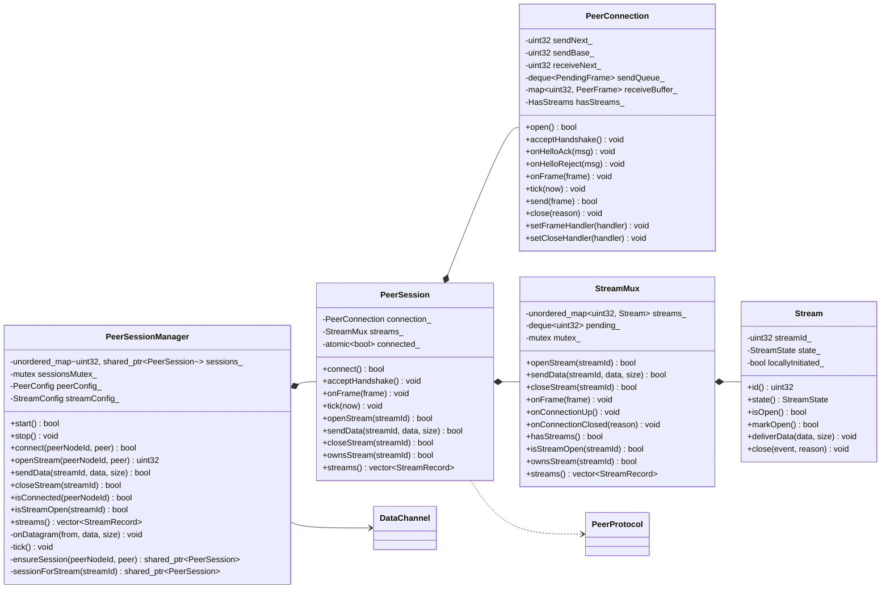
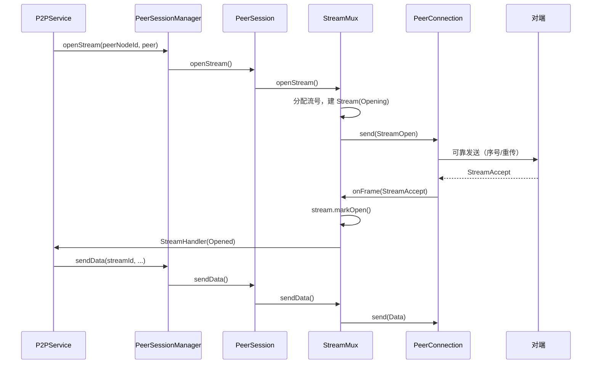
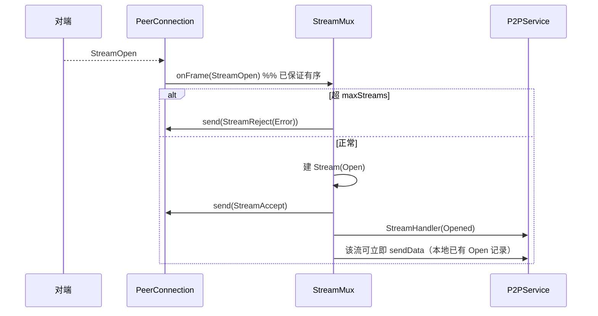

# 传输层分层设计：连接层与流层拆分

本文给出「把 `PeerConnection` 拆成连接层与流层」的目标结构：目录、文件、类、函数、线程模型、迁移步骤与验收标准。拆分不修改线上协议（帧格式与信令不变），属于内部结构重构。

文档中的行号与依赖已对照当前实现核对。其中 2.6（OBJECT 聚合与单产物）、7.1（锁内不回调）、7.2（断开时两类流的事件）、8.1（握手接线）、9.1（流号在调用线程生成）是落地的硬约束：跳过任意一条会分别导致 CMake 配置/产物出错、回调重入死锁、事件语义回归、排队流失效、公共 API 无法同步返回。

构建形态约定：项目对外只产出一个库（`libnetproxy`）。连接层与流层是**编译期模块**，用 OBJECT 库表达依赖边界，不产生额外库文件，也不进入安装导出集（见 2.6）。

## 1. 拆分依据

现状（见 [architecture.md](architecture.md)）中 `PeerConnection`（502 行）同时承担五件事：

1. 连接状态机与握手（Hello / HelloAck / HelloReject）
2. 可靠传输（序号、ACK、窗口、重传、快速重传、去重、乱序缓存、有序交付）
3. 流表与流信令（StreamOpen / StreamAccept / StreamReject / StreamClose）
4. 数据交付与流事件回调
5. 心跳、空闲关闭、连接关闭

拆成两层，边界按「谁负责重传、谁负责语义」划分：

| 关注点 | 归属 |
| --- | --- |
| Hello 握手、nonce 校验、握手重试 | 连接层 |
| `connectionSeq`、`acknowledge`、窗口、RTO 重传、重复 ACK 快重传、去重、乱序缓存、**有序交付** | 连接层（唯一的重传点） |
| Ping 心跳、Close 连接、空闲关闭 | 连接层 |
| 流表、`StreamOpen/Accept/Reject/Close` 信令、并发上限 | 流层 |
| 单流状态、单流回调、流级错误 | 流层（`Stream`） |
| 帧编解码、帧类型枚举 | `protocol`（两层共用，不变） |

两条不可越界的契约：

- **可靠性只属于连接层**。流层不得自行重传、不得感知序号与窗口。
- **连接层保证有序交付**：对端先发 `StreamOpen` 再发该流的 `Data`，本地一定先交付 `StreamOpen`。流层可以依赖这一点。

## 2. 模块划分（方案 A）

### 2.1 两个模块 + 一个组装层

| 模块 | 目录 | 职责 | 对外头文件 | CMake 目标 |
| --- | --- | --- | --- | --- |
| 连接层 | `transport/connection/` | 握手、可靠有序帧通道、心跳、关闭 | `PeerConnection.h` | `netproxy_connection`（OBJECT） |
| 流层 | `transport/stream/` | 流表、流信令、数据分发、并发上限 | `StreamMux.h`、`Stream.h` | `netproxy_stream`（OBJECT） |
| 组装层 | `transport/`（根） | 把两者接成每对端一个会话；报文路由 | `PeerSession.h`、`PeerSessionManager.h` | 并入 `netproxy` |

两个模块都是 OBJECT 库：只用来表达 include 与依赖边界，objects 直接并入 `netproxy`，不产出 `libnetproxy_connection.a` / `libnetproxy_stream.a`。

「组装层」不是第三个模块：它没有自己的状态模型，只负责构造、转调与生命周期，编译上属于 `netproxy` 主目标。

### 2.2 目录结构

```
src/
├── protocol/
│   ├── Protocol.h              # 不变：FrameType / StreamEvent / CloseReason
│   └── Frame.h                 # 新增：PeerFrame（从 transport/PeerProtocol.h 移入）
│
├── transport/
│   ├── connection/             # ── 模块 A：连接层 ──
│   │   ├── PeerConnection.h/.cpp   # 改造：剥离全部流逻辑
│   │   ├── PeerProtocol.h/.cpp     # 不变：帧编解码
│   │   ├── PeerConfig.h            # 新增：从 PeerConnection.h 拆出（去掉 maxStreams）
│   │   └── TransportTypes.h        # 移动：PacketSender
│   │
│   ├── stream/                 # ── 模块 B：流层 ──
│   │   ├── Stream.h/.cpp           # 新增：单条流
│   │   ├── StreamMux.h/.cpp        # 新增：流表 + 流信令
│   │   ├── StreamConfig.h          # 新增：maxStreams、acceptTimeoutMs
│   │   └── StreamTypes.h           # 新增：StreamState、StreamRecord
│   │
│   ├── DataChannel.h/.cpp          # 不变：UDP 收发（组装层使用）
│   ├── PeerSession.h/.cpp          # 新增：每对端门面，组合 A + B
│   └── PeerSessionManager.h/.cpp# 瘦身：只做路由与生命周期
│
tests/transport/
├── connection/
│   ├── PeerProtocolTest.cpp        # 移动：帧编解码，随 netproxy_tests 链接主库
│   └── PeerConnectionTest.cpp      # 改造：握手 / ARQ / 有序交付 / 心跳
├── stream/
│   ├── StreamMain.cpp              # 新增：独立测试入口（只跑流层用例）
│   └── StreamMuxTest.cpp           # 新增：流信令与流表，只链 netproxy_stream
└── （原有 P2PServiceTest 覆盖组装层与端到端行为，位置不变）
```

约定：**子目录 = 两个模块，`transport/` 根 = 组装与适配**。目录表达层次，CMake 目标表达依赖边界。

### 2.3 为什么流层不提到 `src/` 顶层

| 判据 | 现状 | 结论 |
| --- | --- | --- |
| 依赖方向 | 流层直接消费 `PeerFrame`，并依赖"连接层保证有序可靠交付"这一契约 | 属于 transport 内部概念 |
| 复用诉求 | 没有"流跑在其它可靠通道上"的需求；`file-transfer.md` 是**在流之上**按 `fileId` 复用，属上层应用 | 无独立诉求 |
| 发布与版本 | 两者始终同版本、同库发布 | 无独立发布诉求 |

业界对照：QUIC（RFC 9000）把 streams 定义在传输规范内部；SCTP 的 streams 属于 association；WebRTC 的 SCTP streams 与 DCEP 也在 transport 侧。因此 `transport/{connection,stream}` 的层次与主流实现一致。

若将来真要把流层复用到其它可靠通道，再把它移动到 `src/stream/` 并抽象帧类型即可——那是**纯移动文件**，成本很低。

### 2.4 依赖方向与 include 规则

```
                 protocol/Protocol.h + protocol/Frame.h
                  （FrameType / StreamEvent / CloseReason / PeerFrame）
                        ▲                          ▲
                        │                          │
        ┌───────────────┘                          └───────────────┐
        │                                                          │
  connection 模块                                            stream 模块
  PeerConnection / PeerProtocol                              Stream / StreamMux
  PeerConfig / TransportTypes                                StreamConfig / StreamTypes
        ▲                                                          ▲
        └───────────────────┬──────────────────────────────────────┘
                            │
                    PeerSession（组装层，transport/ 根）
                            ▲
              PeerSessionManager（路由，transport/ 根）
                            ▲
                       P2PService
```

| 目标 | 允许 include | 禁止 include |
| --- | --- | --- |
| `netproxy_connection` | `protocol/`、`net/`（`IPAddress`）、标准库 | `stream/`、`transport/PeerSession.h`、`transport/PeerSessionManager.h` |
| `netproxy_stream` | `protocol/`、标准库 | `connection/`、`net/`、`core/`、组装层头文件 |
| `netproxy`（组装层） | 全部 | — |

`stream` 模块**不依赖 `PeerConnection` 类本身**：发帧通过 `FrameSender = std::function<bool(protocol::PeerFrame)>` 注入，收帧通过 `onFrame(const PeerFrame&)` 被调用，关闭通过 `onConnectionClosed(reason)` 通知。这是两个模块能真正解耦的关键。

### 2.5 为支撑边界需要移动的类型

| 类型 | 现在位置 | 目标位置 | 原因 |
| --- | --- | --- | --- |
| `PeerFrame` | `transport/PeerProtocol.h` | `protocol/Frame.h`（`netproxy::protocol`） | 流层需要帧结构，但不应 include 连接层头文件 |
| `PacketSender` | `transport/TransportTypes.h` | `transport/connection/TransportTypes.h` | 只有连接层发原始报文 |
| `StreamRecord`、`StreamState` | `transport/PeerSessionManager.h`（`StreamState` 在 `PeerConnection.h`） | `transport/stream/StreamTypes.h` | 归流层；回调签名随类定义，不集中放（见 4.4） |
| `PeerConfig` | `transport/PeerConnection.h` | `transport/connection/PeerConfig.h` | 连接参数 |
| `StreamConfig` | 不存在（`PeerConfig::maxStreams`） | `transport/stream/StreamConfig.h` | 从连接配置中拆出流相关参数 |

`PeerProtocol`（编解码）留在连接层：只有连接层接触原始报文。

### 2.6 CMake 目标

项目当前只有一个产物 `libnetproxy`，本次拆分**不新增库产物**：两个模块用 OBJECT 库承载源文件，编译后并入 `netproxy`。这也与 `jni/CMakeLists.txt` 已有的写法一致（`netproxy_jni_objects` + `$<TARGET_OBJECTS:...>`）。

```cmake
# 模块 A：连接层（OBJECT 库不产出独立库文件）
add_library(netproxy_connection OBJECT
    transport/connection/PeerConnection.cpp
    transport/connection/PeerProtocol.cpp)
# 只暴露本层目录与它允许依赖的 protocol/、net/；
# 不给 src 根，避免"顺手 include 到 stream/ 或组装层"
target_include_directories(netproxy_connection PRIVATE
    ${CMAKE_CURRENT_SOURCE_DIR}/transport/connection
    ${CMAKE_CURRENT_SOURCE_DIR}/protocol
    ${CMAKE_CURRENT_SOURCE_DIR}/net)
target_compile_features(netproxy_connection PRIVATE cxx_std_17)
set_target_properties(netproxy_connection PROPERTIES POSITION_INDEPENDENT_CODE ON)
netproxySetWarnings(netproxy_connection)

# 模块 B：流层（OBJECT 库；只给 protocol/，连 net/ 都拿不到）
add_library(netproxy_stream OBJECT
    transport/stream/Stream.cpp
    transport/stream/StreamMux.cpp)
target_include_directories(netproxy_stream PRIVATE
    ${CMAKE_CURRENT_SOURCE_DIR}/transport/stream
    ${CMAKE_CURRENT_SOURCE_DIR}/protocol)
target_compile_features(netproxy_stream PRIVATE cxx_std_17)
set_target_properties(netproxy_stream PROPERTIES POSITION_INDEPENDENT_CODE ON)
netproxySetWarnings(netproxy_stream)

# 主库：把两个模块的 objects 并入，仍是唯一产物
add_library(netproxy
    ... 现有源文件 ...
    transport/PeerSession.cpp
    transport/PeerSessionManager.cpp
    transport/DataChannel.cpp
    $<TARGET_OBJECTS:netproxy_connection>
    $<TARGET_OBJECTS:netproxy_stream>)
# 组装层会包含两个模块的头，而模块内部用的是短名 include，
# 因此需要把模块目录与 protocol/、net/ 一并加进来（只影响主库，不影响模块边界）
target_include_directories(netproxy
    PRIVATE
        ${CMAKE_CURRENT_SOURCE_DIR}
        ${CMAKE_CURRENT_SOURCE_DIR}/protocol
        ${CMAKE_CURRENT_SOURCE_DIR}/net
        ${CMAKE_CURRENT_SOURCE_DIR}/transport/connection
        ${CMAKE_CURRENT_SOURCE_DIR}/transport/stream)
```

边界由构建系统强制，而不是靠约定：

| 目标 | include 目录 | 因此写不出来的 include |
| --- | --- | --- |
| `netproxy_connection` | `transport/connection`、`protocol`、`net` | `stream/*`、`transport/PeerSession.h`、`core/*` |
| `netproxy_stream` | `transport/stream`、`protocol` | `connection/*`、`net/*`、`core/*`、组装层头文件 |
| `netproxy` | `src`（现有） | — |

代价是 include 风格要统一（见 2.8 第 4 条）：模块内部一律短名（`"PeerConnection.h"`、`"StreamMux.h"`、`"Protocol.h"`、`"Frame.h"`、`"Socket.h"`），组装层与测试一律从 `src` 起的完整路径（`"transport/PeerSession.h"`、`"transport/stream/StreamMux.h"`）。**不能**给模块加 `src` 根，否则 `#include "transport/connection/PeerConnection.h"` 依然能编译通过，边界形同虚设。

三个必须同时完成的动作：

| 动作 | 原因 |
| --- | --- |
| 用 `OBJECT` 而非 `STATIC` | `STATIC` 会产出 `.a`，且作为 `netproxy` 的链接依赖后，`install(TARGETS netproxy EXPORT NetProxyTargets)` 会要求它也在导出集里，否则 configure 失败 |
| 用 `$<TARGET_OBJECTS:...>` 加入 `netproxy`，**不要** `target_link_libraries` | `target_sources` + objects 不产生目标间链接关系，`netproxy` 的导出属性保持干净，`install(EXPORT)` 与 `NetProxyTargets.cmake` 都不需要改动 |
| `POSITION_INDEPENDENT_CODE ON` | Android 预设 `BUILD_SHARED_LIBS=ON`，`netproxy` 是 .so；OBJECT 库不带 PIC 会链接失败（`-fPIC` 不会自动下传） |

`netproxy_protocol` 不再作为独立目标：`protocol/` 是纯头文件，两个模块通过 `PRIVATE ${CMAKE_CURRENT_SOURCE_DIR}` 直接 `#include "protocol/Protocol.h"`，无需额外的 INTERFACE 目标。

测试目标：

```cmake
# 连接层测试：仍链接主库（需要 net/Socket.cpp 里的 IPAddress 实现），
# 按 src 根路径用 "transport/connection/..." 引用头文件。
add_executable(netproxy_tests ... transport/connection/PeerConnectionTest.cpp ...)
target_link_libraries(netproxy_tests PRIVATE NetProxy::netproxy)

# 流层测试：把 OBJECT 库的 objects 直接编进测试可执行，
# 不新增库产物，同时保证流层单独可编译、可链接。
add_executable(netproxy_stream_tests
    StreamMain.cpp
    transport/stream/StreamMuxTest.cpp
    $<TARGET_OBJECTS:netproxy_stream>)
# 与 PeerConnectionTest 一致：按 src 根 + "transport/stream/..." 前缀引用头文件
target_include_directories(netproxy_stream_tests PRIVATE ${PROJECT_SOURCE_DIR}/src)
target_link_libraries(netproxy_stream_tests PRIVATE Threads::Threads)
```

前提是 `StreamMux` 不调用 `Log::*`（Log.cpp 在主库），否则该测试会缺符号；需要可观测性时由它统计计数、由组装层记录（见 15.7）。

`netproxy_stream_tests` 需要独立的 `main`：现有 `tests/Main.cpp` 把所有 `runXxxTests()` 串在一个可执行里，新增目标要配一个只调 `runStreamMuxTests()` 的入口（复用 `tests/TestSupport.h` 与 `tests/Tests.h`）。

### 2.7 文件清单与行数预估

| 文件 | 模块 | 动作 | 拆分前 | 实测 |
| --- | --- | --- | --- | --- |
| `protocol/Frame.h` | protocol | 新增（移动 `PeerFrame`） | 10 行 | 20 行 |
| `connection/PeerConfig.h` | connection | 新增（从 `PeerConnection.h` 拆出） | — | 31 行 |
| `connection/TransportTypes.h` | connection | 移动 | 17 行 | 17 行 |
| `connection/PeerProtocol.h/.cpp` | connection | 移动 | 298 行 | 283 行 |
| `connection/PeerConnection.h` | connection | 改造 | 360 行 | 274 行 |
| `connection/PeerConnection.cpp` | connection | 改造 | 502 行 | 375 行 |
| `stream/StreamTypes.h` | stream | 新增 | — | 31 行 |
| `stream/StreamConfig.h` | stream | 新增 | — | 17 行 |
| `stream/Stream.h/.cpp` | stream | 新增 | — | 129 行 |
| `stream/StreamMux.h/.cpp` | stream | 新增 | — | 478 行 |
| `PeerSession.h/.cpp` | 组装层 | 新增 | — | 192 行 |
| `PeerSessionManager.h` | 组装层 | 瘦身 | 178 行 | 112 行 |
| `PeerSessionManager.cpp` | 组装层 | 瘦身 | 419 行 | 375 行 |
| `DataChannel.h/.cpp` | 组装层 | 不变 | 213 行 | 213 行 |

### 2.8 模块级落地步骤（阶段 1：纯搬运，行为零变化）

1. **先拆构建目标**：按 2.6 新建两个 OBJECT 目标（各放一个空 `.cpp` 占位）并用 `$<TARGET_OBJECTS:...>` 并入 `netproxy`，分别用 `linux-clang`、`windows-vs2026`、`android-arm64-v8a` 预设各配置构建一次。先确认产物仍只有 `libnetproxy`、PIC 与 Android .so 正常，再搬代码。
2. 新建 `src/transport/connection/`、`src/transport/stream/`、`tests/transport/connection/`、`tests/transport/stream/`。
3. 用 `git mv` 移动 `PeerConnection.*`、`PeerProtocol.*`、`TransportTypes.h` 与 `PeerProtocolTest.cpp`，保留历史。
4. 把 `PeerFrame` 提到 `src/protocol/Frame.h`，定义放入 `netproxy::protocol`，`PeerProtocol.h` 改为 include 它；各使用点写 `protocol::PeerFrame`（见 15.6）。
5. 修正 include：模块内部一律短名（`"PeerConnection.h"`、`"StreamMux.h"`、`"Protocol.h"`、`"Frame.h"`、`"Socket.h"`）；组装层与测试一律从 `src` 起写完整路径（`"transport/PeerSession.h"`、`"transport/stream/StreamMux.h"`）。易漏点：`PeerConnection.h` 的 `#include "protocol/Protocol.h"`、`TransportTypes.h` 的 `#include "net/Socket.h"` 要改为短名，`tests/transport/PeerConnectionTest.cpp` 的 `"transport/PeerConnection.h"` 要改为 `"transport/connection/PeerConnection.h"`。
6. 按 2.6 把源文件从 `netproxy` 挪到两个子目标，主目标继续聚合，`P2PService` 可见符号不变。
7. 验收：`cmake --preset linux-clang && cmake --build --preset linux-clang && ctest --test-dir build/linux-clang` 全绿；Windows 侧 `cmake --preset windows-vs2026 && cmake --build --preset windows-vs2026`；`netproxy_stream` 能单独编译通过即证明没有反向依赖。
8. 此阶段只搬文件与拆目标，**不修改任何逻辑**；职责拆分放在第 13 节后续步骤。

## 3. 类图



## 4. 类型与配置

### 4.1 `transport/connection/TransportTypes.h`（移动）

```cpp
namespace netproxy::transport {

// 把一段已编码的报文发送到指定地址，由 DataChannel 提供实现。
// 仅连接层使用；流层通过 FrameSender 注入，不接触原始报文与目标地址。
using PacketSender = std::function<void(const std::string& packet, const net::IPAddress& target)>;

} // namespace netproxy::transport
```

> `StreamRecord` 不在这里，已移到流层的 `stream/StreamTypes.h`（见 4.4）。

### 4.2 `transport/connection/PeerConfig.h`（新增，从 `PeerConnection.h` 拆出）

从现有 `PeerConfig` 中移出 `maxStreams`（归流层），其余保持不变：

```cpp
struct PeerConfig {
    int helloRetryIntervalMs = 1000;
    int helloRetryCount = 5;
    std::size_t maxPayloadSize = 1400;
    std::size_t sendWindow = 16;
    std::size_t receiveWindow = 64;
    int retransmitTimeoutMs = 200;
    int maxRetransmitCount = 5;
    int pingIntervalMs = 30000;
    int pingTimeoutMs = 10000;
    int pingRetryCount = 3;
    int idleTimeoutMs = 60000;
    int closeTimeoutMs = 2000;
    int tickMs = 50;
};
```

两个参数在拆分后需要额外约定：

- `idleTimeoutMs` 的判定条件现在是 `streams_.empty() && 空闲超时`（见 `PeerConnection.cpp` 的 `tick`）。流表搬走后连接层无法自行判断「有没有流」，必须由 `PeerSession` 在构造时注入 `HasStreams`（见第 5 节），否则空闲关闭要么永不触发，要么在有流时误关连接。
- `maxPayloadSize` 仍属连接层（它是 MTU 约束，不是流语义）。`StreamMux::sendData` 不持有该值，因此长度校验落在 `PeerConnection::send(PeerFrame)` 内部，流层只透传返回值。

### 4.3 `transport/stream/StreamConfig.h`（新增）

```cpp
struct StreamConfig {
    std::size_t maxStreams = 16; // 单连接流上限，超限回 StreamReject
    int acceptTimeoutMs = 0;     // 预留：等待 StreamAccept 的超时，0 表示不检查
};
```

> `P2PServiceConfig` 对外字段不变，内部把 `maxStreamsPerPeer` 映射到 `StreamConfig::maxStreams`。

### 4.4 `transport/stream/StreamTypes.h`（新增）

```cpp
namespace netproxy::transport {

// 流状态。
enum class StreamState : std::uint8_t {
    Opening = 1, // 本地已发 StreamOpen，等待对端 StreamAccept
    Open = 2,    // 双向可传数据
    Closing = 3, // 预留：已发 StreamClose，等待清理
    Closed = 4   // 已关闭，不再出现在流表中
};

// 流快照，供上层查询（原定义在 PeerSessionManager.h）。
struct StreamRecord {
    std::uint32_t streamId = 0;
    std::uint32_t peerNodeId = 0;
    bool open = false;
    bool locallyInitiated = false;
};

} // namespace netproxy::transport
```

现状 `PeerSessionManager.h` 的 `StreamRecord` 只有 `streamId` / `peerNodeId` / `open` 三个字段，`locallyInitiated` 是本次新增，用来让上层区分主动开流与被动接受（当前两类的表现不一致）。`P2PService::streams()` 只拷贝前三个字段，公共结构 `StreamInfo` 不变，属于兼容扩展。

回调签名随使用它的类定义：`Stream` 用自己的 `EventCallback` / `DataCallback`，`StreamMux` 用注入的 `FrameSender`（见第 6、7 节），不集中放在本文件，避免两处维护。

## 5. 连接层：`PeerConnection`（`transport/connection/`）

职责：握手、可靠有序帧通道、心跳、关闭。**不解析 `Stream*` 帧语义**，只保留「`Ping`/`Close` 是控制帧、不进序号」这一条连接级知识。

```cpp
namespace netproxy::transport {

enum class ConnectionState : std::uint8_t {
    Connecting = 1,
    Connected = 2,
    Closing = 3,
    Closed = 4
};

class PeerConnection final {
public:
    using Sender = PacketSender;
    using FrameHandler = std::function<void(const PeerFrame&)>;          // 有序交付
    using CloseHandler = std::function<void(protocol::CloseReason)>;          // 连接进入 Closed
    using HasStreams = std::function<bool()>;                      // 由流层提供，用于空闲关闭

    PeerConnection(std::uint32_t peerNodeId, std::uint32_t localNodeId, const net::IPAddress& peer,
                   const PeerConfig& config, Sender sender, HasStreams hasStreams);
    ~PeerConnection();

    PeerConnection(const PeerConnection&) = delete;
    PeerConnection& operator=(const PeerConnection&) = delete;

    // 握手
    bool open();
    void acceptHandshake();
    void onHelloAck(const HelloMessage& message);
    void onHelloReject(const HelloMessage& message);

    // 帧通道
    void onFrame(const PeerFrame& frame);
    // 可靠、有序；窗口不足时内部排队。
    // 状态不是 Connected、或 payload 超过 maxPayloadSize 时返回 false（长度校验在连接层兜底）。
    bool send(PeerFrame frame);
    void tick(std::chrono::steady_clock::time_point now);
    void close(protocol::CloseReason reason);

    // 回调
    void setFrameHandler(FrameHandler handler);
    void setCloseHandler(CloseHandler handler);

    // 查询（业务线程内使用）
    bool isConnected() const;
    ConnectionState state() const;
    std::uint32_t peerNodeId() const;
    const net::IPAddress& peer() const;
    std::size_t maxPayloadSize() const;

private:
    struct PendingFrame {
        PeerFrame frame;
        std::chrono::steady_clock::time_point sentAt{};
        int retransmitCount = 0;
    };

    void sendHello();
    void sendFrame(PeerFrame frame);
    void flushWindow();
    void handleAck(std::uint32_t acknowledge, std::uint16_t window);
    void receiveFrame(const PeerFrame& frame);
    void deliverOrdered(const PeerFrame& frame);   // 交给 FrameHandler
    void sendAck();
    void sendControl(protocol::FrameType type, const std::string& payload);
    std::uint16_t windowRemaining() const;
    void enterClosed(protocol::CloseReason reason);     // 状态置 Closed + CloseHandler

    // 成员：peerNodeId_、localNodeId_、peer_、config_、sender_、hasStreams_、state_、
    //       handshakeStarted_、helloNonce_、helloRetries_、helloSentAt_、sendNext_、sendBase_、
    //       peerWindow_、receiveNext_、receiveBuffer_、sendQueue_、pendingFrames_、duplicateAcks_、
    //       lastActive_、pingSentAt_、pingMisses_、frameHandler_、closeHandler_
};

} // namespace netproxy::transport
```

三条实现约束：

1. **`send` 是唯一入口**：`queueFrame` 改为对外 `send`，进入时先校验 `state_ == Connected` 与 `payload.size() <= config_.maxPayloadSize`。现状 `queueFrame` 无状态检查（靠调用方保证），对外暴露后必须自带兜底，否则流层在 `Closing` 期间发帧会破坏状态机。
2. **`HasStreams` 由 `PeerSession` 注入**，绑定到 `StreamMux::hasStreams()`。`tick` 的空闲分支从 `streams_.empty()` 改为 `!hasStreams_()`，其余逻辑不变；谓词为空时按「无流」处理（保持旧行为）。
3. **关闭只有一个出口**：`close()`、`tick` 的 `Closing` 超时、`deliverFrame(Close)`、`onHelloReject` 四处统一走 `enterClosed(reason)`，由它置 `Closed`、清队列、触发 `CloseHandler` 一次。现状 `onHelloReject` 直接置状态（`PeerConnection.cpp:73`），拆分后漏调 `CloseHandler` 会让流层永远收不到 `Closed`。

与现有实现的差异：

| 现有成员/方法 | 处理 |
| --- | --- |
| `streams_`、`StreamState` | 移出到 `StreamMux` / `Stream` |
| `openStream` / `closeStream` / `sendData` | 移出到 `StreamMux` |
| `handleStreamFrame` / `deliverFrame` 的流分支 | 移出到 `StreamMux::onFrame` |
| `closeAllStreams` | 由 `CloseHandler` 通知流层后由 `StreamMux::onConnectionClosed` 完成 |
| `emitStreamEvent` / `setStreamHandler` / `setDataHandler` | 移出到 `StreamMux` |
| `queueFrame` | 改名为对外 `send(PeerFrame)`，增加状态与长度校验 |
| `tick` 的 `streams_.empty()` | 改为注入的 `hasStreams_()` |
| `deliverFrame` 的 `Ping` / `Close` 分支 | 保留在连接层 |
| 其余（握手、ACK、窗口、重传、心跳） | 原样保留 |

## 6. 单流：`Stream`（`transport/stream/`）

职责：只维护一条流的状态与回调，不持有连接，不做收发调度。

```cpp
namespace netproxy::transport {

enum class StreamState : std::uint8_t {
    Opening = 1, // 本地已发 StreamOpen，等待对端 StreamAccept
    Open = 2,    // 双向可传数据
    Closing = 3, // 预留：已发 StreamClose，等待清理
    Closed = 4   // 已关闭，不再出现在流表中
};

class Stream final {
public:
    using EventCallback = std::function<void(std::uint32_t streamId, protocol::StreamEvent event,
                                             protocol::CloseReason reason)>;
    using DataCallback = std::function<void(std::uint32_t streamId, const char* data, std::size_t size)>;

    Stream(std::uint32_t streamId, std::uint32_t peerNodeId, bool locallyInitiated);

    std::uint32_t id() const;
    std::uint32_t peerNodeId() const;
    StreamState state() const;
    bool isOpen() const;
    bool locallyInitiated() const;

    void setEventCallback(EventCallback handler);
    void setDataCallback(DataCallback handler);

    bool markOpen();                                  // Opening -> Open；返回状态是否变化
    void deliverData(const char* data, std::size_t size);
    void close(protocol::StreamEvent event, protocol::CloseReason reason); // -> Closed 并回调

private:
    std::uint32_t streamId_ = 0;
    std::uint32_t peerNodeId_ = 0;
    bool locallyInitiated_ = false;
    StreamState state_ = StreamState::Opening;
    EventCallback eventHandler_;
    DataCallback dataHandler_;
};

} // namespace netproxy::transport
```

说明：

- `Stream` 不持有 `PeerConnection`，无法自行发帧——发送统一走 `StreamMux`，保证所有帧进入同一条可靠队列。
- `Stream` 自身不加锁：它只被 `StreamMux` 的 `mutex_` 覆盖，作为 `unordered_map` 的值存在。因此 `deliverData` / `close` 触发的回调必须由 `StreamMux` 在**释放锁之后**调用，不能在 `Stream` 内部直接回调（见 7.1）。
- `Closing` 状态沿用现状的预留语义（当前实现直接删表），暂不启用。

## 7. 流层：`StreamMux`（`transport/stream/`）

职责：唯一的流表、流信令的收发与状态推进、数据分发、并发上限控制、连接未就绪时的开流排队。

```cpp
namespace netproxy::transport {

class StreamMux final {
public:
    using StreamHandler = std::function<void(std::uint32_t streamId, std::uint32_t peerNodeId,
                                             protocol::StreamEvent event, protocol::CloseReason reason)>;
    using DataHandler = std::function<void(std::uint32_t streamId, std::uint32_t peerNodeId,
                                           const char* data, std::size_t size)>;
    using FrameSender = std::function<bool(PeerFrame)>;   // 注入连接层可靠发送

    StreamMux(std::uint32_t peerNodeId, const StreamConfig& config, FrameSender sender);

    // 连接层驱动的入口（业务线程）
    void onFrame(const PeerFrame& frame);                 // 只处理 Data / Stream*
    void onConnectionUp();                                // 握手完成：补发排队开流
    void onConnectionClosed(protocol::CloseReason reason);     // 已开流 Closed、排队流 Rejected

    // 上层 API（业务线程）
    // 流号由调用线程生成后传入（见 9.1），Mux 不做分配，只负责建流与排队。
    bool openStream(std::uint32_t streamId);
    bool sendData(std::uint32_t streamId, const void* data, std::size_t size);
    bool closeStream(std::uint32_t streamId);

    // 任意线程查询（内部加锁）
    bool hasStreams() const;                              // 供连接层判定空闲关闭
    bool isStreamOpen(std::uint32_t streamId) const;
    bool ownsStream(std::uint32_t streamId) const;
    std::vector<StreamRecord> streams() const;

    void setStreamHandler(StreamHandler handler);
    void setDataHandler(DataHandler handler);

private:
    void handleStreamOpen(const PeerFrame& frame);
    void handleStreamAccept(const PeerFrame& frame);
    void handleStreamReject(const PeerFrame& frame);
    void handleStreamClose(const PeerFrame& frame);
    void handleData(const PeerFrame& frame);

    void sendStreamOpen(std::uint32_t streamId);
    void flushPending();
    void removeStream(std::uint32_t streamId);

    std::uint32_t localNodeId_ = 0;
    std::uint32_t peerNodeId_ = 0;
    StreamConfig config_;
    FrameSender sender_;
    bool connected_ = false;   // 由 onConnectionUp / onConnectionClosed 维护

    mutable std::mutex mutex_;
    std::unordered_map<std::uint32_t, Stream> streams_;   // 唯一流表
    std::deque<std::uint32_t> pending_;                   // 连接未就绪时排队的流

    StreamHandler streamHandler_;
    DataHandler dataHandler_;
};

} // namespace netproxy::transport
```

信令处理规则（与现状一致）：

| 收到 | 行为 |
| --- | --- |
| `StreamOpen`（流已存在） | 重发 `StreamAccept`（幂等），不重复回调 `Opened` |
| `StreamOpen`（超 `maxStreams`） | 回 `StreamReject(Error)`，不建流 |
| `StreamOpen`（正常） | 建流并置 `Open` → 回 `StreamAccept` → 回调 `Opened` |
| `StreamAccept` | 仅当本地流为 `Opening` 时置 `Open` → 回调 `Opened` |
| `StreamReject` | 删流 → 回调 `Rejected(Error)` |
| `StreamClose` | 删流 → 回调 `Closed(Remote)` |
| `Data` | 按 `streamId` 找到流后投递；未找到则丢弃并计数 |

开流路径：

- 连接已就绪：建 `Stream(Opening)` → 发 `StreamOpen`。
- 连接未就绪：`Stream(Opening)` 立即建（`PeerSession` 已把流号同步返回给调用方），`streamId` 入 `pending_`，等 `onConnectionUp()` 再发 `StreamOpen`。

### 7.1 锁与回调的边界（必须遵守）

`StreamMux` 的 `mutex_` 只保护流表与 `pending_`，**不得在持锁期间调用任何外部回调**（`StreamHandler` / `DataHandler` / `FrameSender`）。原因：应用在 `DataHandler` 里立即回发是常规用法（`P2PServiceTest` 的 data 回调就是如此），持锁回调会让 `sendData` 二次加锁 `std::mutex` 而自锁；`FrameSender` 也可能反向触发连接层状态变化。

实现模式固定为「锁内收集 → 解锁 → 回调」：

```cpp
void StreamMux::handleData(const PeerFrame& frame) {
    const std::uint32_t streamId = frame.streamId;
    const std::string payload = frame.payload;   // 出锁后仍要用的数据先复制
    DataHandler handler;
    {
        std::lock_guard<std::mutex> lock(mutex_);
        const auto entry = streams_.find(streamId);
        if (entry == streams_.end()) {
            ++dropped_;                          // 未找到流，计数后丢弃（与现状一致，不校验状态）
            return;
        }
        handler = dataHandler_;                  // 只取回调，不在这里调用
    }

    if (handler) {
        handler(streamId, peerNodeId_, payload.data(), payload.size());
    }
}
```

### 7.2 连接断开时两类流的事件不同

现状 `PeerSessionManager::tick` 对排队中的流回调 `Rejected(Timeout)`（`PeerSessionManager.cpp:287-293`），已开流的流则由 `PeerConnection::closeAllStreams` 回调 `Closed(reason)`（`PeerConnection.cpp:478-487`）。拆分后两者都在 `streams_` 里，`onConnectionClosed` 必须按来源区分，否则行为不一致：

| 流的来源 | 回调 |
| --- | --- |
| 在 `pending_` 中（`StreamOpen` 未发出） | `Rejected(Timeout)` |
| 已发出 `StreamOpen` 或已 `Open` | `Closed(reason)` |

`onConnectionClosed` 执行后，`streams_` 与 `pending_` 必须同时清空，`connected_` 置 false，供下一次握手复用同一会话对象。

## 8. 每对端门面：`PeerSession`

职责：把「一条连接 + 其上的流」组合成每对端一个对象，承担原先散落在 `PeerSessionManager` 的每对端状态。

```cpp
namespace netproxy::transport {

class PeerSession final {
public:
    PeerSession(std::uint32_t localNodeId, std::uint32_t peerNodeId, const net::IPAddress& peer,
                const PeerConfig& peerConfig, const StreamConfig& streamConfig, PacketSender sender);

    // 连接层转发
    bool connect();
    void acceptHandshake();                               // 内部：状态转为 Connected 后调 streams_.onConnectionUp()
    void onHelloAck(const HelloMessage& message);         // 同上
    void onHelloReject(const HelloMessage& message);
    void onFrame(const PeerFrame& frame);
    void tick(std::chrono::steady_clock::time_point now);
    void close(protocol::CloseReason reason);

    // 流层转发
    bool openStream(std::uint32_t streamId);              // 流号由 manager 在调用线程生成
    bool sendData(std::uint32_t streamId, const void* data, std::size_t size);
    bool closeStream(std::uint32_t streamId);
    bool ownsStream(std::uint32_t streamId) const;        // manager 定位流所属会话
    bool isStreamOpen(std::uint32_t streamId) const;
    std::vector<StreamRecord> streams() const;

    void setStreamHandler(StreamMux::StreamHandler handler);
    void setDataHandler(StreamMux::DataHandler handler);

    // 查询（跨线程安全）
    std::uint32_t peerNodeId() const;
    const net::IPAddress& peer() const;
    bool isConnected() const;           // 读 atomic
    ConnectionState state() const;      // 仅业务线程

private:
    void onConnectionClosed(protocol::CloseReason reason);

    PeerConnection connection_;
    StreamMux streams_;
    std::atomic<bool> connected_{false}; // 供应用线程查询，连接层状态只在业务线程可读
};

} // namespace netproxy::transport
```

`PeerSession` 是本次拆分消除「状态镜像」的关键：`connected_` 只是一个 `atomic<bool>`，取代原先 manager 里的 `unordered_map<uint32_t,bool> connectedCache_`；流表则完全交给 `StreamMux`，不再有 `streamToPeer_` / `streamOpen_`。

### 8.1 构造接线与状态同步

成员声明顺序必须是 `connection_` 在 `streams_` 之前，然后在构造函数体内完成双向接线：

```cpp
PeerSession::PeerSession(...)
    : connection_(peerNodeId, localNodeId, peer, peerConfig,
                  sender, [this] { return streams_.hasStreams(); }),   // 惰性求值，允许 streams_ 尚未构造
      streams_(peerNodeId, streamConfig,
               [this](PeerFrame frame) { return connection_.send(std::move(frame)); }) {
    connection_.setFrameHandler([this](const PeerFrame& frame) { streams_.onFrame(frame); });
    connection_.setCloseHandler([this](protocol::CloseReason reason) { onConnectionClosed(reason); });
}
```

状态同步点，一处都不能漏：

| 时机 | 动作 |
| --- | --- |
| `acceptHandshake()` / `onHelloAck()` 返回后 | 调 `onHandshakeCompleted()`：若 `connection_.isConnected()` 则 `connected_ = true`、`streams_.onConnectionUp()` |
| `CloseHandler` 触发 | `connected_ = false`、`streams_.onConnectionClosed(reason)` |
| `connect()` 被 HelloReject 拒绝 | 同上（拒绝走 `enterClosed`，CloseHandler 会触发） |

现状这两处 `flushPending` 由 manager 在 `onDatagram` 里显式调用（拆分前的 `PeerSessionManager.cpp:219`、`:235`）；拆分后由 `PeerSession::onHandshakeCompleted()` 完成，否则「未连接时排队开流」的功能会静默失效。

## 9. 路由层：`PeerSessionManager`

职责：报文入口、握手报文的路由（未知节点建会话）、`nodeId → PeerSession` 表、统一 tick、对外 API 转发。

```cpp
namespace netproxy::transport {

class PeerSessionManager final {
public:
    PeerSessionManager(DataChannel& channel, std::uint32_t localNodeId, const PeerConfig& peerConfig,
                          const StreamConfig& streamConfig, core::TaskLoop& business);
    ~PeerSessionManager();

    PeerSessionManager(const PeerSessionManager&) = delete;
    PeerSessionManager& operator=(const PeerSessionManager&) = delete;

    bool start();
    void stop();

    bool connect(std::uint32_t peerNodeId, const net::IPAddress& peer);
    std::uint32_t openStream(std::uint32_t peerNodeId, const net::IPAddress& peer);
    bool sendData(std::uint32_t streamId, const void* data, std::size_t size);
    bool closeStream(std::uint32_t streamId);
    bool isConnected(std::uint32_t peerNodeId) const;
    bool isStreamOpen(std::uint32_t streamId) const;
    std::vector<StreamRecord> streams() const;

    void setStreamHandler(StreamMux::StreamHandler handler);
    void setDataHandler(StreamMux::DataHandler handler);

private:
    void onDatagram(const net::IPAddress& from, const char* data, std::size_t size);
    void tick();
    void scheduleTick();

    std::shared_ptr<PeerSession> ensureSession(std::uint32_t peerNodeId, const net::IPAddress& peer);
    std::shared_ptr<PeerSession> sessionForStream(std::uint32_t streamId) const; // 线性扫描，见下
    void forgetSession(std::uint32_t peerNodeId);

    DataChannel& channel_;
    std::uint32_t localNodeId_ = 0;
    PeerConfig peerConfig_;
    StreamConfig streamConfig_;
    core::TaskLoop& business_;
    PacketSender sender_;

    mutable std::mutex sessionsMutex_;
    std::unordered_map<std::uint32_t, std::shared_ptr<PeerSession>> sessions_;
    std::atomic<bool> running_{false};
};

} // namespace netproxy::transport
```

关于 `streamId → 会话` 的查找：**不再维护反向索引**。局域网 P2P 的对端数量是个位数，`sessionForStream()` 线性扫描 `sessions_` 并调用 `PeerSession::ownsStream()` 足够快，同时避免再引入一份需要同步的映射表（那正是上一轮 `streams` 看不到对端流的根因）。若将来对端数量上百，再考虑由 `StreamMux` 的 `Opened/Closed` 回调驱动一个索引，并在同一处维护。

### 9.1 流号必须在调用线程生成

`P2PService::openStream(peerNodeId)` 是同步返回流号的公共 API，而 `StreamMux` 只在业务线程执行。因此保留「调用线程分配、业务线程建流」的两阶段：

```cpp
std::uint32_t PeerSessionManager::openStream(std::uint32_t peerNodeId, const net::IPAddress& peer) {
    if (!running_.load()) {
        return 0;
    }

    const std::uint32_t streamId = randomStreamId();   // 调用线程生成，立即返回

    business_.post([this, peerNodeId, peer, streamId] {
        auto session = ensureSession(peerNodeId, peer);
        if (!session->openStream(streamId)) {
            emitStreamEvent(streamId, peerNodeId, protocol::StreamEvent::Rejected, protocol::CloseReason::Error);
        }
    });

    return streamId;
}
```

约束：

- **不得**用 `std::future` / 条件变量把业务线程的分配结果同步回来——那会在 I/O 或应用线程上等待业务线程，新增死锁面。
- `TaskLoop::post` 是 FIFO，调用方紧接着发的 `sendData(streamId)` 一定排在 `openStream` 之后，不会出现「先发数据后建流」。
- `isStreamOpen()` / `streams()` 在 post 执行前看不到新流，与现状一致（现状的 `streamOpen_` 也是在 post 内写入），不作为回归项。

## 10. 关键时序

### 10.1 本地开流（连接已就绪）



### 10.2 对端开流（本地被动接受）



### 10.3 连接断开

```
PeerConnection 进入 Closed
   → CloseHandler(reason)
      → PeerSession::onConnectionClosed(reason)
         → connected_ = false
         → StreamMux::onConnectionClosed(reason)
            → pending_ 中的流：Rejected(Timeout)（与现状一致）
            → 其余流：Closed(reason)
            → 清空 streams_ 与 pending_
   → PeerSessionManager::tick 发现 state()==Closed
      → 路由表移除会话（此时流表已空，不再需要遍历清理）
```

注意顺序：`CloseHandler` 在 `tick` 内触发，流层回调里**不得**回改 `sessions_`（会造成遍历中删除）。会话删除统一由 `tick` 末尾完成。

## 11. 现有代码 → 新位置映射

| 现有实现 | 新归属 |
| --- | --- |
| `PeerConnection::open` / `onHelloAck` / `acceptHandshake` / `onHelloReject` / `sendHello` | `PeerConnection`（不变） |
| `queueFrame` | `PeerConnection::send`（对外可见，补状态与 `maxPayloadSize` 校验） |
| `sendFrame` / `flushWindow` / `handleAck` / `receiveFrame` / `sendAck` / `sendControl` / `windowRemaining` | `PeerConnection`（不变） |
| `tick` 的 Connecting / 重传 / 心跳 / Closing 分支 | `PeerConnection::tick` |
| `deliverFrame` 的 `Ping` / `Close` 分支 | `PeerConnection` |
| `deliverFrame` 的 `Data` / `Stream*` 分支、`handleStreamFrame` | `StreamMux::onFrame` 及其 `handleStream*` |
| `openStream` / `closeStream` / `sendData` | `StreamMux` |
| `streams_`、`emitStreamEvent`、`closeAllStreams`、`maxStreams` 判断 | `StreamMux` / `Stream` |
| `setStreamHandler` / `setDataHandler` | `StreamMux`（`PeerSession` 与 manager 逐层转发） |
| `PeerSessionManager::connections_` + `streamToPeer_` + `streamOpen_` + `pendingStreams_` + `connectedCache_` | 前四项删除；`pendingStreams_` → `StreamMux::pending_`；`connectedCache_` → `PeerSession::connected_` |
| `PeerSessionManager::peerForStream` / `removeStream` / `emitStreamEvent` / `emitData` / `flushPending` | 删除（职责已下沉） |
| `PeerSessionManager::ensureConnection` | `ensureSession`（构造 `PeerSession` 并接好回调） |
| `PeerSessionManager::tick` | 保留，改为遍历 `sessions_` 调用 `PeerSession::tick` |

## 12. 线程模型

| 对象 | 写路径 | 读路径 | 同步手段 |
| --- | --- | --- | --- |
| `PeerConnection` | 业务线程 | 业务线程 | 无锁（保持现状） |
| `Stream` / `StreamMux::streams_` | 业务线程 | 任意线程（`isStreamOpen` / `ownsStream` / `streams`） | `StreamMux::mutex_` |
| `PeerSession::connected_` | 业务线程 | 任意线程 | `std::atomic<bool>` |
| `PeerSessionManager::sessions_` | 业务线程 | 任意线程（`sendData` / `streams` / `isConnected`） | `sessionsMutex_` |

I/O 线程与业务线程之间仍只通过 `IoLoop::post()` 与 `DataChannel` 回调交互，不新增跨线程直接调用。

两条附加规则：

- **持锁不回调**：`StreamMux::mutex_` 内只做表操作与状态推进，`StreamHandler` / `DataHandler` / `FrameSender` 一律在解锁后调用（见 7.1）。`sessionsMutex_` 同理，`PeerSessionManager::streams()` 先拷出快照再返回。
- **回调不再加锁**：应用回调里调用 `sendData` / `closeStream` 是合法用法，必须能重入（与现状无锁模型行为一致）。

## 13. 迁移步骤（每步可编译、可测试）

顺序原则：**测试锚点先于结构改造，构建拆分先于代码搬运，模块独立先于接线切换**。文档先前的「先改 `PeerConnection::streams_` 为 `Stream`」会在中间态同时存在两套流状态，已调整为下面的顺序。

0. **补基线测试**（不改生产代码，只加 `P2PServiceTest` 用例）：
   - 对端发起的流：B 端收到 `Opened` 后，`serviceB.streams()` 含该流、`isStreamOpen()` 为真、`sendData` 能送达 A。当前会失败，拆分后转绿，作为重构收益的验收项。
   - 回调内回发：`setDataHandler` 中直接 `sendData(streamId, ...)`，验证不丢失、不卡死。
   - 「排队流断开 = `Rejected(Timeout)`」在现有结构下没有可用的构造入口（需要 mock `DataChannel`），本条不在步骤 0 覆盖，改在步骤 4 的 `StreamMuxTest` 中按 7.2 的语义建立。
1. **拆构建目标（纯 CMake）**：按 2.6 新建两个 OBJECT 目标、空 `.cpp` 占位、PIC，并通过 `$<TARGET_OBJECTS:...>` 并入主库；不新增产物、不改 `install`/`export`。跑通 `linux-clang`、`windows-vs2026`、`android-arm64-v8a` 三套配置。此步不搬任何逻辑。
2. **纯搬运（阶段 1）**：按 2.8 用 `git mv` 覆盖占位文件、移动 `PeerFrame`、修正 include。行为零变化，验收是 `ctest` 全绿、`netproxy_stream` 目标可单独构建、产物仍只有 `libnetproxy`。
3. **抽 `Stream` + 独立单测**：新增 `Stream`/`StreamTypes`/`StreamConfig` 与 `StreamMuxTest`，暂不接入 `PeerConnection`，避免中间态污染。
4. **实现 `StreamMux`**：流表、信令、pending、`hasStreams()`，并落实 7.1（锁外回调）与 7.2（断开时两类事件）。`StreamMuxTest` 覆盖：正常开流/接受/拒绝/关闭、超 `maxStreams`、pending 断开 = `Rejected(Timeout)`、已开流断开 = `Closed(reason)`、`DataHandler` 内重入 `sendData`。此步仍不改 manager。
5. **`PeerConnection` 剥离流逻辑**：改为 `send()` / `setFrameHandler()` / `setCloseHandler()`，注入 `HasStreams`，关闭收口到 `enterClosed()`。重写 `PeerConnectionTest` 为握手 / ARQ / 窗口 / 有序交付用例。
6. **抽 `PeerSession`，去镜像**：manager 的 `streamToPeer_` / `streamOpen_` / `pendingStreams_` / `connectedCache_` 全部删除，改为 `sessions_` + 转发 + 线性扫描。此步修复「对端发起的流不出现在 `streams()`、也无法回发」，步骤 0 的第一条用例转绿。
7. **文档与测试收尾**：更新 `architecture.md` 4.4 类图与类职责表、`peer-protocol.md` 目录树；补契约用例。

## 14. 验收标准

- `ctest` 全绿，含新增用例；`linux-clang` 与 `windows-vs2026` 均通过。
- 构建：产物仍只有 `libnetproxy`（不出现 `libnetproxy_connection.a` / `libnetproxy_stream.a`）；`netproxy_stream_tests` 通过 `$<TARGET_OBJECTS:...>` 独立编译链接；`android-arm64-v8a` 能产出 .so；`cmake --install` 后的 `NetProxyTargets.cmake` 与改动前一致。
- 行为等价性：开流 / 双向数据 / 拒绝（超 `maxStreams`）/ 主动关闭 / 对端关闭 / 连接断开广播 `Closed`，与拆分前一致。
- 事件语义：排队中被断开的流回调 `Rejected(Timeout)`，已开流回调 `Closed(reason)`。
- 回归用例：对端发起的流必须出现在 `streams()` 中、`isStreamOpen()` 为真、且可回发数据并送达。
- 重入用例：`DataHandler` 内直接 `sendData` 不丢失、不死锁（锁定 7.1 的锁边界）。
- 契约用例：`StreamOpen` 与 `Data` 乱序到达时，连接层不得把 `Data` 交付给流层（用于锁定「有序交付」契约）。
- 代码规模：`PeerConnection.cpp` 从 502 行降到 375 行（约 −25%），`PeerSessionManager.cpp` 从 419 行降到 375 行且不再包含任何流状态。行数高于预估是因为注释密度较高，逻辑行已按职责切分。

## 15. 已知限制与不做的事

1. **队头阻塞未解决**：所有流共用连接级 `sendWindow` 与一条 ARQ 队列，慢流仍可能占满窗口。要真正隔离需要帧头增加流级窗口字段，属于协议变更，不在本次范围。
2. **不把重传下沉到流层**：每流独立 ARQ 会显著增加复杂度，也放大队头阻塞。
3. **不把 Hello 移入流层**：连接级语义不应依赖流。
4. **不改帧格式**：本次拆分对线上协议零影响，新旧版本仍可互通。
5. **`StreamMux` 暂不引入流级定时器**：`acceptTimeoutMs` 仅预留字段；若启用，由 `PeerSession::tick` 驱动 `StreamMux::tick`，仍在业务线程内。
6. **`PeerFrame` 的命名空间已对齐文件位置**：定义在 `netproxy::protocol`，连接层、流层、组装层统一写 `protocol::PeerFrame`，不保留 `netproxy::transport` 别名。测试里通过 `using netproxy::protocol::PeerFrame;` 引用。
7. **流层不直接调用 `Log`**：这是 `netproxy_stream` 能独立链接测试的前提。需要可观测性时，由 `StreamMux` 统计计数（丢弃帧、拒绝次数）暴露给组装层记录，而不是在流层 `#include "Log.h"`。
8. **`StreamRecord::locallyInitiated` 只对上层可见**：`P2PService::StreamInfo` 不新增字段，避免公共 API 变更；若后续需要，再单独扩展。
