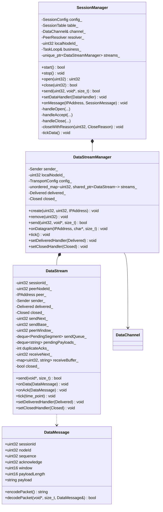

# 数据传输协议与模块设计

本文描述会话建立后的可靠数据传输：报文格式、模块划分、类接口与线程模型。

会话信令见 [session-protocol.md](session-protocol.md)，整体架构见 [architecture.md](architecture.md)。

## 1. 概述

数据传输在会话建立后开始，与信令共用同一个数据 socket（`DataChannel`），靠报文 `type` 区分：

| type | 归属 | 处理者 |
| --- | --- | --- |
| 1~5 | 会话信令 | `SessionManager` |
| 6~7 | 数据传输 | `transport` 模块 |

模块边界：

- `SessionManager` 负责会话生命周期与报文路由，持有 `DataChannel`
- `transport` 只负责数据报文的格式与可靠性，不持有 socket，不依赖 session
- `P2PService` 只转发 `sendData` 与 `DataHandler`

## 2. 模块结构

```
src/
├── protocol/
│   └── Protocol.h              # 通用头常量：magic、version、头长度
├── session/
│   ├── SessionProtocol.h/.cpp  # 信令报文
│   ├── SessionTable.h/.cpp
│   ├── DataChannel.h/.cpp
│   └── SessionManager.h/.cpp   # 会话 + 路由 + 持有 DataStreamManager
└── transport/
    ├── DataProtocol.h/.cpp     # Data / Ack 编解码
    ├── DataStream.h/.cpp       # 单会话可靠通道
    └── DataStreamManager.h/.cpp
```

依赖方向：

```
session ──> transport ──> protocol
session ──> protocol
```

`transport` 不 include 任何 `session` 头文件。

## 3. 类图



## 4. 报文格式

### 4.1 通用头（16 字节）

与信令共用，全部网络字节序：

| 偏移 | 长度 | 字段 | 说明 |
| --- | --- | --- | --- |
| 0 | 4 | `magic` | `0x4E50534E`，ASCII `NPSN` |
| 4 | 1 | `version` | 当前为 `1` |
| 5 | 1 | `type` | 6=Data，7=Ack |
| 6 | 2 | `flags` | 保留，填 0 |
| 8 | 4 | `nodeId` | 发送方节点标识，非 0 |
| 12 | 4 | `sessionId` | 会话标识，非 0 |

常量定义在 `protocol/Protocol.h`，session 与 transport 共用，避免两份 magic 漂移。

### 4.2 Data（type = 6，头 28 字节）

| 偏移 | 长度 | 字段 | 说明 |
| --- | --- | --- | --- |
| 0 | 16 | 通用头 | |
| 16 | 4 | `sequence` | 本会话内递增，从 0 开始 |
| 20 | 4 | `acknowledge` | 累计确认，期望收到的下一个序号 |
| 24 | 2 | `window` | 接收方剩余缓存（报文数） |
| 26 | 2 | `payloadLength` | 负载长度，1~1400 |
| 28 | ... | `payload` | 业务数据 |

`Data` 顺带携带 `acknowledge`，双向同时发送时可以少发纯 ACK。

### 4.3 Ack（type = 7，头 24 字节）

| 偏移 | 长度 | 字段 | 说明 |
| --- | --- | --- | --- |
| 0 | 16 | 通用头 | |
| 16 | 4 | `acknowledge` | 累计确认 |
| 20 | 2 | `window` | 接收方剩余缓存 |
| 22 | 2 | `reserved` | 填 0 |

### 4.4 校验

`DataMessage::decodePacket` 依次校验，任一步失败返回 false：

1. 长度 ≥ 16
2. `magic` 正确
3. `version == 1`
4. `type` 为 6 或 7
5. `nodeId != 0`、`sessionId != 0`
6. Data：长度 ≥ 28，`payloadLength <= size - 28`，`payloadLength > 0`
7. Ack：长度 ≥ 24

## 5. DataMessage

```cpp
namespace netproxy::transport {

/**
 * 数据报文，按 type 区分 Data 与 Ack。
 */
class DataMessage final {
public:
    static constexpr std::size_t HEADER_SIZE = 16;
    static constexpr std::size_t DATA_HEADER_SIZE = 28;
    static constexpr std::size_t ACK_HEADER_SIZE = 24;

    std::uint8_t type = 6;              // 6=Data，7=Ack
    std::uint32_t sessionId = 0;
    std::uint32_t nodeId = 0;
    std::uint32_t sequence = 0;         // Data 使用
    std::uint32_t acknowledge = 0;
    std::uint16_t window = 0;
    std::uint16_t payloadLength = 0;    // Data 使用
    std::string payload;                // Data 使用

    /**
     * 编码为完整报文，包含通用头。
     *
     * @return 网络字节序的二进制内容，长度由 type 决定。
     */
    std::string encodePacket() const;

    /**
     * 解析完整报文。
     *
     * @param data 报文首地址。
     * @param size 报文长度。
     * @param message 解析结果，仅在返回 true 时写入。
     * @return 解析成功返回 true。
     */
    static bool decodePacket(const void* data, std::size_t size, DataMessage& message);
};

}
```

职责：只做格式转换，不保存状态、不发送。

## 6. DataStream

单条会话的可靠通道，负责序号、窗口、重传、按序交付。

### 6.1 接口

```cpp
class DataStream final {
public:
    // 发送报文，由 SessionManager 注入
    using Sender = std::function<void(const std::string& packet, const net::IPAddress& target)>;

    // 数据按序交付给上层
    using Delivered = std::function<void(const char* data, std::size_t size)>;

    // 重传耗尽或不可恢复错误
    using Closed = std::function<void(CloseReason reason)>;

    DataStream(std::uint32_t sessionId, std::uint32_t peerNodeId, const net::IPAddress& peer,
               std::uint32_t localNodeId, const TransportConfig& config, Sender sender);
    ~DataStream();

    DataStream(const DataStream&) = delete;
    DataStream& operator=(const DataStream&) = delete;

    /**
     * 提交一条消息。
     *
     * @param data 消息内容。
     * @param size 长度，超过 maxPayloadSize 返回 false。
     * @return 已受理返回 true；长度非法或已关闭返回 false。
     */
    bool send(const void* data, std::size_t size);

    /**
     * 处理收到的 Data 报文。
     */
    void onData(const DataMessage& message);

    /**
     * 处理收到的 Ack 报文。
     */
    void onAck(const DataMessage& message);

    /**
     * 重传检查，由业务线程周期调用。
     */
    void tick(std::chrono::steady_clock::time_point now);

    void setDeliveredHandler(Delivered handler);
    void setClosedHandler(Closed handler);

private:
    // 已发送未确认的报文。
    struct PendingSegment {
        std::uint32_t sequence = 0;
        std::string payload;
        std::chrono::steady_clock::time_point sentAt{};
        int retransmitCount = 0;
    };

    void sendSegment(const PendingSegment& segment);
    void sendAck();
    void deliverContiguous();
    void fillWindow();
    void close(CloseReason reason);

    std::uint32_t sessionId_ = 0;
    std::uint32_t peerNodeId_ = 0;
    net::IPAddress peer_;
    Sender sender_;
    Delivered delivered_;
    Closed closed_;

    // 发送侧
    std::uint32_t sendNext_ = 0;
    std::uint32_t sendBase_ = 0;
    std::uint32_t peerWindow_ = 16;
    std::deque<PendingSegment> sendQueue_;
    std::deque<std::string> pendingPayloads_;
    int duplicateAcks_ = 0;

    // 接收侧
    std::uint32_t receiveNext_ = 0;
    std::map<std::uint32_t, std::string> receiveBuffer_;

    bool closed_ = false;
};
```

### 6.2 关键成员

| 成员 | 作用 |
| --- | --- |
| `sendNext_` | 下一个待分配序号 |
| `sendBase_` | 最老的未确认序号，等于 `sendQueue_.front()` |
| `peerWindow_` | 对端通告的接收窗口，默认 16 |
| `sendQueue_` | 已分配序号、等待确认的报文，按序号升序 |
| `pendingPayloads_` | 窗口满时暂存的应用数据，尚未分配序号 |
| `duplicateAcks_` | 连续重复 ACK 次数，用于快速重传 |
| `receiveNext_` | 期望收到的下一个序号 |
| `receiveBuffer_` | 乱序缓存，键为序号 |
| `closed_` | 已终止标记，保证 `Closed` 只回调一次 |

### 6.3 发送流程

```
send(data, size)
  ├─ closed_ 或 size == 0 或 size > maxPayloadSize → false
  ├─ 窗口可用（sendNext_ - sendBase_ < min(sendWindow, peerWindow_)）
  │    ├─ 分配 sequence = sendNext_++
  │    ├─ 构造 PendingSegment，入 sendQueue_
  │    ├─ sendSegment（Data 带当前 acknowledge 与 window）
  │    └─ true
  └─ 窗口满：pendingPayloads_.push_back(data)，返回 true
```

窗口推进后由 `fillWindow` 把 `pendingPayloads_` 依次转成已发送段。

### 6.4 接收流程

```
onData(message)
  ├─ closed_ → 丢弃
  ├─ seq == receiveNext_：交付 Delivered，receiveNext_++，deliverContiguous 处理缓存连续段
  ├─ seq > receiveNext_ 且 receiveBuffer_.size() < receiveWindow：缓存
  ├─ 其他（重复或越窗）：丢弃
  └─ 无论哪种，回 sendAck（acknowledge = receiveNext_，window = 剩余缓存）
```

`deliverContiguous` 从 `receiveBuffer_` 中按 `receiveNext_` 顺序取出并交付。

### 6.5 ACK 处理

```
onAck(message)
  ├─ acknowledge > sendBase_：移除 sendQueue_ 中 sequence < acknowledge 的段
  │    ├─ sendBase_ = acknowledge
  │    ├─ duplicateAcks_ = 0
  │    ├─ peerWindow_ = message.window
  │    └─ fillWindow()
  ├─ acknowledge == sendBase_ 且 sendQueue_ 非空：++duplicateAcks_
  │    └─ 达到 3：重发队首，duplicateAcks_ = 0
  └─ acknowledge < sendBase_：过期，忽略
```

Data 报文中携带的 `acknowledge` 同样走这套逻辑。

### 6.6 重传

```
tick(now)
  ├─ closed_ → 返回
  ├─ sendQueue_ 为空 → 返回
  ├─ head = sendQueue_.front()
  ├─ now - head.sentAt < rto → 返回
  ├─ head.retransmitCount >= maxRetransmitCount
  │    └─ close(CloseReason::Error)
  └─ 否则 ++retransmitCount、更新 sentAt、重发 head
```

每次只重发队首，避免一次性重发整个窗口造成放量。

## 7. DataStreamManager

按 `sessionId` 管理 `DataStream`，是 `SessionManager` 与数据通道之间的唯一接口。

```cpp
class DataStreamManager final {
public:
    using Delivered = std::function<void(std::uint32_t sessionId, const char* data, std::size_t size)>;
    using Closed = std::function<void(std::uint32_t sessionId, CloseReason reason)>;

    DataStreamManager(Sender sender, std::uint32_t localNodeId, const TransportConfig& config);
    ~DataStreamManager();

    DataStreamManager(const DataStreamManager&) = delete;
    DataStreamManager& operator=(const DataStreamManager&) = delete;

    /**
     * 会话建立后创建数据流。
     */
    void create(std::uint32_t sessionId, std::uint32_t peerNodeId, const net::IPAddress& peer);

    /**
     * 会话关闭或断链时销毁。
     */
    void remove(std::uint32_t sessionId);

    /**
     * 提交数据，转发到对应 DataStream。
     */
    bool send(std::uint32_t sessionId, const void* data, std::size_t size);

    /**
     * I/O 线程收到数据报文后投递过来。
     */
    void onDatagram(const net::IPAddress& from, const char* data, std::size_t size);

    /**
     * 周期重传检查，业务线程调用。
     */
    void tick();

    void setDeliveredHandler(Delivered handler);
    void setClosedHandler(Closed handler);

private:
    Sender sender_;
    std::uint32_t localNodeId_ = 0;
    TransportConfig config_;

    std::unordered_map<std::uint32_t, std::shared_ptr<DataStream>> streams_;
    Delivered delivered_;
    Closed closed_;
};
```

职责说明：

| 成员 | 说明 |
| --- | --- |
| `channel_` | 注入给每个 `DataStream` 的 `Sender` 来源 |
| `streams_` | 会话标识到数据流的映射，`create/remove` 维护 |
| `delivered_` | 汇聚各流的交付回调，补上 `sessionId` |
| `closed_` | 汇聚各流的断链回调，补上 `sessionId` |

`create` 时给流注入：

```cpp
[this](const std::string& packet, const net::IPAddress& target) {
    channel_.send(packet, target);
}
```

## 8. SessionManager 集成

### 8.1 新增成员

```cpp
std::unique_ptr<transport::DataStreamManager> streams_;
DataHandler dataHandler_;
```

### 8.2 构造与启动

`SessionManager` 构造时创建 `streams_`，并在 `start()` 中设置回调：

```cpp
streams_ = std::make_unique<transport::DataStreamManager>(channel_, config_, business_);

streams_->setDeliveredHandler([this](std::uint32_t sessionId, const char* data, std::size_t size) {
    onDataDelivered(sessionId, data, size);
});

streams_->setClosedHandler([this](std::uint32_t sessionId, CloseReason reason) {
    closeWithReason(sessionId, reason);
});
```

### 8.3 报文路由

```cpp
void SessionManager::onMessage(const net::IPAddress& from, const SessionMessage& message) {
    switch (message.type) {
        case SessionType::Open:   handleOpen(from, message);   break;
        case SessionType::Accept: handleAccept(from, message); break;
        case SessionType::Reject: handleReject(message);       break;
        case SessionType::Close:  handleClose(message);        break;
        case SessionType::Ping:   handlePing(from, message);   break;
        case SessionType::Data:
        case SessionType::Ack:    routeToStream(from);         break;
    }
}
```

数据报文需要原始字节，路由时把 `handleDatagram` 拿到的缓冲区整体交给管理：

```cpp
void SessionManager::handleDatagram(const net::IPAddress& from, const char* data, std::size_t size) {
    // 只读 type 判断归属
    if (isDataPacket(data, size)) {
        business_.post([this, from, packet = std::string(data, size)] {
            streams_->onDatagram(from, packet.data(), packet.size());
        });
        return;
    }

    // 信令走原有解析
    SessionMessage message;
    if (!SessionMessage::decode(data, size, message)) return;
    business_.post([this, from, message] { onMessage(from, message); });
}
```

`isDataPacket` 只检查长度、magic 与 `type` 是否为 6/7。

### 8.4 生命周期同步

| 时机 | 动作 |
| --- | --- |
| `handleOpen` 建立成功 | `streams_->create(sessionId, message.nodeId, from)` |
| `handleAccept` 建立成功 | `streams_->create(sessionId, record.peerNodeId, record.peerAddress)` |
| `closeOnBusiness` | `streams_->remove(sessionId)` |
| `handleClose` | `streams_->remove(sessionId)` |
| 保活断链 | `streams_->remove(sessionId)` |
| 重传耗尽 | `closeWithReason(sessionId, reason)` |

`closeWithReason` 负责发 `Close`、删会话表、删数据流、回调 `Closed`：

```cpp
void SessionManager::closeWithReason(std::uint32_t sessionId, CloseReason reason) {
    SessionRecord record;
    if (!table_.find(sessionId, record)) return;

    SessionMessage close;
    close.type = SessionType::Close;
    close.sessionId = sessionId;
    close.nodeId = localNodeId_;
    close.reason = static_cast<std::uint8_t>(reason);
    sendMessage(close, record.peerAddress);

    table_.remove(sessionId);
    streams_->remove(sessionId);
    notify(sessionId, record.peerNodeId, Event::Closed);
}
```

### 8.5 定时器

`dataTickMs`（默认 50ms）的周期任务，在业务线程调用 `streams_->tick()`；保活仍用原有 1s 定时。

### 8.6 数据交付

```cpp
void SessionManager::onDataDelivered(std::uint32_t sessionId, const char* data, std::size_t size) {
    touchSession(sessionId);              // 数据也刷新保活

    DataHandler handler;
    {
        std::lock_guard<std::mutex> lock(handlerMutex_);
        handler = dataHandler_;
    }

    SessionRecord record;
    const std::uint32_t peerNodeId = table_.find(sessionId, record) ? record.peerNodeId : 0;
    if (handler) {
        handler(sessionId, peerNodeId, data, size);
    }
}
```

## 9. P2PService 对外接口

```cpp
struct SessionConfig 相关的数据参数由 P2PServiceConfig 透传：

struct P2PServiceConfig {
    // 已有字段...
    std::size_t maxPayloadSize = 1400;
    std::size_t sendWindow = 16;
    std::size_t receiveWindow = 64;
    int retransmitTimeoutMs = 200;
    int maxRetransmitCount = 5;
};

using DataHandler = std::function<void(std::uint32_t sessionId, std::uint32_t peerNodeId,
                                       const char* data, std::size_t size)>;

void setDataHandler(DataHandler handler);
bool sendData(std::uint32_t sessionId, const void* data, std::size_t size);
```

`sendData` 语义：会话已建立且消息长度合法才返回 true，实际发送与重传由 `DataStream` 负责。

## 10. 配置

```cpp
struct SessionConfig {
    // 已有字段：会话上限、重试、保活...

    std::size_t maxPayloadSize = 1400;   // 单包负载上限
    std::size_t sendWindow = 16;         // 发送窗口
    std::size_t receiveWindow = 64;      // 接收缓存上限（报文数）
    int retransmitTimeoutMs = 200;       // RTO
    int maxRetransmitCount = 5;          // 单包重传上限
    int dataTickMs = 50;                 // 重传检查粒度
};
```

## 11. 分片（阶段二）

阶段一限制单条消息 ≤ 1400 字节，`send` 超长直接返回 false。

阶段二在 Data 头增加：

| 偏移 | 长度 | 字段 |
| --- | --- | --- |
| 28 | 4 | `messageId` |
| 32 | 2 | `fragmentIndex` |
| 34 | 2 | `fragmentCount` |

头部变为 36 字节，接收方按 `messageId` 聚合，按 `fragmentIndex` 重组，以 `fragmentCount` 判断完整。`DataStream` 的序号与窗口机制不变。

## 12. 线程模型

| 操作 | 线程 | 说明 |
| --- | --- | --- |
| `DataChannel` 收包 | I/O 线程 | 只读 type，投递到业务线程 |
| `onDatagram` / `onData` / `onAck` | 业务线程 | 状态推进 |
| `send` / `create` / `remove` | 业务线程 | 由 `SessionManager` 在业务线程调用 |
| `tick` | 业务线程 | 由 50ms 定时任务驱动 |
| `channel_.send` | 内部 `io.post` | 真正发送在 I/O 线程 |

`DataStream` 的所有状态只在业务线程访问，不需要锁。

## 13. 实施顺序

1. `protocol/Protocol.h`：magic、version、头长度常量
2. `transport/DataProtocol`：`DataMessage` 编解码与单元测试
3. `transport/DataStream`：序号、按序交付、立即 ACK（无窗口无重传）
4. `transport/DataStreamManager`：`create/remove/send/onDatagram/tick`
5. `SessionManager`：路由、生命周期同步、`send`、`closeWithReason`
6. `P2PService`：`sendData`、`DataHandler`
7. 发送窗口、`pendingPayloads`、超时重传、快速重传
8. 测试与文档

## 14. 测试计划

| 用例 | 验证 |
| --- | --- |
| `DataMessage` 往返 | Data/Ack 字段与长度正确 |
| 非法报文 | 长度不足、magic 错、type 错、payloadLength 越界 |
| 小数据往返 | 100 字节经会话传输后内容一致 |
| 顺序交付 | 连续 10 条，接收顺序与发送一致 |
| 乱序缓存 | 手工注入乱序 Data，按序交付 |
| 超长拒绝 | 1401 字节返回 false |
| 窗口流控 | 接收方缓存满时发送方停止，ACK 后继续 |
| 超时重传 | 注入丢包，200ms 后收到重发 |
| 快速重传 | 连续 3 个重复 ACK 立即重发队首 |
| 重传耗尽 | `Closed` 回调，会话被 `Close(reason=4)` |
| 会话失效 | `close` 后 `send` 返回 false |

`DataStream` 的测试通过注入假 `Sender` 捕获报文，不依赖真实 socket。

## 15. 边界与约束

- 只保证单会话内的可靠有序，不保证跨会话顺序
- 单包上限 1400，避免 IP 分片
- 关闭会话时丢弃未确认数据，不等待 flush
- 无加密与认证，局域网内按可信网络处理
- `DataStream` 不感知会话状态，由 `SessionManager` 决定何时创建与销毁
